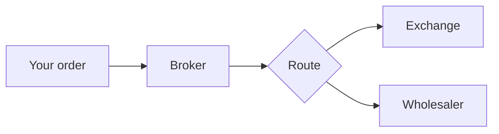

# Lesson template

Every lesson follows this layout, in this order. A lesson takes about 15 minutes to read (700 to 1200 words of prose, never more than 1500), then 5 minutes of exercises and 10 minutes of practice: the reader's 30 minutes a day. Tables, charts, figures, diagrams, formulas and code don't count toward the word budget.

`STYLE.md` has the writing rules and the book's conventions (money, tickers, times, made-up stocks for trade examples). `DESIGN.md` shows how each box looks.

## The layout

```markdown
# Title of the lesson

<span class="tag tag-skill">Skill</span> <span class="tag tag-part">RISK</span>

After this lesson you can <one sentence: what the reader can do or work out>.

Before this: [Lesson name](../03-risk-and-position-sizing/02-r-multiples.md), [a math book lesson](https://faiyaz-svg.github.io/MathFromTheGroundUp/...). You need: a calculator, or nothing.

## The idea

A situation with numbers first, then the idea in plain words, then the name.
2 to 4 short sections (### headings) if the idea has steps. Each new term is
**bold** where it is defined.

## How it works

The method as numbered steps, and the formulas: each formula in KaTeX, then a
list that explains every symbol with its unit.

<div class="example" markdown>

### Worked example: <what it shows>

Every number worked to the end, so a reader with a calculator gets the same.

</div>

A chart, figure or diagram wherever it helps (most lessons have at least one),
each with a sentence before it saying what to look at.

## In code

Optional. One line on what the code shows, then the box below.

<div class="canada" markdown>

### For Canadians

Optional. TFSA, RRSP, FHSA, cash and margin accounts, CAD and USD, CRA rules,
Wealthsimple and IBKR specifics, with sources ("as of 2026").

</div>

## Common mistakes

At most 3, each one short: what goes wrong, why, and the fix.

## Try it

3 to 5 exercises, each with its answer in a closed box (see below).

<div class="practice" markdown>

## Practice today (10 min)

| Minutes | Task |
|---|---|
| 10 | One concrete task: a chart drill set, a paper trade with a journal entry, a look-up in EDGAR or the economic calendar. |

</div>

## Key terms

- **Term**: one-line definition.

Next: [Next lesson title](05-where-to-put-the-stop.md)
```

The "How it works" heading may be renamed to fit the lesson ("Reading the order book", "Sizing step by step"). "The idea", "Try it", "Practice today (10 min)" and "Key terms" are fixed names that `tools/lint.py` looks for. "Common mistakes" is optional but almost every lesson has one; it feeds the common mistakes page.

## The tag line

The line under the title has the lesson's kind, from `tools/lessons.yml`, then the part's code. The last lesson of each part also gets a review tag.

| Kind | Tag |
|---|---|
| idea | `<span class="tag tag-idea">Idea</span>` |
| skill | `<span class="tag tag-skill">Skill</span>` |
| strategy | `<span class="tag tag-strategy">Strategy</span>` |
| data | `<span class="tag tag-data">Data</span>` |
| canada | `<span class="tag tag-canada">Canada</span>` |
| code | `<span class="tag tag-code">Code</span>` |
| case | `<span class="tag tag-case">Case study</span>` |
| career | `<span class="tag tag-career">Career</span>` |
| review | `<span class="tag tag-review">Review</span>` (after the kind) |

Then the part code: `<span class="tag tag-part">MKT</span>`.

## Exercises and answers

Number exercises with an escaped dot, because each answer box breaks a Markdown list:

```markdown
1\. Your account is US$25,000 and you risk 1% per trade. Stock A trades at US$48.20 and your stop is US$46.70. How many shares?

<details class="solution" markdown>
<summary>Answer</summary>

Risk = 1% of US$25,000 = US$250. Risk per share = 48.20 - 46.70 = US$1.50. Shares = 250 / 1.50 = 166.7, so 166 shares (round down, so the loss stays under US$250).

</details>
```

Every answer shows the working. Every number is checked in `tools/checks/<folder>.py` (below).

## Review lessons

The last lesson of each part (flagged `review` in `tools/lessons.yml`) teaches its own small topic and then ends, before "Key terms", with:

- `## Part check`: 6 to 8 questions over the whole part, with answers in boxes.
- A practice box that sets the part's paper-trading or journal block where the plan calls for one (parts 4, 7, 8, 14, 15 and 16), linking `../practice/paper-trading.md`.

## Price charts: the `chart` fence

Price charts are interactive on the site (zoom, crosshair) and drawn from made-up data. A fence names a data file and lists what to draw, one `key: value` per line:

````markdown
```chart
data: 05-reading-charts/uptrend-pullback.json
title: Stock A, daily: an uptrend with a pullback
show: volume, sma 20, sma 50
level: 104.20 | Support
zone: 101.50-103.00 | 2026-03-02 to 2026-03-20 | Fair value gap
marker: 2026-03-14 | below | Entry
line: 2026-02-02 96.40 to 2026-03-10 103.80 | Trendline
range: 2026-02-01 to 2026-04-30
caption: The pullback held the 20-day average.
```
````

| Key | What it does |
|---|---|
| `data` | The file under `docs/assets/charts/`. Required. |
| `title` | Shown above the chart. Name the made-up stock and the timeframe. |
| `show` | Comma list: `volume`, `sma N`, `ema N`, `vwap` (intraday, resets each day), `avwap DATE` (anchored), `bb N K` (Bollinger), `keltner N K`, `rsi N`, `macd F S SIG`, `atr N`, `stoch N SMOOTH D`. RSI, MACD, ATR and stochastics get their own panel under the price. |
| `type` | `candles` (default), `bar` or `line`. |
| `level` | A dashed horizontal line: `price | label`. Repeatable. |
| `zone` | A shaded band: `low-high | label`, or `low-high | FROM to TO | label` for a time span. Repeatable. |
| `marker` | An arrow on a bar: `time | above or below | text`. Repeatable. |
| `line` | A straight line between two points: `TIME PRICE to TIME PRICE | label`. |
| `range` | The part shown when the page opens: `FROM to TO`. The reader can still scroll. |
| `height` | Pixels for the price panel, 200 to 700 (default 360). |
| `caption` | One sentence under the chart. "Made-up price data, for teaching." is added automatically. |

Times are `YYYY-MM-DD` for daily and weekly data, and `YYYY-MM-DD HH:MM` (or `HH:MM` for the first day) in New York time for intraday data.

The data comes from `tools/charts_src/<folder>.yml` (format at the top of `tools/make_charts.py`). Design each chart for the point it teaches: plant the trend, the range, the gap or the hand-shaped bars you need, then run

```
.venv/Scripts/python tools/make_charts.py <folder>
```

and read the printed summary (bar numbers, dates, closes, lowest low, highest high per segment). Quote levels and dates from that summary or from the JSON file itself, never by guessing. Add `--preview` to save a PNG of each chart to `tools/charts_src/_preview/` and look at it.

In VS Code the fence shows as text, which is readable on purpose: the title, levels and caption say what the chart shows.

## Static figures

Payoff diagrams, yield curves, distributions, drawdown curves and other plots are drawn with matplotlib in `tools/figures/<folder>/<topic>.py`, using `figstyle.save_pair` (see the docstring in `tools/figures/figstyle.py`). Each figure has a dark and a light SVG; the lesson includes both lines, and the site shows the one that matches the reader's theme. Check each figure with `figstyle.preview(path)`, which writes a PNG you can open.

Real data in figures comes only from US public-domain sources (BLS, BEA, Treasury, CFTC, SEC), named under the figure.

## Diagrams

Flows and structures (where an order goes, how an ETF creates shares, how the statements connect) use Mermaid:

````markdown

````

Short labels, at most about 12 boxes, `LR` or `TD`.

## In code

Optional. Short Python, only when it shows the idea better than words: computing returns, reading a filing, a position-size function. The quant track (part 20) goes further.

```html
<details class="code" markdown>
<summary>In code</summary>

```python
import pandas as pd

bars = pd.read_csv("stock-a-daily.csv", parse_dates=["date"])
print(bars["close"].pct_change().std())
```

</details>
```

- Every snippet must run: `tools/check_code.py` runs each one in a folder holding the book's sample data files (`docs/assets/data/*.csv`). Tell the reader where to download a file the first time a lesson uses it.
- A snippet that needs the internet (yfinance, EDGAR, FRED) starts with the comment `# needs internet`. The checker only compiles those. EDGAR requests need a User-Agent with the reader's own name and email: write `headers = {"User-Agent": "Your Name your.email@example.com"}` and say why.
- Print the result the text quotes, so the numbers can be compared.

## Checking the numbers

Every worked example and every answer is recomputed in Python in `tools/checks/<folder>.py`, using the helpers in `tools/checks/_lib.py`. The check computes the number and asserts that the lesson prints it:

```python
from _lib import lesson, has, usd

t = lesson("03-risk-and-position-sizing", 4)
risk = 0.01 * 25_000
shares = int(risk / (48.20 - 46.70))
assert shares == 166
has(t, "166 shares", usd(risk))
```

Run all checks with `.venv/Scripts/python tools/checks/run.py`, or one part with `.venv/Scripts/python tools/checks/run.py 03`.

## Links to lessons that don't exist yet

Only link to pages that already exist. When you mention a planned lesson, write its title in plain text and put the planned path in an HTML comment right after it, so `tools/link_planned.py` can add the link later:

```markdown
Part 15 prices this with implied volatility<!-- link: ../15-options/08-implied-volatility.md -->.
```

The text right before the comment must be the target lesson's title from `tools/lessons.yml`, ignoring case. A leading "The" may be dropped, and for a title with a colon, the part before the colon is enough ("Momentum indicators" for "Momentum indicators: RSI, MACD and stochastics").
