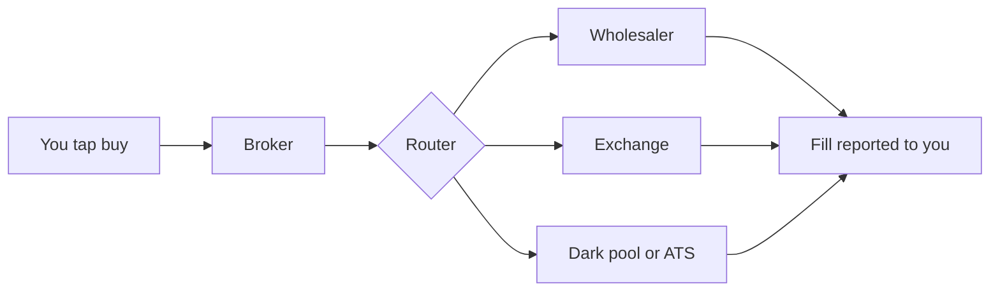

# Exchanges and where your order goes

Idea MKT

After this lesson you can trace an order from your phone to a fill, say who may execute it, and read a broker's routing disclosure.

Before this: [What a stock is and why prices move](01-what-a-stock-is.md). You need: nothing.

## The idea

You tap "buy 200 shares" of Stock A. The order does not go to "the stock market", because there is no single place. It goes to your **broker**, the firm that holds your account and sends your orders on. The broker then picks a place to execute it.

A US stock trades in many places at once. An **exchange** (NYSE, Nasdaq, Cboe and others) is a regulated marketplace that matches buy and sell orders and publishes the prices. The same stock is quoted on all of them at the same time. An **alternative trading system** (ATS, often called a dark pool) is a private matching venue that does not show its orders to the public before they trade. A **wholesaler** is a market-making firm that buys and sells against retail orders directly, off the exchanges. Anything that executes orders outside an exchange is called **off-exchange** trading.

Off-exchange trading is not a small corner. Cboe reported that 50.6% of US stock volume in 2025 traded off-exchange, the first year above half ([Cboe, 2025 year in review](https://www.cboe.com/insights/posts/2025-u-s-equities-year-in-review)).

## How it works

Every US stock has a **best bid** (the highest price any buyer shows) and a **best ask** (the lowest price any seller shows), taken across all exchanges. Together they are the **National Best Bid and Offer**, or **NBBO**. Lesson 4 explains bids and asks in full ([Bid, ask and the order book](04-bid-ask-and-the-order-book.md)). For now, read the NBBO as "the best prices on offer anywhere".

Your broker's **smart order router** is software that decides where each order goes. Follow the diagram from the left.

Three rules shape the choice.

1. **Best execution.** A broker must seek the best terms reasonably available for your order, rather than the lowest cost to the broker. Regulators in both countries require it.
2. **Order protection.** In the US, Regulation NMS Rule 611 stops a venue from filling an order at a price worse than the best displayed price on another exchange. The SEC proposed in June 2026 to rescind this rule, and as of this writing it is a proposal ([summary by Morrison Foerster, June 12, 2026](https://www.mofo.com/pdf/resources/insights/260612-sec-proposes-landmark-rollback-of-core-regulation)). Check the SEC's site for the final outcome.
3. **Disclosure.** Under SEC Rule 606, a broker publishes a quarterly report of where it routes customer orders and what it is paid. Rule 605 reports how well each market centre executes orders. Rule 606(b) lets you ask your broker for the routing detail on your own orders for the past six months ([FINRA glossary on Rule 606](https://www.finra.org/finra-data/glossary-606)).

### Why a wholesaler can give you a better price

A wholesaler that fills your order is allowed to give **price improvement**: a fill at a better price than the displayed best bid or ask. Wholesalers pay brokers for retail orders. That payment is **payment for order flow** (PFOF). It creates a conflict, because the broker has a reason to send orders where it is paid most. Best execution and the disclosure reports exist to check that conflict.

### Worked example: price improvement on 200 shares

The NBBO for Stock A is US$49.98 bid and US$50.00 ask. You send a market order (an order to trade at the best available price, covered in lesson 5) to buy 200 shares.

1. A wholesaler fills it at US$49.995, half a cent below the ask.
2. At the ask you would have paid 200 x 50.00 = US$10,000.00.
3. You paid 200 x 49.995 = US$9,999.00.
4. The price improvement is 10,000.00 - 9,999.00 = US$1.00, or half a cent per share.

Half a cent a share is small, and on a thin-spread stock it is typical. It still adds up over many trades, and it is the number to look for in a broker's execution quality reports.

### For Canadians

Canada has its own rules. CIRO is the self-regulator for Canadian dealers, and it sets best execution expectations for them ([CIRO guidance on best execution](https://www.ciro.ca/node/10664)). Orders in US-listed stocks go through the US system described above. Read your broker's disclosure to see how it routes US-listed orders and whether it is paid for them. Wealthsimple and IBKR Canada are compared in Part 2 ([Wealthsimple and IBKR compared](../02-accounts-currency-and-taxes/02-wealthsimple-and-ibkr.md)).

## Common mistakes

- Treating an exchange's price as the market price. The best price can be on any venue, which is why the NBBO exists.
- Assuming a "free" commission means a free trade. The cost can sit in the spread and the fill price, so compare the fills as well as the commissions.
- Quoting the market's venue count as a fixed number. New exchanges open and old ones merge, so look it up when you need it.

## Try it

1\. Stock A has an NBBO of US$20.00 bid and US$20.02 ask. You buy 500 shares with a market order and a wholesaler fills at US$20.015. What is the price improvement in dollars?

Answer

At the ask you would pay 500 x 20.02 = US$10,010.00. You paid 500 x 20.015 = US$10,007.50. The improvement is US$2.50, which is half a cent per share.

2\. In the diagram, which box is a venue that does not show orders before they trade?

Answer

The dark pool or ATS.

3\. A broker sends 100% of your orders to one wholesaler that pays it well. Which rule or report would show that, and what would you compare?

Answer

The Rule 606 quarterly report shows where the broker routes orders and what payments it receives. Compare it with the Rule 605 execution quality statistics for the same wholesaler, such as how often it improves the price and by how much.

## Practice today (10 min)

| Minutes | Task |
|---|---|
| 5 | Find your broker's order routing or execution quality page (search for "order routing disclosure" on its site). Write down where it says your US-listed orders go. |
| 5 | In your broker's order ticket for a stock, find any routing choice (for example "smart" or a named venue). Write down the default. |

## Key terms

- **Broker**: the firm that holds your account and sends your orders to market.
- **Exchange**: a regulated marketplace that matches orders and publishes prices.
- **Alternative trading system (ATS)**: a private matching venue, often called a dark pool.
- **Wholesaler**: a market-making firm that fills retail orders off-exchange.
- **Off-exchange**: any execution outside an exchange.
- **Best bid and best ask**: the highest buy price and lowest sell price shown.
- **NBBO**: the National Best Bid and Offer, the best bid and best ask across all US exchanges.
- **Smart order router**: software that chooses where to send each order.
- **Best execution**: the duty to seek the best reasonably available terms for a customer's order.
- **Price improvement**: a fill at a better price than the displayed best bid or ask.
- **Payment for order flow (PFOF)**: money a wholesaler pays a broker for its retail orders.

Next: [Market hours and the opening and closing auctions](03-market-hours-and-auctions.md)
