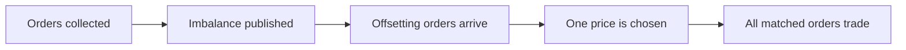

# Market hours and the opening and closing auctions

<span class="tag tag-idea">Idea</span> <span class="tag tag-part">MKT</span>

After this lesson you can say which sessions exist and when, work out how an auction picks one price, and explain why the open and close have the most volume.

Before this: [Exchanges and where your order goes](02-exchanges-and-where-orders-go.md). You need: a calculator.

## The idea

Stock A closes Monday, March 2, 2026 at US$99.61 in the 5-minute chart below. On Tuesday the first trade is at US$101.60, which is 2.0% higher. Between those two regular-session trades the stock did not move continuously. It waited overnight, orders and news piled up, and at 9:30 a.m. ET one auction turned all of it into a single opening price.

All times in this book are Eastern Time (ET), which is Toronto's time zone and shifts with daylight saving together with New York's.

## Sessions

| Session | Time (ET) | Notes |
|---|---|---|
| Regular session | 9:30 a.m. to 4:00 p.m. | Most volume, tightest prices |
| Pre-market | Early morning to 9:30 a.m. | Starts as early as 4:00 a.m. on some venues |
| After-hours | 4:00 p.m. to 8:00 p.m. | Late sessions on several venues |
| Overnight | 8:00 p.m. to 4:00 a.m. | Offered by some brokers, from Sunday evening |

The pre-market and after-hours sessions are together called **extended hours**. NYSE lists its early sessions starting at 4:00 a.m. and its late sessions at 4:00 to 8:00 p.m. ET ([NYSE hours and calendars](https://www.nyse.com/markets/hours-calendars), as of 2026).

What you can trade, and when, depends on your broker. Wealthsimple lists pre-market at 4:00 to 9:30 a.m., post-market at 4:00 to 8:00 p.m., and an overnight session from 8:00 p.m. to 4:00 a.m., running Sunday 8 p.m. to Friday 8 p.m. ([Wealthsimple extended hours](https://www.wealthsimple.com/en-ca/legal/extended-hours), as of 2026). Its overnight orders run through an alternative trading system, may not be price protected, and trades after 8:00 p.m. count as the next business day for settlement. For other brokers, including IBKR Canada, check the broker's current extended-hours window before you plan around it.

Extended hours have fewer participants. Fewer orders mean wider gaps between the best bid and ask (lesson 4 defines this spread) and bigger price jumps on small orders.

### Holidays and early closes

NYSE is closed on Thanksgiving, Thursday, November 26, 2026, and closes early at 1:00 p.m. ET the next day, November 27. It also closes at 1:00 p.m. on December 24 and is closed on December 25 ([NYSE calendar](https://www.nyse.com/markets/hours-calendars), as of 2026). Canadian holidays differ: the TSX is closed on December 25 and again on December 28, 2026 ([TSX calendar](https://www.tsx.com/en/trading/calendars-and-trading-hours/calendar)).

## How it works: the auctions

An **auction** collects orders for a period and then matches them all at one price. The **opening auction** sets the first regular-session price at 9:30 a.m. The **closing auction** sets the official closing price at 4:00 p.m. That close is the price used for index values, fund valuations and most daily charts.

Before the auction, the exchange publishes an **imbalance**: the gap between buy and sell shares that would trade at the indicative price. The imbalance invites offsetting orders, which narrows it.



At NYSE, entry of market-on-open and limit-on-open orders (orders that trade only in the opening auction) starts at 6:30 a.m., and imbalance information starts at 8:00 a.m. For the close, orders for the closing auction (market-on-close and limit-on-close) must be entered by 3:50 p.m.; after that only orders that offset a large imbalance are accepted, and cancels are rejected ([NYSE auctions](https://www.nyse.com/trade/auctions), as of 2026). Nasdaq runs its own opening and closing crosses with different cut-off times, so check [nasdaqtrader.com](https://www.nasdaqtrader.com/) for the current ones.

The auction picks the price that **maximizes the number of shares matched**. Real exchanges add tie-break rules, but this is the core.

<div class="example" markdown>

### Worked example: finding the opening price

Limit orders (orders with a price limit) in the opening book of Stock A:

| Price | Shares to buy at this price | Shares to sell at this price |
|---|---|---|
| 50.10 | 500 | 600 |
| 50.05 | 400 | 500 |
| 50.00 | 300 | 400 |
| 49.95 | 200 | 300 |

A buyer will trade at their price or lower. A seller will trade at their price or higher. So at each price, total demand is the buy shares at that price or higher, and total supply is the sell shares at that price or lower.

| Price | Demand | Supply | Matched (smaller of the two) |
|---|---|---|---|
| 50.10 | 500 | 1,800 | 500 |
| 50.05 | 900 | 1,200 | 900 |
| 50.00 | 1,200 | 700 | 700 |
| 49.95 | 1,400 | 300 | 300 |

The most shares match at US$50.05: 900 shares. At that price demand is 900 and supply is 1,200, so there is an imbalance of 300 shares to sell. Everyone who bids at 50.05 or higher buys at US$50.05, even the buyer who was willing to pay 50.10.

</div>

## Why the open and close are busy

The chart shows two sessions of a made-up stock in 5-minute bars. Look at the volume panel: tall bars at 9:30 a.m. and 3:55 p.m. and short bars around midday.

```chart
data: 01-how-markets-work/opening-gap-5m.json
title: Stock A, 5-minute bars: a gap up at the open
marker: 2026-03-03 09:30 | below | Opens at 101.60
level: 99.61 | Prior close
show: volume
range: 2026-03-02 09:30 to 2026-03-03 15:55
caption: The prior close was 99.61 and the next session opened at 101.60, 2.0% higher.
```

On March 2 the 9:30 bar traded 215,600 shares, against an average of about 49,700 shares for the 5-minute bars from 12:00 to 12:45 p.m. Funds that must trade at the close, news that arrived overnight and traders closing positions all cluster at those two moments. If you trade a small account, midday is quieter, so a fast move there can come from a single large order.

### Trading halts

Rules can pause trading. Under **limit up-limit down** (LULD), a stock that stays outside a price band around its recent average for 15 seconds is paused for 5 minutes. For Tier 1 stocks (the S&P 500, the Russell 1000 and some exchange-traded products) priced over US$3.00, the band is 5% either way; for other stocks over US$3.00 it is 10%. The bands double in the last 25 minutes for Tier 1 stocks ([FINRA guardrails](https://www.finra.org/investors/insights/guardrails-market-volatility), as of 2026). **Market-wide circuit breakers** halt all trading when the S&P 500 falls 7%, 13% or 20% from the prior close; the first two halt for 15 minutes if they happen before 3:25 p.m., and the third ends the day.

## Common mistakes

- Placing a market order in extended hours and being filled far from the last price. Use a limit order (lesson 5) and check your broker's rules.
- Reading the opening print as the day's "real" price. The first trade of a stock comes from an auction with its own imbalance.
- Forgetting an early close. Check the exchange calendar before a holiday week.

## Try it

1\. In the opening book above, what happens to the match at US$50.00? Why is it not chosen?

<details class="solution" markdown>
<summary>Answer</summary>

Demand is 1,200 but supply is only 700, so 700 shares match. That is fewer than the 900 at US$50.05.

</details>

2\. A stock closes at US$40.00. LULD for a Tier 2 stock above US$3.00 is 10%. What price band applies around US$40.00 (ignoring that the real band is set around a rolling average)?

<details class="solution" markdown>
<summary>Answer</summary>

10% of 40.00 = 4.00, so the band runs from US$36.00 to US$44.00.

</details>

3\. The S&P 500 closed at 6,000 yesterday. At what level does the first market-wide circuit breaker trigger?

<details class="solution" markdown>
<summary>Answer</summary>

A 7% fall is 6,000 x 0.07 = 420 points, so the trigger is 6,000 - 420 = 5,580.

</details>

4\. Stock A closed at US$99.61 and opened at US$101.60. What is the gap in percent?

<details class="solution" markdown>
<summary>Answer</summary>

(101.60 - 99.61) / 99.61 = 0.0200, so +2.0%.

</details>

<div class="practice" markdown>

## Practice today (10 min)

| Minutes | Task |
|---|---|
| 4 | Look up the NYSE calendar and write the next early close and the next holiday. |
| 3 | In your broker app, find out which extended-hours sessions it offers and what order types it allows in them. |
| 3 | Open a 5-minute chart of any stock in your broker or TradingView and mark the volume at 9:30 and at 12:00. Compare. |

</div>

## Key terms

- **Regular session**: the 9:30 a.m. to 4:00 p.m. ET trading day.
- **Extended hours**: the pre-market and after-hours sessions.
- **Auction**: a period of collecting orders followed by one matching price.
- **Opening auction**: the auction that sets the first price at 9:30 a.m.
- **Closing auction**: the auction that sets the closing price at 4:00 p.m.
- **Imbalance**: the shortfall of buy or sell shares at an auction's indicative price.
- **Limit up-limit down (LULD)**: price bands that pause a stock that moves too fast.
- **Circuit breaker**: a market-wide halt after a large fall in the S&P 500.

Next: [Bid, ask and the order book](04-bid-ask-and-the-order-book.md)
