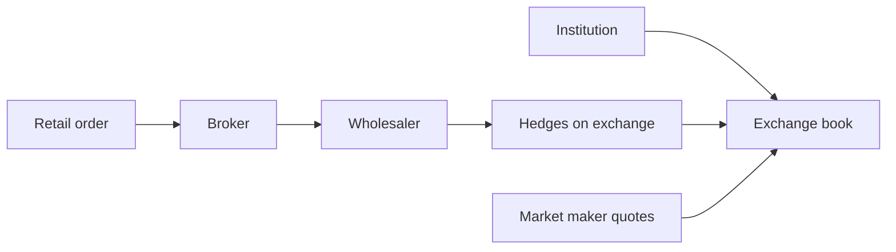

# Who is on the other side of your trade

Idea MKT

After this lesson you can name the main kinds of counterparty, explain how a market maker earns money and loses it, and say when your limit order is the one providing liquidity.

Before this: [Order types](05-order-types.md). You need: a calculator.

## The idea

Every trade has two sides. When you buy 100 shares of Stock A, someone sold you those 100 shares. That someone is your **counterparty**. It is rarely another person who looked at the same chart as you and decided to sell. It is usually one of a few kinds of firm, each with a different goal.

| Participant | What it is | Typical goal |
|---|---|---|
| Retail trader | An individual, like you | Profit from price moves or long-term growth |
| Institution | A mutual fund, pension fund, hedge fund or insurer | Build or reduce large positions without moving the price |
| Market maker | A firm that quotes both a bid and an ask all day | Earn the spread, hold little risk |
| Wholesaler | A market maker that buys and sells against retail orders off-exchange | Same, with a steady supply of retail orders |
| High-frequency firm | A firm trading very fast on small price differences | Earn tiny amounts on a very large number of trades |

A **market maker** stands ready to buy at its bid and sell at its ask. It does not care whether the price rises or falls; it wants to buy at the bid, sell at the ask, and keep the difference, the spread. The market maker is the reason a retail order can fill instantly: it supplies the other side.

## How it works

Orders that wait in the book, like a limit order, are **providing liquidity** (adding to the book). Orders that trade against what is waiting, like a market order, are **taking liquidity**. When you take, you pay the spread. When you provide, you may earn it, but you wait, and you may not fill.

Wholesalers handle most retail marketable orders. The SEC said in 2022 that retail brokers route more than 90% of these orders to a small group of wholesalers ([SEC press release 2022-225](https://www.sec.gov/newsroom/press-releases/2022-225)). An institution works differently: its order may be a million shares, so it splits the order into many small pieces and sends them over hours or days, to avoid moving the price.

Exchanges pay or charge small fees on each trade. Under a **maker-taker** fee model, an exchange pays a rebate to the order that adds liquidity and charges a fee to the order that takes it. The SEC caps the taker fee (the access fee); in 2024 it adopted a lower cap, with compliance moved to November 2027 (see [SEC release 2024-137](https://www.sec.gov/newsroom/press-releases/2024-137), as of 2026). These fees are small per share, but they shape where firms send their orders.

### How a market maker loses

A market maker earns the spread on average, and takes a loss when it trades with someone who knows more than it does. That is called **adverse selection**: the orders that arrive are more likely to come from people who expect the price to move against the market maker. When Stock A's news comes out, a market maker holding its inventory on the wrong side loses much more than a spread. To protect itself, it widens the spread when news or volatility is likely.

### Worked example: spread income against one bad fill

A market maker quotes Stock A at US$49.98 bid and US$50.00 ask.

1. A seller hits its bid: the maker buys 1,000 shares at 49.98.
2. A buyer lifts its ask: the maker sells 1,000 shares at 50.00. Income is (50.00 - 49.98) x 1,000 = US$20.00 for the round trip.

Now suppose the maker buys 1,000 shares at 49.98 and then bad news about Stock A drops the quote to 49.80 bid before it can sell.

3. The loss on the position is (49.98 - 49.80) x 1,000 = US$180.00.
4. It takes 180 / 20 = 9 complete round trips of spread income to earn that back.

This is the reason spreads widen before news, and why a quiet, steady stock has a tighter spread than a news-driven one.

### What this means for you

You trade at the spread when you use market orders, and you pay for speed. You can be the one providing liquidity by placing a limit order inside or at the edge of the spread, and a fill then comes from someone who wanted to trade now. The cost of waiting is that fills tend to come when the market moves against you: a buy limit at the bid fills when sellers are pushing the price down through it.

## Common mistakes

- Assuming your order is matched with another individual. It is usually matched with a firm that is managing inventory.
- Treating a tight spread as no cost. A tight spread is small on each share, and it is paid on both the entry and the exit.
- Using limit orders and assuming they always avoid the spread. A limit at the bid waits in line and may fill only on a falling price.

## Try it

1\. A market maker's bid is 30.00 and ask is 30.04. It buys 500 shares at the bid and sells 500 at the ask. What does it earn?

Answer

(30.04 - 30.00) x 500 = US$20.00.

2\. The same maker buys 500 shares at 30.00 and the stock drops to a 29.70 bid before it can sell. What is the loss at that bid, and how many round trips of 500 shares at a 4-cent spread cover it?

Answer

Loss = (30.00 - 29.70) x 500 = US$150.00. Each round trip earns US$20.00, so 150 / 20 = 7.5, which means 8 round trips (7 would not be enough).

3\. You place a buy limit one cent below the best bid and it fills. Were you providing or taking liquidity?

Answer

Providing. Your order waited in the book and a seller took it.

4\. An institution wants to buy 2 million shares of a stock that trades 4 million shares a day. Why does it not send one order?

Answer

One order of half a day's volume would walk the book and push the price against it. It splits the order over time to keep its average price near the market.

## Practice today (10 min)

| Minutes | Task |
|---|---|
| 5 | Find the Rule 606 report on your broker's website and write the top venue or wholesaler it names for market orders. |
| 5 | On a quote page, find a stock with a wide spread and one with a tight spread. Write each spread and guess which has more adverse selection risk and why. |

## Key terms

- **Counterparty**: the other side of your trade.
- **Market maker**: a firm that quotes both a bid and an ask and earns the spread.
- **Wholesaler**: a market maker that fills retail orders off-exchange.
- **Providing liquidity**: placing an order that waits in the book.
- **Taking liquidity**: trading against orders already in the book.
- **Maker-taker**: a fee model that pays adders of liquidity and charges takers.
- **Adverse selection**: the risk that the order arriving comes from someone who knows the price is about to move.

Next: [Settlement, cash accounts and margin](07-settlement-cash-and-margin.md)
