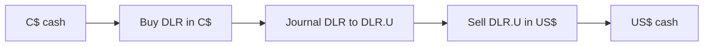

# Norbert's gambit and CDRs

Canada ACCT

After this lesson you can describe how Norbert's gambit converts currency, work out its cost against a broker's conversion fee, and say what a CDR is and what it does not do for you.

Before this: [USD or CAD, and currency conversion fees](03-usd-vs-cad-and-fx-fees.md). You need: a calculator.

## The idea

The last lesson showed that a broker's conversion fee can be 0.5% to 1.5% of the amount. For a large amount, there is a way to convert with a much smaller cost. **Norbert's gambit** uses a stock that trades on a Canadian exchange in both currencies. A common one is a US dollar currency fund that trades as DLR in Canadian dollars and DLR.U in US dollars. Both tickers are the same fund with the same CUSIP (the identification number of a security), so a broker can move the shares from one to the other without selling them.

Because the two tickers track the same US dollar value, the price of DLR in C$ is about the US$ price of DLR.U times the exchange rate. You buy in one currency, move the shares, and sell in the other. You pay two commissions, a small bid-ask spread on each side, and a fee for the move, and you skip the conversion fee ([Questrade's explanation](https://www.questrade.com/learning/Norberts-Gambit-Currency-conversion)).

The **journal** is the step where the broker moves shares between the two tickers inside your account. Wealthsimple has a help-centre page on Norbert's gambit and describes the journal as a request you make on its website, with a fee and a wait of a few business days. Read that page for the current fee and timing before you start ([Wealthsimple help](https://help.wealthsimple.com/hc/en-ca/articles/45418222943131)). I could not confirm whether IBKR Canada offers the journal, so ask its support.

## How it works

1. Buy DLR with your Canadian dollars. Use a limit order near the ask, because a spread of one cent on a C$13.80 share is small but real.
2. Ask your broker to journal the shares from DLR to DLR.U. The shares are in transit for a few days, and you can't sell them in that time.
3. Sell DLR.U in US dollars.
4. Add the costs: two commissions, the journal fee, and the spread you paid on both sides.

The risk is in the wait. Once you own the shares, their US dollar value does not depend on the exchange rate, because the fund holds US dollars. What can move is the fund's own US dollar price and the spread you get when you sell, and you cannot trade the shares while the journal is pending. If the DLR.U price drifts 0.5% against you during the wait, you lose about as much as you saved against a 0.5% fee.

### Worked example: converting 50,000 Canadian dollars

The numbers below are made up for the example. DLR trades at a mid price of C$13.80 and DLR.U at US$10.00 (so the rate is 1.38). Each trade has a one-cent spread: you buy DLR at the ask of C$13.81 and sell DLR.U at the bid of US$9.99. Each trade costs C$10 in commission, and the journal costs C$10. The tiered fee of the last lesson for C$50,000 is 0.5%.

1. Shares: you can afford 50,000 / 13.81 = 3,620 shares (rounded down).
2. Cost of the shares: 3,620 x 13.81 = C$49,992.20.
3. Proceeds in US dollars: 3,620 x 9.99 = US$36,163.80.
4. In Canadian dollars at 1.38: 36,163.80 x 1.38 = C$49,906.04.
5. Spread cost: 49,992.20 - 49,906.04 = C$86.16.
6. Fees: 10 + 10 + 10 = C$30.
7. Total cost: 86.16 + 30 = C$116.16, which is 0.23% of C$49,992.20.

The tiered fee would be 0.5% of C$50,000 = C$250. The gambit saved about C$134, if the rate did not move while the shares were in transit.

Fixed fees make the gambit weaker as the amount shrinks. With the same costs on C$5,000, you buy 362 shares for C$4,999.22 and the total cost is C$38.62, or 0.77%. That still beats a 1.5% fee, but the C$30 of fixed fees takes a bigger share each time the amount gets smaller.

## CDRs

A **CDR** (Canadian Depositary Receipt) is a security that trades in Canadian dollars on a Canadian exchange and gives you exposure to a US or foreign stock. Cboe Canada lists them ([Cboe Canada CDRs](https://cboe.com/listings/ca/cdr/)). They are issued in Canadian dollars with a built-in currency hedge, which is meant to remove most of the effect of the exchange rate on your return. Cboe Canada says the hedge is notional, so returns can differ a little from the stock. CIBC issues CDRs on US blue-chip stocks (65 by September 2024, per a [Cboe note on new CDR tickers](https://www.cboe.com/insights/posts/10-new-cdr-tickers-listed-on-cboe-canada)), and BMO Global Asset Management also issues CDRs, as of 2026. Check the issuer's page for the current list, the fee and how dividends are treated.

What a CDR does for you: you buy in Canadian dollars, with no conversion step. What it does not do: it is not the stock itself, it carries the issuer's fee, and the hedge changes your currency exposure (lesson 5, [Currency risk on US stocks](05-currency-risk-on-us-stocks.md)).

### For Canadians

A CDR trades on a Canadian exchange, so the order, settlement and your CAD account work as for a Canadian stock. How the withholding on its dividends and the cost base work for a CDR depends on the issuer's terms, so read the prospectus and ask your tax preparer before you buy one for a registered account.

## Common mistakes

- Starting the gambit with a small amount. Fixed fees make it more expensive than the broker's fee below a certain size, which you can compute.
- Using market orders on DLR or DLR.U. A limit order caps the spread you pay.
- Forgetting that the shares cannot be sold while the journal is pending, so the DLR.U price can move before you sell.

## Try it

1\. Using the example's costs (C$30 in fees, a one-cent spread on each side, a rate of 1.38), compute the total cost of converting C$20,000 by gambit.

Answer

Shares: 20,000 / 13.81 = 1,448 (rounded down). Cost: 1,448 x 13.81 = C$19,996.88. Proceeds: 1,448 x 9.99 = US$14,465.52, or C$19,962.42 at 1.38. Spread cost = 19,996.88 - 19,962.42 = C$34.46. Total = 34.46 + 30 = C$64.46, which is 0.32%. A tiered fee of 1.0% on C$20,000 would be C$200.

2\. Why does the wait during the journal matter?

Answer

You cannot sell during the wait, so the DLR.U price can drift before you sell. A 0.5% move on C$50,000 is C$250, as large as the 0.5% fee you were trying to avoid.

3\. A CDR on a US stock is hedged to the Canadian dollar. The US stock rises 10% in US dollars and the US dollar falls 5% against the Canadian dollar. Roughly what does the CDR holder earn in Canadian dollars, before fees?

Answer

About 10%, because the hedge removes most of the currency move. An unhedged holder of the US stock earns 1.10 x 0.95 - 1 = 4.5% (lesson 5).

## Practice today (10 min)

| Minutes | Task |
|---|---|
| 4 | Look up DLR and DLR.U on your broker's quote page. Write the bid, ask and the C$ and US$ prices, and compute the rate they imply. |
| 3 | Read your broker's help page on the journal (or on conversions) and write down the fee and the timing. |
| 3 | Compute the gambit cost for the amount you would convert, and compare it with your broker's fee. |

## Key terms

- **Norbert's gambit**: converting currency by buying a dual-listed fund in one currency, journaling it, and selling it in the other.
- **DLR and DLR.U**: the Canadian-dollar and US-dollar tickers of one fund that tracks the US dollar.
- **CUSIP**: the identification number of a security, shared by DLR and DLR.U.
- **Journal**: a broker transfer of shares between two tickers or accounts.
- **CDR**: a Canadian Depositary Receipt, a Canadian-dollar security that gives exposure to a foreign stock, usually with a currency hedge.

Next: [Currency risk on US stocks](05-currency-risk-on-us-stocks.md)
