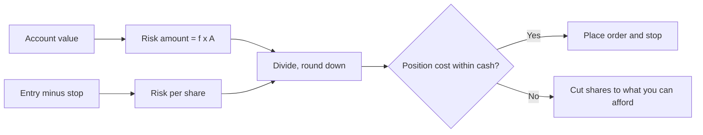

# Position sizing with fixed fractional risk

<span class="tag tag-skill">Skill</span> <span class="tag tag-part">RISK</span>

After this lesson you can work out how many shares to buy so that a stop-out costs a set percent of your account, in a USD account or a CAD account.

Before this: [R-multiples](02-r-multiples.md), [Order types](../01-how-markets-work/05-order-types.md). You need: a calculator.

## The idea

Your account is US$25,000. Stock A trades at US$48.20 and you have decided the idea is wrong if the price falls to US$46.70. How many shares do you buy?

A common answer is "as many as I can afford", which would be 518 shares. If the stop fills at 46.70, the loss is 518 x 1.50 = US$777, or 3.1% of the account. On a stock with a stop 0.30 away, the same 518 shares would lose US$155.40. The risk changes every time the stop does.

**Fixed fractional sizing** fixes the risk instead of the share count. Before each trade you pick a fraction \(f\) of the account to lose if the stop fills, such as 1%. Then you buy the number of shares that makes the loss at the stop equal to that fraction. A wide stop gives a small position and a tight stop gives a large one, and the loss at the stop is the same.

## How it works

\[ \text{shares} = \left\lfloor \frac{f \times A}{E - S} \right\rfloor \]

- \(f\) is the fraction of the account you will risk, such as 0.01 for 1%.
- \(A\) is the account value, in the account's currency.
- \(E\) is the planned entry price and \(S\) the stop price, in US$ per share. \(E - S\) is the risk per share.
- The brackets \(\lfloor\ \rfloor\) mean round down to a whole number, so the loss at the stop never exceeds \(f \times A\).

The steps:

1. Risk amount = \(f \times A\).
2. Risk per share = \(E - S\) (for a short, \(S - E\)).
3. Shares = risk amount divided by risk per share, rounded down.
4. Check that you can pay for it: shares x \(E\) must fit your cash (or your margin, which lesson 7 of Part 1 explains: [Settlement, cash accounts and margin](../01-how-markets-work/07-settlement-cash-and-margin.md)).



<div class="example" markdown>

### Worked example: a USD account

Account US$25,000, risk 1%, buy Stock A at US$48.20 with a stop at US$46.70.

1. Risk amount = 0.01 x 25,000 = US$250.00.
2. Risk per share = 48.20 - 46.70 = US$1.50.
3. 250 / 1.50 = 166.67, which rounds down to 166 shares.
4. Position cost = 166 x 48.20 = US$8,001.20, which is 32.0% of the account.
5. Actual risk = 166 x 1.50 = US$249.00, or 0.996% of the account.

Rounding down leaves US$1.00 of risk unused. Rounding up to 167 would risk US$250.50, slightly over the 1% limit.

</div>

The same US$250 of risk gives different positions as the stop moves. The table uses the same entry of US$48.20.

| Stop distance | Shares | Position cost | Loss at the stop |
|---|---|---|---|
| US$0.75 | 333 | US$16,050.60 | US$249.75 |
| US$1.50 | 166 | US$8,001.20 | US$249.00 |
| US$3.00 | 83 | US$4,000.60 | US$249.00 |
| US$5.00 | 50 | US$2,410.00 | US$250.00 |

Position cost falls from US$16,050.60 to US$2,410.00 while the risk stays near US$250. A trader who sizes by cost would risk very different amounts on these four trades.

### A CAD account trading a US stock

Your account is C$30,000, you risk 1%, and the stock is priced in US$. Risk is measured in your account's currency, but the stop distance is in US$, so you convert once. Assume US$1 = C$1.37 (a made-up rate for the example, not a quote).

1. Risk amount = 0.01 x 30,000 = C$300.00.
2. In US$: 300 / 1.37 = US$218.98.
3. Risk per share = US$1.50 (entry 48.20, stop 46.70).
4. Shares = 218.98 / 1.50 = 145.99, which rounds down to 145 shares.
5. Position cost = 145 x 48.20 = US$6,989.00, which is C$9,574.93.
6. Actual risk = 145 x 1.50 = US$217.50, about C$298.

Note step 4. At 146 shares the loss at the stop would be 146 x 1.50 x 1.37 = C$300.03, a few cents over C$300. Round down every time.

The exchange rate matters twice. It sets the share count today, and it changes what a US$ loss is worth in C$ by the time you exit. The stop protects the US$ price, not the C$ value of the account. Part 2 covers the currency risk itself ([Currency risk on US stocks](../02-accounts-currency-and-taxes/05-currency-risk-on-us-stocks.md)).

<div class="canada" markdown>

### For Canadians

In a Wealthsimple CAD account, a US-listed trade carries a 1.5% currency conversion fee, and a USD account does not, as of 2026 ([Wealthsimple trade fees](https://www.wealthsimple.com/legal/fees/trade)). Check the current fee before you rely on it. That cost belongs in the plan, and lesson 6 puts it in R ([Slippage, gaps and costs](06-slippage-gaps-and-costs.md)). Part 2 compares the two currencies in detail ([USD or CAD, and currency conversion fees](../02-accounts-currency-and-taxes/03-usd-vs-cad-and-fx-fees.md)).

</div>

## In code

A position size function for either currency. `fx` is how many units of account currency one US$ costs (1.0 for a USD account).

<details class="code" markdown>
<summary>In code</summary>

```python
import math

def position_size(account, risk_pct, entry, stop, fx=1.0):
    risk_amount = account * risk_pct / 100      # in account currency
    risk_usd = risk_amount / fx                 # in US$
    per_share = entry - stop                    # in US$
    return math.floor(risk_usd / per_share)

print(position_size(25_000, 1, 48.20, 46.70))
print(position_size(30_000, 1, 48.20, 46.70, fx=1.37))
```

The code prints 166 and then 145, the two share counts from the examples.

</details>

## Common mistakes

- Sizing by what you can afford. Cost tells you nothing about the loss at the stop.
- Rounding to the nearest share instead of down. Over many trades the extra risk adds up.
- Choosing the stop after choosing the size. The stop comes from the chart (lesson 5), and the size follows from it. If the stop is too wide for the size you want, the answer is a smaller position or no trade.

## Try it

1\. Account US$40,000, risk 0.5%, entry US$27.60, stop US$26.40. How many shares?

<details class="solution" markdown>
<summary>Answer</summary>

Risk = 0.005 x 40,000 = US$200. Risk per share = 27.60 - 26.40 = 1.20. 200 / 1.20 = 166.67, so 166 shares. Cost = 166 x 27.60 = US$4,581.60.

</details>

2\. Account US$25,000, risk 1%, entry US$48.20, stop US$47.90. The sizing formula gives 833 shares. Can you buy that in a cash account? What do you do?

<details class="solution" markdown>
<summary>Answer</summary>

Risk = US$250, risk per share = 0.30, 250 / 0.30 = 833.33, so 833 shares. Cost = 833 x 48.20 = US$40,150.60, which is more than the US$25,000 in the account. The most you can afford is 25,000 / 48.20 = 518.67, so 518 shares, which risks 518 x 0.30 = US$155.40 (0.62%). Buy 518 or fewer.

</details>

3\. Short Stock B at US$30.00 with a stop at US$31.50. Account US$20,000, risk 1%. How many shares?

<details class="solution" markdown>
<summary>Answer</summary>

Risk = US$200. Risk per share = 31.50 - 30.00 = 1.50. 200 / 1.50 = 133.33, so 133 shares.

</details>

4\. Account C$15,000, risk 1%, US$1 = C$1.40. Stock A entry US$20.00, stop US$19.00. How many shares, and what is the risk in C$?

<details class="solution" markdown>
<summary>Answer</summary>

Risk = C$150, which is 150 / 1.40 = US$107.14. Risk per share = US$1.00. Shares = 107.14 / 1.00, so 107 shares. Actual risk = 107 x 1.00 x 1.40 = C$149.80.

</details>

<div class="practice" markdown>

## Practice today (10 min)

| Minutes | Task |
|---|---|
| 4 | Set a risk percent for your account (use 1% or less while you learn). Write the dollar risk in your account's currency. |
| 4 | Take three charts from [chart drills](../practice/chart-drills.md). For each, choose an entry and a stop below a recent low, and compute the shares and the position cost. |
| 2 | Check each position against your cash. Cut any you cannot pay for. |

</div>

## Key terms

- **Fixed fractional sizing**: sizing each trade so the loss at the stop is a fixed fraction of the account.
- **Risk per share**: the entry price minus the stop price for a long trade.
- **Risk amount**: the fraction of the account you accept losing on one trade, in dollars.
- **Position size**: the number of shares bought or sold short.

Next: [Where to put the stop](05-where-to-put-the-stop.md)
