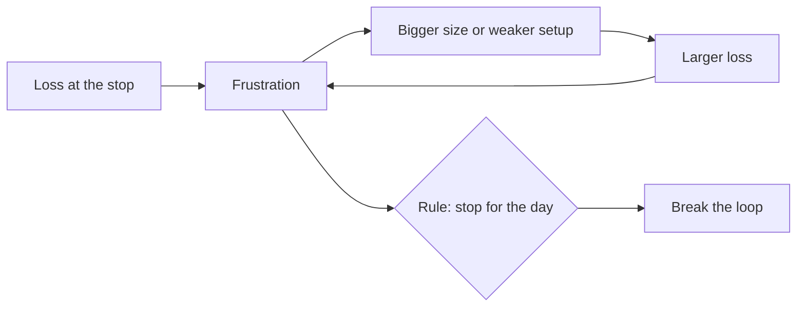

# Tilt, revenge trading and FOMO

<span class="tag tag-idea">Idea</span> <span class="tag tag-part">MIND</span>

After this lesson you can recognize tilt, revenge trading and fear of missing out in your own trades, work out what they cost in dollars and R, and set rules that stop them before the next order.

Before this: [Biases that cost traders money](01-biases-that-cost-traders.md). You need: a calculator.

## The idea

Your account is US$25,000 and your plan risks 1% per trade, which is US$250. You lose US$250 on a stop. You are annoyed. The next setup looks fine but small, so you size it at US$500 of risk "to get back to even". It stops out. Now you are down US$750 and angry, and the third trade risks US$1,000. It also loses.

Three losses at the plan's size cost US$750, or 3.0% of the account. The same three losses with escalating size cost US$1,750, or 7.0%. The market did the same thing to you both times. The only change was the size you chose while upset.

This lesson names the three most common ways emotion takes over a session, and what you can set up in advance.

## How it works

### Tilt and revenge trading

**Tilt** is a state where strong emotion, usually frustration after a loss, pushes you to trade worse than your plan says. The word comes from poker. A **revenge trade** is a trade taken to win back a loss quickly, usually with a bigger size or a weaker setup than the plan allows. **Overtrading** is taking more trades than the plan calls for, often as a side effect of tilt.

Behavioural research gives two reasons it happens. [Loewenstein (1996)](https://doi.org/10.1006/obhd.1996.0028) described "visceral" states such as anger and fear that narrow attention to the present and make people underestimate how much those states will change their behaviour. Once you are in the state, the plan feels like it belongs to someone else. And [Thaler and Johnson (1990)](https://doi.org/10.1287/mnsc.36.6.643) found that after a loss, people take more risk when there is a chance to get back to even, which is what a revenge trade is.

The same study found a second pattern: after a gain, people also took more risk, as if gains were "house money". A winning streak can raise your size for the same reason a loss does.

<div class="example" markdown>

### Worked example: the cost of the ladder

Account US$25,000. Plan risk 1% = US$250 per trade.

| Trade | Plan risk | Revenge risk | Result at the stop |
|---|---|---|---|
| 1 | US$250 | US$250 | -US$250 |
| 2 | US$250 | US$500 | -US$500 |
| 3 | US$250 | US$1,000 | -US$1,000 |
| Total | US$750 (3.0%) | US$1,750 (7.0%) | |

The loss is 1,750 / 25,000 = 7.0% of the account, against 750 / 25,000 = 3.0%. Doubling after each loss also means the account needs a 7.5% gain to recover, because 25,000 - 1,750 = 23,250 and 1,750 / 23,250 = 7.5%.

</div>

The sequence is easier to see as a loop.



### Fear of missing out

**FOMO** (fear of missing out) is the pull to enter a trade because the price is already moving and you are not in it. The chart shows a plan that was ready and a trade taken late.

```chart
data: 04-psychology-journal-and-paper-trading/fomo-chase.json
title: Stock A, daily: the plan and the chase
level: 50.50 | Planned entry 50.50
level: 48.90 | Planned stop 48.90
marker: 2026-04-21 | below | Plan triggers
marker: 2026-05-01 | above | Chase at 55.90
range: 2026-04-01 to 2026-05-13
caption: The plan bought a break above the range at 50.50 with a stop at 48.90. Eight trading days later Stock A closed at 55.90, and the chase entry has the same stop 7.00 below it.
```

The plan risked 50.50 - 48.90 = US$1.60 per share. On May 1, Stock A closed at 55.90, which is 5.40 above the planned entry and 3.4 times the planned risk. A trader who buys there with the same stop at 48.90 risks 55.90 - 48.90 = US$7.00 per share. At 156 shares (the plan's size, US$250 / US$1.60 = 156.25, rounded down), that is 156 x 7.00 = US$1,092, or 4.4 times the planned US$250.

FOMO enters at the worst place on the chart for the stop. If the stop moves up to keep the risk small, it sits inside normal noise and gets hit. If it stays, the risk is large. The setup that existed on April 21 is gone by May 1.

### Rules that cut the loop

1. A **daily loss limit**: after losing a set amount (for example 2R or 3R), you stop trading for the day. Part 3's [Your trading plan](../03-risk-and-position-sizing/10-your-trading-plan.md) fixes the numbers.
2. A **cooling-off rule**: after any loss beyond 1R or any rule break, you step away for a set time (30 minutes) before the next order.
3. A **missed-trade rule**: if you did not enter at the planned price, you do not chase. You write it in the journal and wait for the next setup.
4. Size never goes up inside a session. Size changes only at the weekly review.

## Common mistakes

- Setting a daily loss limit and then ignoring it once. The day you ignore it is the day it was written for.
- Taking the next trade at the same size to "prove" the loss was normal. A short break works better than a quick trade.
- Treating a missed trade as a loss. You did not lose money, you did not take a trade.

## Try it

1\. Your plan risks 1% of a US$40,000 account. You lose one trade, then risk 2% on the next and lose it, then risk 4% on the third and lose it. What is the total loss in dollars and as a percentage of the starting account?

<details class="solution" markdown>
<summary>Answer</summary>

Losses: 1% of 40,000 = US$400, then 2% = US$800, then 4% = US$1,600 (using the starting size each time). Total = US$2,800, which is 7.0% of 40,000. At the plan size, three losses would be US$1,200 (3.0%).

</details>

2\. After the US$2,800 loss above, what percentage gain on the remaining account gets back to US$40,000?

<details class="solution" markdown>
<summary>Answer</summary>

Remaining = 40,000 - 2,800 = US$37,200. The gain needed = 2,800 / 37,200 = 7.5%.

</details>

3\. Stock A had a planned entry of US$50.50 and a stop of US$48.90. It now trades at US$55.00. With the same stop, how many times the planned risk per share would you take by buying now?

<details class="solution" markdown>
<summary>Answer</summary>

Planned risk per share = 50.50 - 48.90 = US$1.60. Risk per share now = 55.00 - 48.90 = US$6.10. The ratio = 6.10 / 1.60 = 3.8 times.

</details>

4\. Write one cooling-off rule and one daily loss limit that you could keep, with numbers.

<details class="solution" markdown>
<summary>Answer</summary>

There is no single correct answer. An example: "After any loss over 1R or any rule break I take no order for 30 minutes. After losing 3R in a day I close the platform." A rule is usable when it has a number and a trigger, so you can tell at once whether you broke it.

</details>

<div class="practice" markdown>

## Practice today (10 min)

| Minutes | Task |
|---|---|
| 5 | Write your cooling-off rule and daily loss limit as two lines with numbers. Put them where you see them before you trade. |
| 3 | Look at your last five trades. Did the size or setup change after a loss? Write yes or no for each. |
| 2 | Add a line to your journal for the next trade: "Emotion before entry" with one word. |

</div>

## Key terms

- **Tilt**: a state where strong emotion makes you trade worse than your plan says.
- **Revenge trade**: a trade taken to win back a loss quickly, usually too large or too weak.
- **Overtrading**: taking more trades than the plan calls for.
- **FOMO**: the pull to enter because the price is already moving and you are not in it.
- **House money effect**: taking more risk after a gain because it feels like the market's money.
- **Daily loss limit**: a set loss at which you stop trading for the day.
- **Cooling-off rule**: a required pause after a loss or rule break.

Next: [Rules and checklists](03-rules-and-checklists.md)
