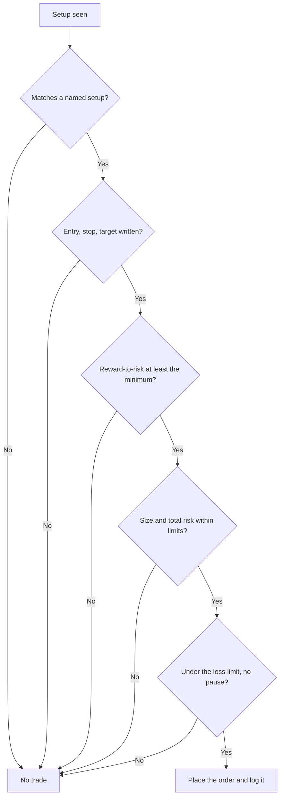

# Rules and checklists

Skill MIND

After this lesson you can write trading rules as yes-or-no tests, build a pre-trade checklist with numbers in it, and use it to accept or reject a trade in under a minute.

Before this: [Tilt, revenge trading and FOMO](02-tilt-revenge-and-fomo.md). You need: a calculator.

## The idea

The last two lessons showed that your judgment is worst when you most need it: right after a loss, or when a stock is running without you. A rule made while calm and followed while upset removes the decision at the moment you are least able to make it.

Two kinds of tools do that. A **trading rule** is a statement you can test with yes or no, such as "I risk no more than 1% of the account on one trade". A **checklist** is a short list of such tests you run through in order before you act.

Checklists have a record outside trading. [Pronovost and colleagues (2006)](https://doi.org/10.1056/NEJMoa061115) put a five-step checklist for inserting central lines into intensive care units in Michigan. The median rate of catheter-related bloodstream infections fell from 2.7 to 0 per 1,000 catheter-days within three months. The steps were already known to the doctors. The list made them happen every time.

For plans in general, [Gollwitzer (1999)](https://doi.org/10.1037/0003-066X.54.7.493) reviewed studies of **implementation intentions**, plans of the form "If situation X happens, then I do Y". People who set such plans were more likely to carry out their goals than people who only set the goal. A trading rule is an if-then plan.

## How it works

### Writing a good rule

A rule is usable when it passes three tests.

1. It has a number or a clear trigger. "Don't risk too much" fails. "Risk at most 1%" passes.
2. You can tell at once whether you followed it, with no judgment needed.
3. You wrote it before the trade, not after.

Rules come in three groups: what you may enter (the setup, the size), what you do while in the trade (the stop, the exit), and what you do between trades (the daily loss limit, the pause from lesson 2). Most of them are decided in your trading plan ([Your trading plan](../03-risk-and-position-sizing/10-your-trading-plan.md)). The checklist is how you apply the plan at the moment of an order.

### A pre-trade checklist

Run it from the top. One "no" means no trade.

1. Does the trade match a named setup in my plan?
2. Are entry, stop and target written down, with prices?
3. Is the reward-to-risk ratio at least my plan's minimum (the example uses 2)?
4. Is the size from the sizing formula, with risk at or under 1% of the account?
5. Is my total open risk within the plan's limit?
6. Am I under the daily loss limit and past any cooling-off period?
7. Is there a scheduled event (earnings, an ex-dividend date) before my exit?
8. Have I written one reason this trade could be wrong?

The **reward-to-risk ratio** is the distance from entry to target divided by the distance from entry to stop.

\[ \text{Reward-to-risk} = \frac{T - E}{E - S} \quad \text{(long trade)} \]

- \(E\) is the entry price, in US$.
- \(S\) is the stop price, in US$, below \(E\) for a long trade.
- \(T\) is the target price, in US$, above \(E\) for a long trade.

### Worked example: two trades through one checklist

Account US$25,000, risk 1% = US$250, minimum reward-to-risk 2.

**Stock A**: entry 50.00, stop 48.50, target 54.50.

1. Risk per share = 50.00 - 48.50 = US$1.50. Reward per share = 54.50 - 50.00 = US$4.50. Ratio = 4.50 / 1.50 = 3.0. Passes item 3.
2. Shares = 250 / 1.50 = 166.7, so 166 shares (rounded down). Risk = 166 x 1.50 = US$249.00, under US$250. Passes item 4.

**Stock B**: entry 30.00, stop 29.00, target 31.20.

3. Risk per share = US$1.00. Reward per share = US$1.20. Ratio = 1.20 / 1.00 = 1.2. This fails item 3, so the answer is no trade, whatever the chart looks like.

The flow runs down the items. The first "no" ends it.

### Rules for the trade and after it

While the trade is open, the stop never moves away from the price. It may move toward the price at a level your plan names in advance. If the stop is hit, you exit and write it in the journal. You do not re-enter for 30 minutes (a cooling-off rule). After the close, you log the trade within the day, while you still remember what you felt ([The trade journal](04-the-trade-journal.md)).

When you break a rule, you record it as a rule break, with the reason. The record is not a punishment. It is the data for the weekly review ([Reviewing your trades](05-reviewing-your-trades.md)).

## Common mistakes

- Writing rules that need judgment, such as "only trade strong stocks". Replace it with a test you can run, such as "the stock is above its 50-day average" (defined in Part 5, [Moving averages](../05-reading-charts/05-moving-averages.md)).
- Changing a rule in the middle of a drawdown. Change rules only at the weekly review, after a loss streak is over.
- Making the checklist so long that you skip it. Eight items are enough. Add one only when a mistake repeats.

## Try it

1\. Stock A: entry 62.00, stop 60.40, target 65.00. Account US$30,000, risk 1%. What is the reward-to-risk ratio and the number of shares?

Answer

Risk per share = 62.00 - 60.40 = US$1.60. Reward per share = 65.00 - 62.00 = US$3.00. Ratio = 3.00 / 1.60 = 1.875, which is 1.9 rounded, and under a minimum of 2, so the checklist says no. Shares, if it had passed: 1% of 30,000 = US$300, and 300 / 1.60 = 187.5, so 187 shares.

2\. Rewrite as a testable rule: "Don't trade when I'm upset."

Answer

"After a loss of more than 1R, I place no order for 30 minutes." It has a trigger (a loss over 1R) and a number (30 minutes), so you can tell whether you followed it.

3\. A checklist has 8 items and you pass 7. What do you do, and why?

Answer

No trade. One "no" ends the checklist. Passing 7 of 8 is how a missing stop or an oversized position gets through.

4\. Stock B: entry 30.00, stop 29.00. What target gives a reward-to-risk of 2, and what is it for 3?

Answer

Risk per share = 1.00. For a ratio of 2 the target is 30.00 + 2 x 1.00 = US$32.00. For 3 it is 30.00 + 3 x 1.00 = US$33.00.

## Practice today (10 min)

| Minutes | Task |
|---|---|
| 6 | Write your own pre-trade checklist with numbers in it (start from the eight items above). Keep it to one page. |
| 4 | Run it on a trade you are thinking about, or a past one. Write which item, if any, said no. |

## Key terms

- **Trading rule**: a statement about your trading that you can test with yes or no.
- **Checklist**: a short list of tests run in order before you act.
- **Implementation intention**: a plan of the form "if X happens, then I do Y".
- **Reward-to-risk ratio**: the distance from entry to target divided by the distance from entry to stop.
- **Rule break**: a trade or action that breaks a written rule, recorded with its reason.

Next: [The trade journal](04-the-trade-journal.md)
