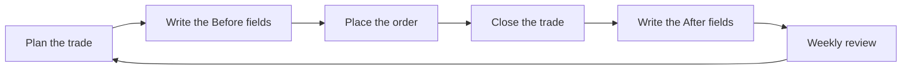

# The trade journal

Skill MIND

After this lesson you can set up a trade journal, record each trade in two stages (before and after), and work out its risk, profit or loss and R multiple from the entries.

Before this: [Rules and checklists](03-rules-and-checklists.md), and [R-multiples](../03-risk-and-position-sizing/02-r-multiples.md). You need: a calculator, and a spreadsheet if you want to build the journal now.

## The idea

You think your breakout trades work better than your pullback trades. You have taken 40 of each over a year. Can you say what each one earned, per trade, in R? Without a record, you are working from memory, and memory keeps the trades that felt memorable.

A **trade journal** is a record of every trade: what you planned, what you did, what happened, and what you felt. It does two jobs. It gives you numbers to measure your results, and it gives you the reasons behind each decision to review later.

There is a research reason to write down the plan before the result. [Fischhoff (1975)](https://doi.org/10.1037/0096-1523.1.3.288) found that people who were told how an event turned out rated that outcome as more likely than people who were not told, and could not set the knowledge aside when asked to. That is **hindsight bias**. A trade that ended well feels as if it was a good decision from the start, and a loss feels like a warning you missed. If your reasons are in the journal with a time stamp from before the trade, you can check what you actually knew.

## How it works

### Two stages

Record each trade twice. Fill in the first stage before you place the order, and do not change it afterward.

| Stage | Fields |
|---|---|
| Before | Date, ticker, setup, direction (long or short), entry price, stop price, target price, shares, risk in dollars, one reason the trade could fail, how you feel in one word |
| After | Exit price, fees, profit or loss in dollars, R, whether you followed the plan (yes or no), what you did differently, screenshots of the chart at entry and at exit, notes |

A **setup** is a named pattern with fixed rules for entry, stop and target, such as a pullback in an uptrend (see [Trend pullback setups](../07-swing-trading/04-trend-pullback-setups.md)). Use a short list of setup names you choose in advance. If every trade gets a new name, you cannot compare them later.

The "followed the plan" field is the most useful one. It splits your results into trades made by the plan and trades made by your mood, which is the split the review in the next lesson depends on.

### The formulas

Three numbers come from the fields.

\[ \text{Risk} = |E - S| \times N \]

\[ \text{P/L} = (X - E) \times N \times d - F \]

\[ R = \frac{\text{P/L}}{\text{Risk}} \]

- \(E\) is the entry price, \(S\) the stop price and \(X\) the exit price, each in US$ per share.
- \(N\) is the number of shares.
- \(d\) is +1 for a long trade and -1 for a short trade.
- \(F\) is fees in US$, entry and exit together.
- Risk is the planned loss at the stop, in US$. P/L is the result after fees, in US$. \(R\) has no unit: it says how many times the planned risk you made or lost.

The fees come out of the P/L, so a trade stopped out exactly at the stop loses slightly more than 1R. That is real, and it is why the journal tracks fees.

### Worked example: two example rows

These are the two example rows in the [trade journal workbook](../downloads/trade-journal.xlsx).

**Stock A, long.** Entry 50.00, stop 48.50, 166 shares, exit 53.00, fees US$2.00.

1. Risk = (50.00 - 48.50) x 166 = US$249.00.
2. P/L = (53.00 - 50.00) x 166 x 1 - 2.00 = 498.00 - 2.00 = US$496.00.
3. R = 496.00 / 249.00 = 1.99.

**Stock B, short.** Entry 30.00, stop 31.00, 250 shares, exit 31.00, fees US$2.00.

1. Risk = (31.00 - 30.00) x 250 = US$250.00.
2. P/L = (31.00 - 30.00) x 250 x (-1) - 2.00 = -250.00 - 2.00 = -US$252.00.
3. R = -252.00 / 250.00 = -1.01.

The average of the two is (1.99 - 1.01) / 2 = 0.49R. Two trades prove nothing, but the calculation is the one the Stats sheet runs on all your trades.

### What to measure from it

With a few dozen trades the journal gives you a **win rate** (winners divided by all closed trades), an **average win** and **average loss** in R, and an **expectancy**, the average R per trade ([Win rate, payoff and expectancy](../03-risk-and-position-sizing/03-win-rate-payoff-and-expectancy.md)). The practice page [Trade journal](../practice/trade-journal.md) lists every formula and shows how to build the sheet in Excel or Google Sheets. [`trade-journal.xlsx`](../downloads/trade-journal.xlsx) and [`trade-journal.csv`](../downloads/trade-journal.csv) are ready to download.

### For Canadians

Your journal is for your own review. It is not a tax record. The CRA says individuals should keep their tax records and supporting documents for at least six years after the end of the tax year they relate to ([CRA, how long to keep your records](https://www.canada.ca/en/revenue-agency/services/tax/individuals/topics/about-your-tax-return/long-should-you-keep-your-income-tax-records.html), as of 2026). Keep the broker's trade confirmations and statements, which show the dates, prices and fees, and keep the journal alongside them. Part 2 covers cost base and record keeping ([Cost base in CAD and keeping records](../02-accounts-currency-and-taxes/08-cost-base-in-cad-and-records.md)), and whether your trading is taxed as capital gains or business income ([Capital gains or business income](../02-accounts-currency-and-taxes/07-capital-gains-vs-business-income.md)).

## Common mistakes

- Filling in the whole row after the trade. The "Before" fields only work if they are written first.
- Logging only the trades that feel worth logging. Missing trades make the statistics look better than the truth. Log every trade, including the small ones and the rule breaks.
- Leaving out fees. On small accounts and short trades, fees are a visible part of 1R.

## Try it

1\. Stock A, long. Entry 40.00, stop 38.50, 120 shares, exit 43.60, fees US$1.50. Find risk, P/L and R.

Answer

Risk = (40.00 - 38.50) x 120 = US$180.00. P/L = (43.60 - 40.00) x 120 - 1.50 = 432.00 - 1.50 = US$430.50. R = 430.50 / 180.00 = 2.39.

2\. Stock B, short. Entry 25.00, stop 26.00, 200 shares, exit 24.00, fees US$2.00. Find risk, P/L and R.

Answer

Risk = (26.00 - 25.00) x 200 = US$200.00. P/L = (24.00 - 25.00) x 200 x (-1) - 2.00 = 200.00 - 2.00 = US$198.00. R = 198.00 / 200.00 = 0.99.

3\. Over 10 trades you have 4 winners with an average of +2.0R and 6 losers with an average of -1.0R. What are the win rate and the expectancy?

Answer

Win rate = 4 / 10 = 40%. Expectancy = 0.4 x 2.0 + 0.6 x (-1.0) = 0.8 - 0.6 = +0.2R per trade. The same total divided by 10: (4 x 2.0 - 6 x 1.0) / 10 = 0.2.

4\. Why should the "reason this trade could fail" field be written before the order?

Answer

After the result is known, hindsight bias makes the outcome feel predictable, so the reason you write will match what happened. A reason written before the order shows what you knew when you decided. It also forces one look at evidence against the trade (confirmation bias, lesson 1).

## Practice today (10 min)

| Minutes | Task |
|---|---|
| 4 | Download the [journal workbook](../downloads/trade-journal.xlsx) (or build one with the [trade journal page](../practice/trade-journal.md)). Delete the two example rows, or keep them to check against. |
| 4 | Enter your last real or paper trade, both stages. If you did not note the "before" fields, write "not recorded". |
| 2 | Write your list of setup names (two to four) on the Stats sheet. |

## Key terms

- **Trade journal**: a record of every trade: the plan, the result and your notes.
- **Setup**: a named pattern with fixed rules for entry, stop and target.
- **Hindsight bias**: judging an event as having been more predictable once you know the outcome.
- **Win rate**: winning trades divided by all closed trades.
- **Expectancy**: the average result per trade, in R.

Next: [Reviewing your trades](05-reviewing-your-trades.md)
