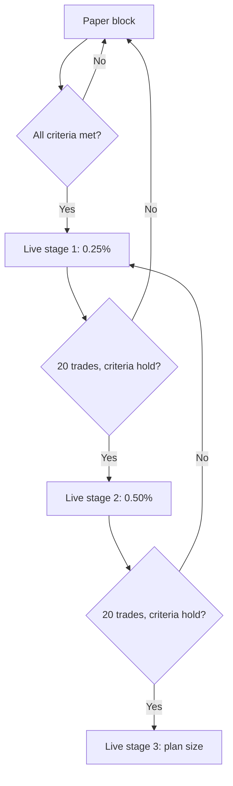

# From paper to live trading

Skill Review MIND

After this lesson you can write criteria for moving from paper to live trading, start live at a small size with a schedule for raising it, and answer the part check on psychology, the journal and paper trading.

Before this: [Setting up paper trading](06-paper-trading-setup.md), and [Reviewing your trades](05-reviewing-your-trades.md). You need: a calculator.

## The idea

At some point paper trading stops teaching you much. The usual mistake is to leave it at the wrong moment: after a lucky streak, or out of boredom. Deciding the exit criteria in advance, in writing, removes that choice.

The criteria below are about process, and not mainly about profit. That is on purpose. A paper account with 30 trades cannot show that a setup makes money, as lesson 5 worked out. What 30 trades can show is whether you follow your plan, keep your losses to the size you planned, and record everything. Those are what you need before real money is at risk.

## How it works

### Go-live criteria

Write these on one page, with your own numbers, before you start the paper block. The numbers here are example rules of thumb. Nobody has tested them as a standard.

1. At least 30 paper trades of the one setup you will trade live.
2. You followed the plan on at least 90% of them (27 of 30).
3. Every trade is in the journal in both stages, with realism rules applied (lesson 6).
4. No loss is worse than 1.2R, that is, 1R plus a margin for slippage and fees. A bigger loss means a stop was moved or skipped.
5. The largest drawdown, in R, stayed inside the limit in your plan ([Drawdowns and risk of ruin](../03-risk-and-position-sizing/08-drawdowns-and-risk-of-ruin.md)).
6. You have written down the amount you can lose without changing your life, and the live account holds no more than that for trading.

Profit is not on the list. If you meet 1 to 6 and the paper result is also positive, good. If you meet them and the result is flat, the plan still works as a process and the next step is more paper trades or a better setup, not hurrying.

What 30 trades can say about a win rate is small. If the true win rate is 50%, the standard error on 30 trades is sqrt(0.5 x 0.5 / 30) = 9.1 percentage points, so a rough 95% interval is 50% plus or minus 1.96 x 9.1, or 32% to 68%. A measured win rate of 60% on 30 trades is inside that range.

### Worked example: checking the criteria

You finish a block with 30 paper trades of Stock A pullbacks. The journal shows 26 followed the plan, the worst loss was -1.1R, the largest drawdown was 4.5R against a plan limit of 6R, and the total is +5.4R.

1. Plan-following = 26 / 30 = 86.7%, under 90%. Criterion 2 fails.
2. Worst loss -1.1R is within 1.2R. Criterion 4 passes.
3. Drawdown 4.5R is inside 6R. Criterion 5 passes.
4. Expectancy = 5.4 / 30 = +0.18R per trade, which is not a criterion.

One criterion failed, so you do not go live yet. You look at the four plan breaks, write the cause of each, and run another 30 paper trades. You need 27 of 30 or better in that new block.

### Going live small

**Live trading** means trading real money. Start with a fraction of your planned risk per trade, and raise it only by schedule. The example schedule below uses a US$25,000 account and a planned risk of 1%.

| Stage | Risk per trade | Dollars | Live trades before moving on |
|---|---|---|---|
| 1 | 0.25% | US$62.50 | 20 |
| 2 | 0.50% | US$125.00 | 20 |
| 3 | 1.00% | US$250.00 | Plan size |

Move up a stage only if the criteria still hold on the live trades (at least 90% followed the plan, no loss worse than 1.2R). If you fall below, drop back a stage and return to paper until you pass again. Stage 1 exists so the first real losses are small enough to feel without damaging the account. At Stage 1 you are practising live emotions, and the result is secondary.

The same Stock A trade (entry 50.00, stop 48.50, risk 1.50 a share) sizes to 41 shares at Stage 1 (62.50 / 1.50 = 41.7, rounded down), 83 at Stage 2 (125 / 1.50 = 83.3) and 166 at Stage 3 (250 / 1.50 = 166.7).

In the journal, add two live fields: the fill price against the planned price (slippage), and how you felt at the stop. Compare them with your paper numbers after the first 20 trades.

## Try it

1\. Account US$40,000, planned risk 1%. Stock A: entry 25.00, stop 24.00. How many shares at Stage 1 (0.25%), Stage 2 (0.50%) and Stage 3?

Answer

Risk per share = US$1.00. Stage 1: 0.25% of 40,000 = US$100, so 100 shares. Stage 2: 0.50% = US$200, so 200 shares. Stage 3: 1% = US$400, so 400 shares.

2\. After 30 paper trades the standard error of the win rate is 9.1 points when the true rate is 50%. What is the standard error for 100 trades, and the rough 95% interval?

Answer

Standard error = sqrt(0.5 x 0.5 / 100) = 0.05, which is 5.0 points. The interval is 50% plus or minus 1.96 x 5.0, or 40.2% to 59.8%. A longer record narrows the range, but slowly: 3.3 times as many trades cut it by a little under half.

3\. During Stage 1 you take 20 live trades, 17 follow the plan, and one loses 1.6R. What do you do?

Answer

17 / 20 = 85%, under 90%, and a 1.6R loss breaks the 1.2R rule. Drop back to paper until you pass the criteria again, and write the cause of the 1.6R loss in the journal.

## Part check

1\. Under the 1992 estimates, a US$100 loss feels as large as what gain?

Answer

The loss feels like 2.25 x 100^0.88. A gain g matches it when g = 100 x 2.25^(1/0.88) = 100 x 2.513, about US$251.

2\. On a US$50,000 account you lose a trade risking 1%, then risk 2% and lose, then risk 4% and lose. What is the total loss?

Answer

US$500 + US$1,000 + US$2,000 = US$3,500, which is 7.0% of the account. At 1% each, the loss would be US$1,500 (3.0%).

3\. Stock B: entry 30.00, stop 29.40, target 31.50. Account US$25,000, risk 1%, minimum reward-to-risk 2. Does it pass, and how many shares?

Answer

Reward = 1.50, risk = 0.60, ratio = 1.50 / 0.60 = 2.5, so it passes. Shares = 250 / 0.60 = 416.7, so 416 shares.

4\. A long trade: entry 80.00, stop 78.00, 50 shares, exit 85.00, fees US$1.00. Find risk, P/L and R.

Answer

Risk = 2.00 x 50 = US$100.00. P/L = 5.00 x 50 - 1.00 = US$249.00. R = 249.00 / 100.00 = 2.49.

5\. A trade followed the plan and lost 1R. Another broke the plan and won 2R. Which goes in the review as the better decision?

Answer

The first. The review judges process apart from outcome (outcome bias), and following the plan is the behaviour you want to repeat.

6\. A buy limit is at 25.00 and the day's low is 25.00. Does the trade-through rule count it as filled?

Answer

No. The price touched the limit but did not trade below it. A live order would have been in a queue.

7\. You have 24 plan-following trades out of 30 and the other criteria are met. Do you go live?

Answer

No. 24 / 30 = 80%, under the 90% criterion. Review the six plan breaks and run more paper trades.

8\. Why does the first live stage use 0.25% risk and not the planned 1%?

Answer

The first real losses are felt differently from paper losses. At 0.25% (US$62.50 on US$25,000) they are small enough to practise following the plan under real emotion without damaging the account.

## Practice today (10 min)

| Minutes | Task |
|---|---|
| 3 | Write your go-live criteria on one page with your own numbers, using the six above as a start. |
| 4 | Start paper block 1 from the [paper trading page](../practice/paper-trading.md): 20 paper trades under your plan and checklist, over about four weeks (the 30-trade criterion comes after). Place and journal the first one now. |
| 3 | Set a weekly review time in your calendar (20 minutes) and write the day. |

## Key terms

- **Go-live criteria**: written tests you must pass before trading real money.
- **Live trading**: trading with real money.
- **Size ramp**: a schedule that raises risk per trade in stages, only when criteria hold.
- **Paper block**: a set number of paper trades with a fixed purpose, done between parts of the book.

Next: [Candles, bars and timeframes](../05-reading-charts/01-candles-bars-and-timeframes.md)
