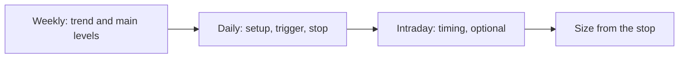

# Multiple timeframes and relative strength

<span class="tag tag-skill">Skill</span> <span class="tag tag-review">Review</span> <span class="tag tag-part">CHRT</span>

After this lesson you can read the same stock on a weekly and a daily chart and let the larger trend set your direction, compute a relative strength line against an index, and check what you learned in this part.

Before this: [Gaps](10-gaps.md), and the rest of Part 5. You need: a calculator.

## The idea

A daily chart of Stock A shows a pullback in April. A weekly chart of the same stock shows a rising staircase of higher highs and higher lows. Which one is right? Both are. They answer different questions, and the useful habit is to ask the larger one first.

A **multiple timeframe** read starts on a longer timeframe to find the trend and the main levels, then moves to a shorter one to find the entry and the stop. A stock that is in an uptrend on the weekly chart gives a pullback on the daily chart a better reason to be bought than a bounce in a weekly downtrend. Part 7 builds swing trades on this order.



## How it works

1. On the weekly chart, apply the swing-point rule of lesson 2 and call the trend (with only 25 weekly bars, the weekly chart here uses 2 bars on each side instead of 5): up, down or range.
2. Mark the weekly support and resistance zones (lesson 3).
3. On the daily chart, look for setups only in the direction of the weekly trend.
4. Take the stop from the daily chart and size the position from it.

The same stock, weekly first. Look at the swing lows stepping up.

```chart
data: 05-reading-charts/stock-a-weekly.json
title: Stock A, weekly
show: sma 10
marker: 2026-02-16 | below | Low 42.22
marker: 2026-03-30 | below | Low 46.56
marker: 2026-05-25 | below | Low 50.39
caption: Weekly swing lows of 42.22, 46.56 and 50.39 and swing highs of 44.82, 50.28 and 55.10.
```

The weekly swing highs are 44.82 (week of February 2), 50.28 (March 16) and 55.10 (May 4). The weekly swing lows are 42.22 (February 16), 46.56 (March 30) and 50.39 (May 25). Each is above the one before: a weekly uptrend. In the last week (June 22) the close is 58.50, above its 10-week SMA of 53.87.

The daily chart shows the pullbacks inside that trend.

```chart
data: 05-reading-charts/stock-a-daily.json
title: Stock A, daily
show: sma 20
level: 50.39 | Weekly swing low
caption: Each daily pullback low (46.56 on April 3, 50.39 on May 27) is above the one before.
```

On the daily chart the pullback that ends on April 3 has a low of 46.56, the same low the weekly chart shows, and the pullback of May 27 reaches 50.39. A daily trader who bought those pullbacks was buying with the weekly trend. The weekly low is also the level that would end the weekly trend call.

Timeframes link in another way: a daily level is a zone on the weekly chart, and traders usually give a weekly level more weight than a daily one, because more trading happened at it.

### Relative strength

**Relative strength** compares a stock's performance with a benchmark such as an index (Part 1: [Indexes, sectors and market cap](../01-how-markets-work/10-indexes-sectors-and-market-cap.md)). The **relative strength line** divides the stock's price by the index and scales to 100 at the start:

\[ RS_t = 100 \times \frac{S_t / S_0}{I_t / I_0} \]

- \(S_t\) is the stock's close and \(I_t\) the index's close at bar \(t\); \(S_0\) and \(I_0\) are the closes at the first bar.
- \(RS_t\) rises when the stock beats the index, and falls when it lags. It has no unit.

<div class="example" markdown>

### Worked example: relative strength against an index

Stock B and the made-up Index X start on January 5, 2026 at 49.16 and 3,985.07.

1. February 19: Stock B closes at 55.65 and the index at 3,972.05. RS = 100 x (55.65 / 49.16) / (3,972.05 / 3,985.07) = 100 x 1.1320 / 0.9967 = 113.57.
2. June 19: Stock B closes at 48.63 and the index at 4,534.04. RS = 100 x (48.63 / 49.16) / (4,534.04 / 3,985.07) = 100 x 0.9892 / 1.1378 = 86.94.

Stock B was up 13.2% while the index was down 0.3% in February, and by June it was down 1.1% while the index was up 13.8%.

</div>

Look at the RS line below. It rises to a peak in February, then falls for four months even though the stock's price ends close to where it started.

```chart
data: 05-reading-charts/rs-ratio.json
title: Stock B against Index X, daily: relative strength line
type: line
level: 100 | Start
marker: 2026-02-19 | above | Peak 113.57
caption: The RS line peaks at 113.57 on February 19 and ends at 86.94.
```

A stock with a rising RS line is leading its benchmark. Jegadeesh and Titman (1993) found that buying stocks that had been winners over the past 3 to 12 months and selling losers earned about 1% a month on average in US stocks from 1965 to 1989 ([Journal of Finance, 48(1), 65-91](https://doi.org/10.1111/j.1540-6261.1993.tb04702.x)). Relative strength is one way to look for winners. The result is an average over many stocks, and winners can lag later.

This book knows of no good published test that multiple-timeframe analysis improves trading results, so treat it as a discipline for organising a chart read, not as an edge by itself.

## Common mistakes

- Using too many timeframes. Weekly, daily and one shorter one are enough.
- Letting the shorter chart overrule the weekly stop. Decide the invalidation level on the chart you trade, and respect the larger one.
- Reading relative strength as direction. A stock can lag an index while rising.

## Try it

1\. A stock rises 10% while its index rises 4%. What is the RS line at that point?

<details class="solution" markdown>
<summary>Answer</summary>

RS = 100 x 1.10 / 1.04 = 105.8.

</details>

2\. A stock is flat while its index rises 5%. What is RS?

<details class="solution" markdown>
<summary>Answer</summary>

RS = 100 x 1.00 / 1.05 = 95.2. The line falls although the price did not.

</details>

3\. The weekly trend is up, and the daily chart shows a break below its last swing low. What does each say, and what do you do?

<details class="solution" markdown>
<summary>Answer</summary>

The weekly says the larger trend is up. The daily says the short-term trend turned down. Without a daily uptrend there is no daily setup to buy, so wait for the daily structure to turn up again with the weekly trend, unless the weekly low also breaks.

</details>

<div class="practice" markdown>

## Practice today (10 min)

| Minutes | Task |
|---|---|
| 5 | Run the full set of [chart drills](../practice/chart-drills.md) for Part 5 and note which question types you missed. |
| 3 | Open a stock you follow on weekly and daily charts. Write the weekly trend, the nearest weekly level and one daily setup that fits it. |
| 2 | Add its RS line against an index. Write whether it leads or lags. |

</div>

## Part check

1\. A bar opens at 30.00, reaches 31.50, falls to 29.40 and closes at 31.20. Find the range, body and close location.

<details class="solution" markdown>
<summary>Answer</summary>

Range = 31.50 - 29.40 = 2.10. Body = 31.20 - 30.00 = 1.20. Close location = (31.20 - 29.40) / 2.10 = 85.7%.

</details>

2\. Swing highs are 50, 52 and 54 and swing lows are 46, 48 and 50. What is the trend and what ends it?

<details class="solution" markdown>
<summary>Answer</summary>

An uptrend: higher highs and higher lows. A close below the last swing low, 50, ends the call.

</details>

3\. A breakout bar trades 3,600,000 shares and the 20-day average is 1,800,000. What is RVOL, and what does it say?

<details class="solution" markdown>
<summary>Answer</summary>

RVOL = 2.0. The bar traded twice the usual volume, which supports the breakout but does not guarantee it.

</details>

4\. For a 10-bar EMA, what is \(k\)? Yesterday's EMA is 40.00 and today's close is 41.00. What is today's EMA?

<details class="solution" markdown>
<summary>Answer</summary>

\(k = 2/11 = 0.1818\). EMA = 0.1818 x 41.00 + 0.8182 x 40.00 = 40.18.

</details>

5\. ATR is 1.00 and today's true range is 2.40. What is the new ATR (N = 14), and where is a 2 x ATR stop for a long entry at 50.00?

<details class="solution" markdown>
<summary>Answer</summary>

ATR = (13 x 1.00 + 2.40) / 14 = 1.10. The stop is 2 x 1.10 = 2.20 below the entry, at 47.80.

</details>

6\. A flag has a pole from 10.00 to 12.50. You enter at 12.40 with a stop at 11.70. What are the target and the reward to risk?

<details class="solution" markdown>
<summary>Answer</summary>

Pole = 2.50, target = 12.40 + 2.50 = 14.90. Risk = 0.70, reward = 2.50, so 3.6R.

</details>

7\. A stock gaps up 5% out of a long range on four times the usual volume. Which gap type is it likely to be, and what makes the label uncertain?

<details class="solution" markdown>
<summary>Answer</summary>

It looks like a breakaway gap (out of a range, heavy volume). The label is certain only afterwards: if the price reverses and fills the gap, it was not.

</details>

8\. A stock is up 10% and its index 4%. A trader says the stock "beat the market, so buy it." What does the RS line say, and what is missing?

<details class="solution" markdown>
<summary>Answer</summary>

RS = 105.8, so the stock led. Missing: a stop and a size. Past relative strength is an average tendency, not a forecast for one stock.

</details>

## Key terms

- **Multiple timeframe analysis**: reading a longer timeframe first for trend and levels, then a shorter one for the setup.
- **Relative strength**: a stock's performance compared with a benchmark.
- **Relative strength line**: 100 times the stock's growth divided by the index's growth since a start date.

Next: [What ICT and smart money concepts claim](../06-ict-and-smart-money-tested/01-what-ict-and-smc-claim.md)
