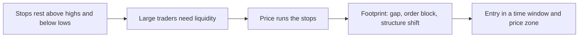

# What ICT and smart money concepts claim

<span class="tag tag-idea">Idea</span> <span class="tag tag-part">ICT</span>

After this lesson you can state the main claims of ICT and smart money concepts in the way their teachers do, mark a break of structure and a change of character on a chart, and sort any claim into "can be tested" or "cannot".

Before this: [Trend and market structure](../05-reading-charts/02-trend-and-market-structure.md) and [Support and resistance](../05-reading-charts/03-support-and-resistance.md). You need: nothing.

## The idea

You have probably seen a chart with boxes, arrows and labels like "sweep", "FVG" and "OB" drawn on it. These come from a body of ideas called **ICT**, short for Inner Circle Trader, the name used by the educator Michael Huddleston, and from a wider community that calls its version **smart money concepts** (SMC). Many traders use these ideas, and this part of the book treats them the way their teachers state them, then asks what could be checked.

The core story has four steps.

1. Large traders (funds, banks, market makers) need to trade size. A large buy order needs many sellers, and a large sell order needs many buyers, or the order moves the price against itself ([Who is on the other side of your trade](../01-how-markets-work/06-who-is-on-the-other-side.md)).
2. Many small traders place stop orders right beyond obvious highs and lows. Those stops are a crowd of orders sitting at known prices. The teachers call these crowds **liquidity**.
3. So price tends to travel to that liquidity, take it, and then move the other way. A fast move into a pool of stops is called a **stop run** or a **sweep**.
4. After the sweep, the large trader's footprints show on the chart: a **fair value gap** (an imbalance left by a fast move), an **order block** (the candle where large orders were placed) and a **break of structure** (a sign the direction changed). The trader enters at those footprints, in the right session of the day, and on the right side of the range.

The claim is not "patterns work". The claim is a chain: orders cluster, large traders need them, price goes there, and the chart shows what happened. Each link can be examined on its own, and each link has a different amount of support.



## How it works

The rest of this part covers one box of the flow chart per lesson. This lesson defines the structure words, because every later lesson uses them.

A **swing high** is a bar whose high is above the highs of the bars on both sides, and a **swing low** is the mirror image ([Trend and market structure](../05-reading-charts/02-trend-and-market-structure.md)). An uptrend is a series of higher swing highs and higher swing lows.

A **break of structure** (BOS) is a close beyond the last swing point in the direction of the trend. In an uptrend it is a close above the last swing high. It says the trend continued. A **change of character** (CHoCH) is the first close beyond a swing point against the trend. In an uptrend it is a close below the last higher low, the swing low that made the most recent high possible. It says the trend may be ending. Many teachers call the same event a **market structure shift** (MSS), and some use BOS for any break of a swing point. This book keeps the two-word split above, so check which words a video uses before comparing it with this page.

Two details change what you see on a chart. Most teachers want a body close beyond the level, and a wick alone does not count. And the swing points depend on how many bars you require on each side, so two traders can mark different swings on one chart.

The chart shows Stock A in an uptrend that turns. Look at the three swing highs and the higher low.

```chart
data: 06-ict-and-smart-money-tested/bos-choch.json
title: Stock A, daily: breaks of structure and a change of character
level: 54.37 | Swing high 1
level: 57.13 | Swing high 2
level: 54.59 | Higher low
marker: 2026-02-24 | below | BOS up
marker: 2026-03-16 | below | BOS up
marker: 2026-03-30 | above | CHoCH
marker: 2026-04-09 | above | BOS down
show: volume
caption: Two closes above swing highs, then a close below the last higher low.
```

The first swing high is 54.37 (February 11). The close on February 24 is 54.57, above it: a BOS. The next swing high is 57.13 (March 3), and the close on March 16 is 57.87, a second BOS. The swing high after that is 60.15 (March 20). The last higher low is 54.59 (March 11). On March 30 the close is 54.42, below 54.59, so that bar is the CHoCH. The market then makes a lower swing low of 53.15 (March 31) and a lower swing high of 56.60 (April 6), and the close on April 9 (52.74) is below 53.15: a BOS down.

<div class="example" markdown>

### Worked example: marking the structure

You can mark the same chart in four steps.

1. Find the swing highs and lows: highs at 54.37, 57.13 and 60.15, lows at 52.02 and 54.59.
2. Check that each low is higher than the one before it: 54.59 is above 52.02, so the trend is up.
3. For each close above the last swing high, mark a BOS. Here that is February 24 and March 16.
4. Mark the CHoCH at the first close below the last higher low, 54.59. That is March 30.

On March 30, the move from the high of 60.15 to the close of 54.42 is a drop of 5.73, or 9.5% (5.73 / 60.15). The label arrives after most of that drop.

</div>

## What can be tested

A claim is testable when it names a rule, a prediction and a comparison. "Price returns to a fair value gap within 10 bars" is testable: count the gaps, count the returns, compare with a baseline. "Smart money hunts the stops" is a statement about intent. Nobody can observe intent on a chart, so it cannot be tested. Only its predictions can: for example, "price reverses more often after trading through equal highs than after other bars".

As of 2026 we found no peer-reviewed study that tests ICT's named patterns (fair value gap, order block, breaker, kill zone) as defined by its teachers. The related evidence is about parts of the chain: clustering of stop orders ([Liquidity and stop runs](02-liquidity-and-stop-runs.md)), support and resistance, and time-of-day patterns in volume and volatility. Absence of studies is not evidence for or against these ideas. It means the reader must test them. Lesson 6 shows how.

<div class="warning" markdown>

Watch out: a chart annotated after the fact always looks right. You know where the move went, so you pick the sweep, the gap and the block that fit. The test is to write the rule first and mark the chart without looking at what came next.

</div>

## Common mistakes

- Treating a teacher's definition as the only one. Block, gap and structure rules vary by teacher, so write your own rule down before you test it.
- Marking structure on a chart you already know the end of. Cover the right side of the chart and mark bar by bar.
- Counting a wick through a swing point as a break when your own rule says "close".

## Try it

1\. On the chart above, which bar is the first close above 54.37, and what is the close?

<details class="solution" markdown>
<summary>Answer</summary>

February 24, with a close of 54.57. The closes before it (February 11 to 23) are all at or below 54.15.

</details>

2\. A trader says the CHoCH happened when the price first traded below 54.59 (a wick counts). A second trader needs a close below. On which date does each rule trigger?

<details class="solution" markdown>
<summary>Answer</summary>

Both rules trigger on March 30: that bar trades down to 54.34 and closes at 54.42. In this chart the two rules agree, but on another chart a wick can pierce a level and close back above it, and then they differ.

</details>

3\. Sort each claim as testable or not testable. (a) "Price closes back below equal highs after a sweep more often than after other bars." (b) "Smart money wants the retail stops." (c) "A fair value gap is revisited within 10 bars."

<details class="solution" markdown>
<summary>Answer</summary>

(a) Testable: it is a count compared with a baseline. (b) Not testable: it describes intent, which a chart does not show. (c) Testable: count gaps, count revisits within 10 bars, and compare with a baseline.

</details>

<div class="practice" markdown>

## Practice today (10 min)

| Minutes | Task |
|---|---|
| 5 | Open a daily chart of any stock you follow. Cover the right half, then mark swing highs and lows and the first BOS and CHoCH bar by bar. Uncover and compare. |
| 3 | Write your own one-line rules for a swing point (how many bars each side) and for a break (wick or close). |
| 2 | Do a few [chart drills](../practice/chart-drills.md) from this part. |

</div>

## Key terms

- **ICT**: Inner Circle Trader, a set of trading ideas taught by Michael Huddleston.
- **Smart money concepts (SMC)**: the wider community's version of ICT-style ideas, built on liquidity, gaps, blocks and structure.
- **Liquidity**: in this usage, orders resting at known prices, mostly stops beyond obvious highs and lows.
- **Stop run (sweep)**: a quick move through a level where stops rest, followed by a return.
- **Fair value gap**: a three-bar imbalance left by a fast move (lesson 3).
- **Order block**: the candle where large orders are said to have been placed (lesson 4).
- **Break of structure (BOS)**: a close beyond the last swing point in the direction of the trend.
- **Change of character (CHoCH)**: the first close beyond a swing point against the trend. Also called a market structure shift (MSS).

Next: [Liquidity and stop runs](02-liquidity-and-stop-runs.md)
