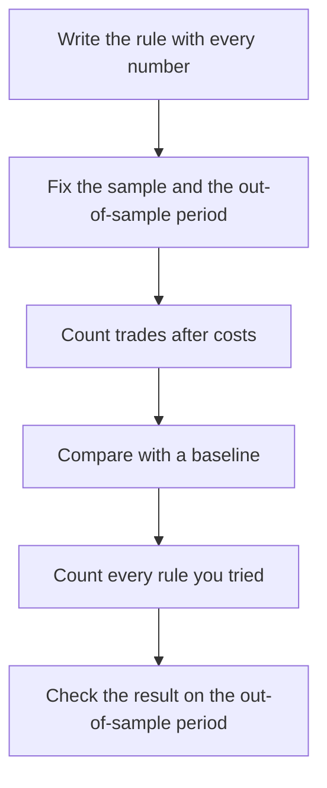

# Testing smart money claims

Data Review ICT

After this lesson you can turn an ICT or smart money claim into a rule that a test can accept or reject, say what sample, baseline, costs and out-of-sample period it needs, and work out how many trades a small edge takes to show up.

Before this: [Order blocks and breakers](04-order-blocks-and-breakers.md) and [Win rate, payoff and expectancy](../03-risk-and-position-sizing/03-win-rate-payoff-and-expectancy.md). You need: a calculator.

## The idea

Lessons 2 to 5 each ended with the same finding: the mechanism is plausible, the named pattern has not been tested in published work that we could find, and the reader can test it. This lesson shows how, so that a claim from any teacher, ICT or not, can be put through the same steps.

The summary of the part is a table.

| Idea | Testable form | What is known |
|---|---|---|
| Stops cluster beyond obvious levels | Count orders near round numbers and highs | Supported in currency order data (Osler 2003, 2005) |
| A sweep of equal highs is followed by a reversal | Return after a close-back-inside bar against all bars | No published test found; our made-up series shows no edge |
| Price returns to a fair value gap | Return rate against the rate for all bars | No published test found; the baseline return rate was as high as the gaps' rate |
| Price reacts at an order block | Placebo test against ordinary candles | No published test found; levels in general show reactions |
| Kill zones and the 62% to 79% zone predict direction | Direction after the window; pullback depth against other zones | Activity varies by hour (Andersen and Bollerslev 1998); no test of direction found |

A missing published test is not a verdict. It leaves the question open, and the test is yours to run.

## How it works

A test has six parts. Skipping one is how a good-looking result appears from nothing.

1. Write the rule before you look. Which bars count as a sweep, how large a displacement is, which candle is the block, which swing, which entry, stop and target. Every number is a parameter you must fix.
2. Set aside the last part of the data (say the final third) and do not touch it until the rule is final. This is the out-of-sample period, covered in Overfitting and out-of-sample testing<!-- link: ../20-quant-track-in-python/09-overfitting-and-out-of-sample.md -->.
3. Count costs in R: spread, commission, and slippage on stop orders ([Slippage, gaps and costs](../03-risk-and-position-sizing/06-slippage-gaps-and-costs.md)).
4. Compare with a baseline: the same entry, stop and target on random bars, on all bars, or the plain trend rule.
5. Count every variant you tried, including the ones you dropped. With many rules tried, the best one looks good by chance. Sullivan, Timmermann and White (1999) used White's Reality Check, a method that adjusts a technical-rule result for the number of rules searched, on 100 years of Dow Jones data ([Journal of Finance 54(5), 1647-1691](https://doi.org/10.1111/0022-1082.00163)). Harvey, Liu and Zhu (2016, working-paper version 2014) argue that, because so many factors have been tried in research, a new one should clear a t-statistic of 3.0 and not the usual 2.0 ([NBER working paper 20592](https://nber.org/papers/w20592)).
6. Run the final rule once on the out-of-sample period.

The figure shows the fifth point with a simulation. Each rule is made-up noise with no edge (daily returns with mean zero and standard deviation 1%, for 250 days). For each count of rules, the bar is the average, over 200 trials, of the best annualized Sharpe ratio (mean daily return divided by its standard deviation, times the square root of 252).

Trying 100 variants of a gap rule, a block rule and a session window is easy to do. The best of 100 no-edge rules has a Sharpe ratio near 2.5, which looks like skill. Part 20 covers this in more detail (Backtesting concepts and biases<!-- link: ../20-quant-track-in-python/08-backtesting-concepts-and-biases.md -->).

### Worked example: how many trades a small edge needs

You test a fair value gap rule on 60 trades. The mean result is +0.15R per trade and the standard deviation of the results is 1.2R.

1. Standard error of the mean = 1.2 / sqrt(60) = 0.155R.
2. t-statistic = 0.15 / 0.155 = 0.97. The usual cutoff is about 2, so this cannot be told apart from zero.
3. Costs: spread and slippage take 0.05R per trade, so the mean is 0.10R and t = 0.10 / 0.155 = 0.65.
4. Trades needed for t = 3 with a mean of 0.15R: n = (3 x 1.2 / 0.15)^2 = 24^2 = 576 trades.

At two trades a week that is more than five years. A small edge cannot be confirmed from a handful of trades, and the journal is the tool that collects enough of them ([The trade journal](../04-psychology-journal-and-paper-trading/04-the-trade-journal.md)).

## Common mistakes

- Judging a method on its best trades. Count every instance of the rule, including those the chart no longer shows.
- Changing the rule after a bad result and testing again on the same data. That is a new variant and it counts toward step 5.
- Reading a high hit rate as an edge without the payoff and the baseline.

## Try it

1\. A test finds 12 winners in 20 trades with a +0.5R average win and a -1R average loss. What is the average result per trade?

Answer

Win rate 12 / 20 = 60%. Average = 0.6 x 0.5 - 0.4 x 1.0 = 0.30 - 0.40 = -0.10R. A 60% win rate loses money here.

2\. A rule has a mean of +0.20R and a standard deviation of 1.0R. How many trades does it take to reach t = 3?

Answer

n = (3 x 1.0 / 0.20)^2 = 15^2 = 225 trades.

## Practice today (10 min)

| Minutes | Task |
|---|---|
| 5 | Pick one idea from this part. Write its rule in six lines: bars, zone, entry, stop, target, time window. Add the baseline you will compare with. |
| 3 | In your [trade journal](../practice/trade-journal.md), add a column for the idea tag (sweep, FVG, OB, OTE, kill zone) so the trades can be counted later. |
| 2 | Do the mixed [chart drills](../practice/chart-drills.md) for this part. |

## Part check

1\. State the chain of claims behind ICT in one sentence each, and name which link has published evidence.

Answer

Stops rest at known prices; large traders need liquidity; price moves to it and reverses; the chart shows footprints (gaps, blocks, structure shifts); entries are best in certain times and zones. The first link has published evidence in currency order data (Osler 2003, 2005). We found no published tests for the named patterns.

2\. Define a bullish fair value gap and give the gap for bar 1 high 50.90 and bar 3 low 52.30.

Answer

Bar 1's high is below bar 3's low. The gap is 50.90 to 52.30, 1.40 wide, with a midpoint of 51.60.

3\. A bar trades above equal highs and closes back below. A second bar trades above and closes above. Which is the sweep and which is the breakout?

Answer

The first is the sweep (close back inside). The second is a breakout. They look the same until the close.

4\. What separates a break of structure from a change of character?

Answer

A BOS is a close beyond the last swing point in the direction of the trend. A CHoCH is the first close beyond a swing point against the trend.

5\. Swing low 50.00, swing high 60.00. Give equilibrium and the OTE zone.

Answer

Equilibrium 55.00. OTE: 53.80 (62%) to 52.10 (79%).

6\. It is November 3, 2026. London opens at 8 a.m. London time. What time is that in Toronto?

Answer

Both the UK (since October 25) and the US (since November 1) are on standard time, so London is 5 hours ahead. 8 a.m. in London is 3 a.m. ET.

7\. In a made-up series, 79% of fair value gaps are revisited within 10 bars, and 81% of all bars are. Is the gap rule an edge?

Answer

There is no evidence of one. The baseline return rate is as high as the gaps' rate, so a high fill rate alone proves nothing.

8\. You tried 100 variants of a rule and the best has a Sharpe ratio of 2.4. Why is that weak evidence?

Answer

The best of 100 no-edge rules averages about 2.5 in the simulation above. Count the variants, then test the final rule on data you did not use.

## Key terms

- **Baseline**: what the same measurement gives on all bars or random bars, to compare the pattern against.
- **Out-of-sample period**: data kept back until the rule is final.
- **Data snooping**: finding a pattern by searching many rules on the same data.
- **t-statistic**: the mean result divided by its standard error.

Next: What swing trading is<!-- link: ../07-swing-trading/01-what-swing-trading-is.md -->
