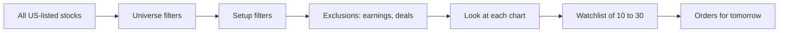

# Scanners and watchlists

<span class="tag tag-skill">Skill</span> <span class="tag tag-part">SWNG</span>

After this lesson you can write a scanner as a list of numeric filters, turn its output into a short watchlist, and say what the scanner cannot tell you.

Before this: [Volume and relative volume](../05-reading-charts/04-volume-and-relative-volume.md), [Reading a quote page](../01-how-markets-work/11-reading-a-quote-page.md). You need: nothing.

## The idea

There are several thousand US-listed stocks. You have 10 minutes after the close. You cannot look at all of them, and most would fail a rule you already hold: that you only trade stocks that are liquid, that move enough to pay for your stop, and that fit one of your three setups.

A **scanner** (also called a screener) is a tool that filters the whole market by numeric rules and returns the stocks that pass. A **watchlist** is the short list you keep from it: the stocks you will look at each evening, usually 10 to 30. The scanner does the narrowing, and your eyes do the last step, which is looking at the chart.

The **universe** is the set of stocks you allow yourself to trade at all, before any setup filter. Define it once and leave it alone.

## How it works

### Step 1: the universe filters

These keep out stocks where a swing trade is unusually costly. The numbers below are the book's starting points, not tested standards. Change them in your plan and write down why.

| Filter | Starting value | Why |
|---|---|---|
| Price | At least US$10 | Very low-priced stocks have wide percentage spreads and can be hard to short or margin |
| Average volume (50 days) | At least 1 million shares | Orders fill near the quote ([Bid, ask and the order book](../01-how-markets-work/04-bid-ask-and-the-order-book.md)) |
| Average dollar volume | At least US$20 million a day | The same idea in money, because a US$10 stock and a US$200 stock need different share counts |
| Market cap | At least US$2 billion | Mid and large caps ([Indexes, sectors and market cap](../01-how-markets-work/10-indexes-sectors-and-market-cap.md)) |
| ATR as a percent of price | 2% to 6% | The stock moves enough to pay for a stop, and not so much that the stop is wide |

**Average dollar volume** is average daily volume times price. For Stock A with a 1.5 million share average and a US$50 price, it is 1,500,000 x 50 = US$75 million. **ATR percent** is the 14-day average true range divided by the close ([Volatility indicators](../05-reading-charts/07-volatility-indicators.md)); an ATR of US$1.00 on a US$50.00 close is 2.0%. This lesson uses the plain 14-day mean of true range, and a scanner's ATR may be smoothed the Wilder way, so its value can differ slightly.

### Step 2: the setup filters

Each setup has its own filter, taken from its lesson. Written the way a free scanner would take them:

| Setup | Filter |
|---|---|
| Trend pullback | Price above the 50-day average, 50-day average rising, price within 8% of the 20-day high, RSI(14) under 50 or three down closes |
| Breakout from a base | Price within 5% of its 52-week high, 50-day average rising, relative volume above 1.5 today |
| Short-term mean reversion | Price above the 200-day average, RSI(2) under 10 |

Free scanners from several providers (TradingView's stock screener and Finviz-style filter pages are two kinds) offer price, volume, average volume, market cap, moving average position, RSI, performance over a period and an earnings date. They differ in which fields they have, in how fresh the data are (end of day or delayed) and in what the free plan allows. Check what yours offers before you rely on it, and do not read this lesson as a recommendation of any of them.

### Step 3: the exclusions

Add three exclusions. Earnings inside your hold: a report in the next 10 trading days is a gap risk that no stop covers. A pending merger or buyout, whose price moves with the deal. A trading halt or an ETF that is leveraged or inverse (part 13), because its daily reset changes how it behaves over days.



### Step 4: the chart review

The scanner returns a list, not trades. For each stock, you look at the chart and ask the questions the setup lesson sets. A name that passes the numbers and shows a ragged, gapping chart gets dropped. Each name on the watchlist gets a note: the setup, the trigger price and the stop.

### Ranking the list

When more stocks pass than you can trade, rank by relative strength: the stock's return over a period against the market's ([Multiple timeframes and relative strength](../05-reading-charts/11-multi-timeframe-and-relative-strength.md)). Jegadeesh and Titman (1993) sorted US stocks by their return over the past 3 to 12 months and found that past winners outperformed past losers over the next 3 to 12 months ([Journal of Finance, 48(1), 65-91](https://doi.org/10.1111/j.1540-6261.1993.tb04702.x)). That is a test of portfolios of many stocks held for months, not of a 10-day swing trade. It supports ranking by past strength as a tie-breaker, and it does not show that a strong stock will pass your next setup.

<div class="example" markdown>

### Worked example: one stock through the filters

Stock A closed at US$52.60 on April 3, 2026. From the sample file, its 50-day average volume is 1,470,018 shares and the plain 14-day mean of true range is US$1.0479. The market cap, US$4.1 billion, is made up.

1. Price 52.60 is at least US$10. Pass.
2. Volume 1,470,018 is at least 1 million. Pass.
3. Average dollar volume (the 50-day mean of close times volume) is US$74.4 million, at least US$20 million. Pass.
4. Market cap US$4.1 billion is at least US$2 billion. Pass.
5. ATR percent = 1.0479 / 52.60 = 1.99%, which is below the 2% floor. Fail.

It fails the last filter by 0.01 percentage points. This is the case for looking at near misses: 1.99% is not different from 2.00% in any way a stop cares about. Decide whether the filter is a hard rule or a guide before you start, and write the answer in the plan.

</div>

## In code

The same filter on the sample file, using the 50-day mean of volume and the 14-day mean of true range. Download [stock-a-pullback-win.csv](../assets/data/stock-a-pullback-win.csv).

<details class="code" markdown>
<summary>In code</summary>

```python
import pandas as pd

bars = pd.read_csv("stock-a-pullback-win.csv", parse_dates=["date"])
prev_close = bars["close"].shift()
true_range = pd.concat(
    [bars["high"] - bars["low"], (bars["high"] - prev_close).abs(), (bars["low"] - prev_close).abs()],
    axis=1,
).max(axis=1)
last = bars.iloc[64]
atr = true_range.rolling(14).mean().iloc[64]
dollar_volume = (bars["volume"] * bars["close"]).rolling(50).mean().iloc[64]
print(last["date"].date(), last["close"], round(atr, 2), round(100 * atr / last["close"], 2))
print(round(dollar_volume / 1e6, 1))
```


The code prints 2026-04-03 52.6 1.05 1.99 and then 74.4.

</details>

## Common mistakes

- Treating the scanner output as a buy list. It is a list of candidates, and the chart review decides.
- A watchlist of 100 names. You will not look at them properly. Keep 10 to 30 and drop a name when it breaks its setup.
- Using a different set of filters every day. You cannot judge a setup's record if its filter keeps changing.

## Try it

1\. Stock B averages 400,000 shares a day and trades at US$30. Does it pass the dollar volume filter of US$20 million?

<details class="solution" markdown>
<summary>Answer</summary>

Dollar volume = 400,000 x 30 = US$12 million. That is below US$20 million, so it fails.

</details>

2\. A stock closes at US$80.00 with an ATR of US$1.20. What is the ATR percent, and does it pass the 2% to 6% filter?

<details class="solution" markdown>
<summary>Answer</summary>

1.20 / 80.00 = 1.5%. It is below 2%, so it fails.

</details>

3\. A scanner returns 140 stocks. You can look at about 25. What are two ways to cut the list without looking at charts?

<details class="solution" markdown>
<summary>Answer</summary>

Tighten a numeric filter (for example require relative volume above 2), or rank by relative strength over 3 to 6 months and keep the top 25. Both are done by the scanner.

</details>

4\. A stock passes every filter and reports earnings in 6 trading days. What does the exclusion rule say?

<details class="solution" markdown>
<summary>Answer</summary>

Drop it, or wait until after the report. The report falls inside a 10-day hold window, and a gap through the stop is not covered by the stop.

</details>

<div class="practice" markdown>

## Practice today (10 min)

| Minutes | Task |
|---|---|
| 5 | Open a free scanner and enter the five universe filters. Write down how many stocks pass and which fields your scanner could not filter on. |
| 3 | Pick the setup filter for the pullback setup and apply it. Keep the first 10 names. |
| 2 | Write one line for each name: setup, trigger price, stop. Delete any you cannot fill in. |

</div>

## Key terms

- **Scanner**: a tool that filters the market by numeric rules and returns the stocks that pass. Also called a screener.
- **Watchlist**: the short list of stocks, usually 10 to 30, that you review each evening.
- **Universe**: the set of stocks you allow yourself to trade before any setup filter.
- **Average dollar volume**: average daily volume times price, in US$.
- **ATR percent**: the 14-day average true range divided by the close, as a percentage.

Next: [Market regime filters](03-market-regime-filters.md)
