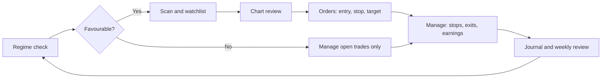

# A weekly swing routine

Skill Review SWNG

After this lesson you can run a repeatable weekly cycle of regime check, scan, orders, management and review in about 30 minutes a day, count your open risk, and start paper block 2.

Before this: every lesson in this part, [Portfolio heat and correlation](../03-risk-and-position-sizing/07-portfolio-heat-and-correlation.md), [Reviewing your trades](../04-psychology-journal-and-paper-trading/05-reviewing-your-trades.md). You need: your journal and a free scanner.

## The idea

The three setups, the regime filter and the exit rules are parts. A routine is how they run together without you deciding from scratch each day. Deciding from scratch is where plans break: you scan when you feel like it, you skip the regime check after a good week, you move a stop because the screen is red.

A **weekly swing routine** is a fixed schedule of small tasks, the same each week, that takes the market from regime to scan to order to management to review. The schedule is the book's suggestion for a 30-minute day. Change the times and keep the order.

## How it works

### The week

| When | Task | Minutes |
|---|---|---|
| Sunday | Weekly review: every trade of the week is in the journal, rule breaks counted, results by setup | 15 |
| Sunday | Regime check: trend, breadth, volatility ([Market regime filters](03-market-regime-filters.md)) and the week's earnings calendar | 8 |
| Sunday | Scan, chart review, watchlist for Monday | 7 |
| Monday to Thursday, after the close | Update trailing stops, note exits and fills, scan, place tomorrow's orders | 12 |
| Friday, after the close | The same, plus a decision on what to carry over the weekend | 12 |
| Before the open each day | Check the orders and any overnight news | 3 |

Sunday uses the full 30 minutes. Each weekday block fits in 15, which leaves room for reading and drills.

### Counting open risk

Each evening, work out the open risk of every position: shares times (current price - stop). Add them up and divide by the account to get portfolio heat, then compare it with the cap in your plan ([Your trading plan](../03-risk-and-position-sizing/10-your-trading-plan.md)).

### Worked example: a week of orders

Account US$25,000, heat cap 5% (the plan's example).

1. Sunday: Index X closes above its 200-day average, 61% of the watchlist universe is above its 50-day average, and no day this week was above a 2% move. All three tests are favourable, so full size.
2. The scan returns 140 stocks from the universe filters. The pullback filter keeps 22. After chart review, 9 stay on the watchlist, and 2 have a trigger bar by Friday.
3. Three trades are open or will be: the open risks are US$249.92, US$249.39 and US$249.48, from the worked examples of lessons 4 to 6. Sum = US$748.79, so heat = 748.79 / 25,000 = 3.0%, under 5%.
4. A fourth trade risking US$250 would bring heat to (748.79 + 250) / 25,000 = 4.0%, still under the cap. The group cap in the plan is checked next.
5. Wednesday: one stock reports earnings on Thursday. The rule is to sell before the report, so the order goes in for the open.

### Keeping the record

The review is where the routine pays. Keep a record by setup: trades, wins, average win in R, average loss in R and expectancy. With 20 trades of one setup, the standard error of the average R is large, which part 3 showed ([Win rate, payoff and expectancy](../03-risk-and-position-sizing/03-win-rate-payoff-and-expectancy.md)). The record shows whether you follow the rules, and only later whether the setup works.

## Try it

1\. Heat: you hold three positions with open risks US$250, US$240 and US$180 on a US$30,000 account. What is heat, and is another US$300 trade allowed under a 5% cap?

Answer

Heat = 670 / 30,000 = 2.23%. Adding 300 gives 970 / 30,000 = 3.23%, under 5%, so yes.

2\. A weekday routine is 3 + 12 minutes and Sunday is 30 minutes. How many minutes a week is that?

Answer

Five weekdays at 15 minutes = 75, plus 30 on Sunday = 105 minutes, which is 1 hour 45.

3\. The index closes below its 200-day average on Wednesday. What does the routine do with new entry orders?

Answer

The regime is unfavourable, so no new long entry orders from the pullback or breakout setups. Open trades are managed with their stops.

## Part check

1\. What is the hold range for a swing trade in this book, and what risk does it carry that a day trade does not?

Answer

2 to 20 trading days. It carries overnight and weekend gap risk, including earnings reports and other news outside the session.

2\. Stock F trades 600,000 shares a day at US$45. Does it pass the US$20 million dollar volume filter?

Answer

600,000 x 45 = US$27 million. Yes.

3\. Index X closes at 4,100 and its 200-day average is 4,150. What is the trend reading, and what happens to the pullback and breakout setups?

Answer

The close is under the average by (4,150 - 4,100) / 4,150 = 1.2%, so trend is unfavourable. No new long trades from either setup.

4\. Pullback: entry US$25.50, stop US$24.70, account US$20,000, risk 1%. Shares? If the prior high is US$28.00, does the trade pass the 2R test?

Answer

Risk per share = 0.80, risk = US$200, shares = 250. Room = 28.00 - 25.50 = 2.50, which is 3.1R. It passes.

5\. Breakout: pivot US$50.00, ATR 1.00, next open US$51.20. Stop and 3R target? Does the open pass the 2 ATR limit?

Answer

The limit is 52.00, and 51.20 is below it, so it passes. Stop = 49.00. Risk per share = 2.20. Target = 51.20 + 3 x 2.20 = US$57.80.

6\. RSI(2) closes at 12, then 8, then 5. Which close is the signal, and when is the entry?

Answer

The close at 8, the first under 10. The entry is the next open after it. The 5 is a continuation, not a new signal.

7\. What win rate breaks even for a 3R target and a 1R loss, before costs?

Answer

1 / (1 + 3) = 25%.

8\. A stock on your watchlist reports earnings in 4 trading days. What does the routine do?

Answer

Exclude it from new entries, since the report falls inside the hold window. If you already hold it, sell before the report unless your plan accepts a loss of more than 1R.

## Practice today (10 min)

| Minutes | Task |
|---|---|
| 4 | Set up paper block 2 in your journal: 20 swing trades of one setup (start with the trend pullback), and a by-setup tab with trades, win rate, average R and expectancy. The block is described in [Paper trading](../practice/paper-trading.md). |
| 3 | Write your weekly schedule from the table above with your own times. |
| 3 | Apply the realism rules on the paper trading page to the block: size from your real account, add fees and slippage, count a limit fill only if price trades through it, one setup at a time, journal both stages. |

The block is a first step. The go-live criteria on the paper trading page ask for 30 trades of one setup, so keep going past 20 if you are not there yet.

## Key terms

- **Weekly swing routine**: a fixed weekly schedule that takes the market from regime check to scan, orders, management and review.
- **Open risk (routine)**: the sum over positions of shares times the distance from price to stop, checked each evening against the heat cap.
- **By-setup record**: the journal's results for each setup alone: trades, win rate, average R and expectancy.

Next: [How day trading differs](../08-day-trading/01-how-day-trading-differs.md)
