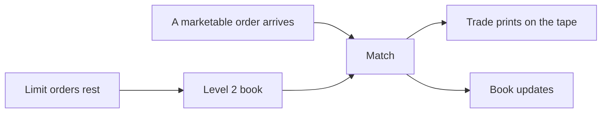

# Level 2 and time and sales

Skill DAY

After this lesson you can read a Level 2 book and a time and sales window, work out the cost of walking the book and the share of trades at the ask, and say what these screens cannot tell you.

Before this: [Bid, ask and the order book](../01-how-markets-work/04-bid-ask-and-the-order-book.md) and [Who is on the other side of your trade](../01-how-markets-work/06-who-is-on-the-other-side.md). You need: a calculator.

## The idea

You have two views of the same stock. One shows orders that are waiting: Level 2, the order book from Part 1, lists the limit orders resting at each price with their sizes. The other shows trades that already happened: **time and sales**, also called the tape, lists each trade with its time, price and size. The book is a set of intentions. The tape is a record of facts.

## How it works

### Reading the book

Here is a made-up book for Stock A at 10:04 a.m. ET.

| Bid size | Bid price | Ask price | Ask size |
|---|---|---|---|
| 1,200 | 25.00 | 25.01 | 600 |
| 800 | 24.99 | 25.02 | 900 |
| 3,000 | 24.98 | 25.03 | 2,500 |

Two numbers come from it. The first is the cost of a large market order, which walks the book (Part 1 lesson 4). The second is the imbalance between the two sides:

\[ I = \frac{B - A}{B + A} \]

- \(B\) is the total size on the bid side across the levels you count, in shares.
- \(A\) is the total size on the ask side across the same levels, in shares.
- \(I\) runs from -1 (all asks) to +1 (all bids), with no unit.

### Worked example: walking the book and the imbalance

1. A market buy of 2,000 shares takes 600 at 25.01, 900 at 25.02 and 500 at 25.03. Cost = 15,006 + 22,518 + 12,515 = US$50,039, so the average price is 50,039 / 2,000 = US$25.0195.
2. Compared with the best ask, 25.01, that is 0.0095 per share of slippage, or US$19.00 on the order.
3. Top two levels: B = 1,200 + 800 = 2,000, A = 600 + 900 = 1,500. I = (2,000 - 1,500) / 3,500 = +0.14.
4. Three levels: B = 5,000, A = 4,000. I = 1,000 / 9,000 = +0.11.

More size sits on the bid, so the book leans toward buyers. A lean of 0.14 is small, and the book can change in a second.

### Reading the tape

Each print is a trade. When the buyer used a market or marketable order, the trade happens at the ask: the buyer was the **aggressor**. A trade at the bid means the seller was the aggressor. Every trade has both a buyer and a seller; the aggressor is the one who crossed the spread.

| Time | Price | Size | Side |
|---|---|---|---|
| 10:04:01 | 25.01 | 300 | At the ask |
| 10:04:01 | 25.01 | 300 | At the ask |
| 10:04:02 | 25.00 | 150 | At the bid |
| 10:04:03 | 25.01 | 500 | At the ask |
| 10:04:05 | 25.00 | 100 | At the bid |
| 10:04:06 | 25.01 | 800 | At the ask |

Shares at the ask = 300 + 300 + 500 + 800 = 1,900. Shares at the bid = 150 + 100 = 250. The share at the ask is 1,900 / 2,150 = 88.4%. Buyers are the ones crossing the spread in this window. A day trader uses this to confirm that a breakout is being bought, not drifting up on thin trades.

### Uses that hold up

1. **Place a limit order** where size is, not in an empty level, so the order is not the first to be skipped.
2. **Estimate slippage** for your size before you enter, as in the example.
3. **Confirm a breakout** by watching whether the prints at the trigger are at the ask and large.
4. **Check the room**: a thick ask size near your entry is an obstacle you can see.

### What you cannot read

- **Hidden orders.** An **iceberg order** shows only a part of its size. A large order can be behind a small display.
- **Off-exchange trades.** Many trades happen off the exchanges (Part 1, [Exchanges and where your order goes](../01-how-markets-work/02-exchanges-and-where-orders-go.md)). They show on the tape after the fact and never appeared in the book.
- **Which venues you see.** A Level 2 feed can be one exchange's book or a combined view, and depth depends on your data subscription. Check what your broker sells.
- **Intent.** Orders can be cancelled in milliseconds. A large bid can be a real buyer or can vanish when the price comes close.

### Spoofing is illegal

**Spoofing** is placing orders you intend to cancel before they execute, to give a false picture of supply or demand. In US futures markets, the Dodd-Frank Act of 2010 added a ban to the Commodity Exchange Act on "bidding or offering with the intent to cancel the bid or offer before execution" ([CFTC, 2013 interpretive guidance on disruptive practices](https://www.cftc.gov/LawRegulation/FederalRegister/finalrules/2013-12365.html)). The CFTC reads it to need intent beyond recklessness. Placing orders you mean to cancel to mislead others in stocks is also manipulation, but this lesson did not confirm a specific SEC or FINRA page, so check their enforcement pages. You never need to do it. And when you read a book, remember that some of the size on it may be someone else's attempt.

### What tests found

Cont, Kukanov and Stoikov studied the best bid and ask of 50 US stocks in NYSE TAQ data and found a roughly linear relation between **order flow imbalance** (the net of buying and selling pressure at the best quotes, from trades, new orders and cancellations) and price changes over short intervals. The slope falls as market depth rises (*The price impact of order book events*, Journal of Financial Econometrics, 2014, volume 12, pages 47 to 88; [arXiv 1011.6402](https://arxiv.org/abs/1011.6402)). The relation explains the price change in the same interval. It is not a test that a retail trader can profit from reading it ahead of time and no test showing that was found for this book.

## Common mistakes

- Treating a large displayed order as a wall that will hold. It can be cancelled or can be one part of a larger hidden order.
- Reading the tape without size. Fifty 100-share prints at the ask can be less than one 5,000-share print at the bid.
- Paying for depth data you do not use. Decide first what decision it changes.

## Try it

1\. Using the book above, a market buy of 1,500 shares. What is the total cost and the average price?

Answer

600 x 25.01 = 15,006 and 900 x 25.02 = 22,518. Total = US$37,524. Average = 37,524 / 1,500 = US$25.016.

2\. Over a window, 3,400 shares trade at the ask and 1,100 at the bid. What share traded at the ask?

Answer

3,400 / 4,500 = 75.6%.

3\. The best bid has 1,800 shares and the best ask has 600. What is the imbalance \(I\)?

Answer

I = (1,800 - 600) / (1,800 + 600) = 1,200 / 2,400 = +0.50.

4\. A 5,000-share bid sits at 24.90 and disappears when the price falls to 25.00. Does that prove spoofing?

Answer

No. Traders cancel orders for many ordinary reasons. Spoofing needs intent to cancel before execution, which the screen cannot show. The point for you is not to rely on one displayed order.

## Practice today (10 min)

| Minutes | Task |
|---|---|
| 4 | In a paper or demo account, open Level 2 and time and sales for one stock. Note which exchanges the book shows. |
| 4 | Watch the tape for two minutes. Count shares at the ask and at the bid and write the share at the ask. |
| 2 | Write one sentence on which decision Level 2 would change in your plan. |

## Key terms

- **Time and sales**: the list of executed trades with time, price and size, also called the tape.
- **Aggressor**: the side of a trade that crossed the spread with a market or marketable order.
- **Order flow imbalance**: the net buying or selling pressure at the best bid and ask.
- **Iceberg order**: an order that displays only part of its size.
- **Spoofing**: placing orders with the intent to cancel them before they execute, to mislead others. It is illegal.

Next: [Execution costs and scalping](08-execution-costs-and-scalping.md)
