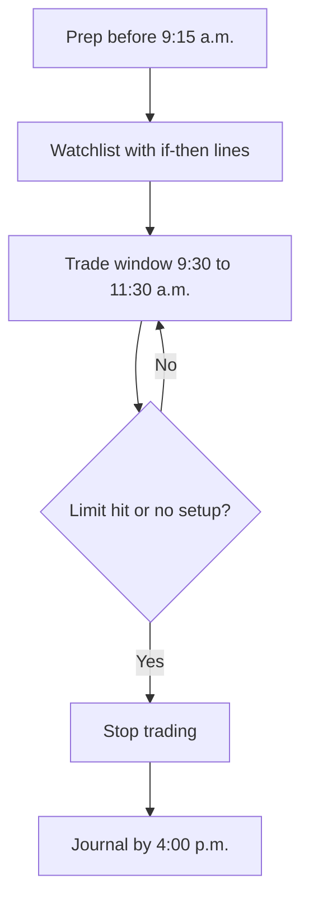

# A day trading routine and limits

Skill Review DAY

After this lesson you can run a day from preparation to journal with a written daily loss limit, size a trade when buying power caps it, and start paper block 3: 20 day trades of one setup.

Before this: every lesson in this part, mainly [Premarket prep](02-premarket-prep.md), [Execution costs and scalping](08-execution-costs-and-scalping.md) and [Your trading plan](../03-risk-and-position-sizing/10-your-trading-plan.md). You need: a calculator and your trading plan file.

## The idea

A day trader makes more decisions in a morning than a swing trader makes in a week, and each one comes with a fast price and a clock. Rules written beforehand do the work. This lesson turns the part into a routine and adds the limits that keep a bad morning from becoming a bad month.

## How it works

### The day

| Time (ET) | Step | Time you spend |
|---|---|---|
| Before 9:15 a.m. | Prep: scan, levels, if-then lines (lesson 2) | 20 minutes |
| 9:15 to 9:30 a.m. | Check the plan file: risk, limit, trade count | 2 minutes |
| 9:30 to 11:30 a.m. | The trade window: only your setup, from the watchlist | By the clock |
| After the window | Stop, or hold a position you already planned to close by 3:55 p.m. | |
| By 4:00 p.m. | Journal every trade, both stages ([trade journal](../practice/trade-journal.md)) | 10 minutes |

The 30-minute-a-day plan in this book does not stretch to a trading window. A day trader needs the first two hours after the open. If you cannot give them, trade swing setups and use this part to understand intraday charts.

### The limits

Part 3 set a daily loss limit of 2R, which is 2% of the account when 1R is 1% ([Your trading plan](../03-risk-and-position-sizing/10-your-trading-plan.md)). On a US$25,000 account that is US$500. A day trader adds three more written limits. The numbers are made up, so adjust them in your plan with a reason.

1. **Trade count**: at most 4 trades a day.
2. **Cooling-off**: after two losses in a row, step away for 15 minutes ([Tilt, revenge trading and FOMO](../04-psychology-journal-and-paper-trading/02-tilt-revenge-and-fomo.md)).
3. **Window**: no new trades after 11:30 a.m. ET.

Count the loss in R with fees and slippage, as in lesson 4. When the day's total reaches -2R, the day is over, even if a setup appears.

### Sizing with a buying power cap

\[ N = \min\left( \left\lfloor \frac{\text{risk amount}}{E - S} \right\rfloor, \left\lfloor \frac{\text{buying power}}{E} \right\rfloor \right) \]

- \(E\) is the entry and \(S\) the stop, in US$ per share.
- The risk amount is 1% of the account, in US$.
- Buying power is the position value your broker allows, in US$. For a cash account it is the settled cash (Part 1, [Settlement, cash accounts and margin](../01-how-markets-work/07-settlement-cash-and-margin.md)).
- \(N\) is the number of shares. The floor brackets round down.

### Worked example: a cap, and a day against the limit

The account is US$25,000 in cash, so the risk amount is US$250.

1. Stock A, entry US$50.00, stop US$49.60. Risk per share = 0.40. Risk-based shares = 250 / 0.40 = 625. The position would be 625 x 50 = US$31,250, more than the cash.
2. Buying-power shares = 25,000 / 50 = 500. \(N = 500\). Actual risk = 500 x 0.40 = US$200, which is 0.8 of the planned 1R.
3. A day: the first two trades lose 1.08R and 1.00R. The total is -2.08R, so the limit is reached after the second trade, and the third setup is not taken.
4. Another day: +1.99R, -1.00R, -1.08R and -1.00R. Running totals: +1.99, +0.99, -0.09, -1.09. The limit is not reached, the trade count of 4 is, and the day ends at -1.09R.

### The US rule that changed

The US pattern day trader rule and its 2026 replacement are explained in [Settlement, cash accounts and margin](../01-how-markets-work/07-settlement-cash-and-margin.md). Canadian margin is in [Margin rules in Canada](../02-accounts-currency-and-taxes/10-margin-rules-in-canada.md). Ask your broker which rules apply to your account.

### Paper block 3

Before any live day trade, run the third paper block of the book: 20 day trades of one setup (the opening range breakout, a VWAP reclaim or fade, or the news first pullback). Use the realism rules on the [paper trading page](../practice/paper-trading.md), and the block's special purpose, which is to add costs and slippage and to keep the daily loss limit.

1. Size from your real account, not the paper balance.
2. Record the spread, commission and slippage of every trade, and compute the cost in R.
3. Count a limit order as filled only if the price trades through it.
4. Journal each trade before and after.
5. Stop the day at the daily loss limit, and follow the cooling-off rule.

The 20 trades are the book's example number, not a tested standard. The go-live criteria on the paper trading page ask for 30 paper trades of the one setup you will trade live, so the trades from block 1 of that setup count toward the 30, and you may need to continue past 20.

## Try it

1\. Your account is US$32,000 in cash and you risk 1%. What is the daily loss limit in R and in dollars?

Answer

1R = US$320. The limit is 2R = US$640, which is also 2% of the account.

2\. Stock A, entry US$80.00, stop US$79.50, account US$30,000 in cash, risk 1%. How many shares, and what is the actual risk?

Answer

Risk amount = US$300. Risk-based shares = 300 / 0.50 = 600, worth US$48,000. Buying-power shares = 30,000 / 80 = 375. N = 375. Actual risk = 375 x 0.50 = US$187.50, which is 0.625 of the planned 1R.

3\. A day's trades are +1.99R, -1.00R, -1.08R and -1.00R. After which trade is the running total lowest, and does the daily limit apply?

Answer

Running totals: +1.99, +0.99, -0.09, -1.09. The lowest is after the fourth trade, at -1.09R. The -2R limit is not reached.

## Part check

1\. The first 5-minute bar of Stock B has open 70.20, high 70.80, low 70.10, close 70.70. Account US$30,000, risk 1%. Give the direction, trigger, stop, shares and 2R target.

Answer

It closed above its open, so long. Trigger 70.81. Stop 70.10 - 0.02 = 70.08. Risk = 0.73. Risk amount = US$300. Shares = 300 / 0.73 = 410.96, so 410. Target = 70.81 + 1.46 = US$72.27.

2\. The cost is US$0.05 per share and the stop is 0.25. What is the cost in R, and the break-even win rate for a 2R target?

Answer

c_R = 0.05 / 0.25 = 0.20R. p* = (1 + 0.20) / 3 = 40.0%.

3\. A stock trades 1,000 shares at a typical price of 10.00, then 3,000 shares at 10.20. What is the VWAP?

Answer

(10.00 x 1,000 + 10.20 x 3,000) / 4,000 = (10,000 + 30,600) / 4,000 = US$10.15.

4\. A Tier 1 stock above US$3.00 has a reference price of US$100. What are the LULD band and the pause rule?

Answer

Tier 1 above US$3.00 has a 5% band: 95.00 to 105.00. If the stock stays at a band edge for 15 seconds, trading pauses for five minutes.

5\. Stock C closed at US$50.00. At what price does Rule 201 start, and what does it do?

Answer

A 10% fall is 5.00, so it starts at US$45.00. For the rest of that day and the next, short sales may not be executed or displayed at or below the national best bid.

6\. Account US$40,000, 1R = 1%. Your first two trades lose 1.05R and 0.98R. Does the daily limit apply?

Answer

Total = -2.03R, past the -2R limit (US$800 on this account). The day is over.

7\. In a window, 2,400 shares traded at the ask and 600 at the bid. What share traded at the ask?

Answer

2,400 / 3,000 = 80.0%.

8\. Your account is US$20,000 in cash, risk 1%, entry US$40.00, stop US$39.50. How many shares?

Answer

Risk amount = US$200. Risk-based shares = 200 / 0.50 = 400, worth US$16,000. Buying-power shares = 20,000 / 40 = 500. The smaller is 400, so 400 shares.

## Practice today (10 min)

| Minutes | Task |
|---|---|
| 5 | Add the day trading limits to your plan file: daily loss limit in R and dollars, trade count, cooling-off, trade window. |
| 3 | Choose the one setup for paper block 3 and write its rules on one page. |
| 2 | Open the [paper trading page](../practice/paper-trading.md) and write the start date of block 3 in your journal. |

## Key terms

- **Trade window**: the hours in which you allow yourself to enter day trades.
- **Trade count limit**: the most trades you take in a day.
- **Buying power cap**: the limit on position size set by the money you can use, not by your risk.

Next: [Filings and EDGAR](../09-company-financials/01-filings-and-edgar.md)
