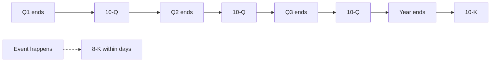

# Filings and EDGAR

<span class="tag tag-data">Data</span> <span class="tag tag-part">FIN</span>

After this lesson you can find a US company's 10-K, 10-Q and 8-K on SEC EDGAR, say what each Item of a 10-K holds, and pull a company's reported numbers into Python.

Before this: [Reading a quote page](../01-how-markets-work/11-reading-a-quote-page.md). You need: a browser, and Python if you try the code box.

## The idea

A quote page gives you a price and a P/E ratio. It does not tell you where the profit comes from, how much debt the company carries, or whether the earnings turn into cash. The company's own filings do, and they are free.

A US company whose shares are listed on an exchange must file reports with the SEC (the Securities and Exchange Commission, the US securities regulator). The SEC publishes them on **EDGAR**, its free online database of filings. You do not need an account.

Through this part we follow one made-up company, Northwind Tools Inc., a profitable mid-size maker of industrial tools. Its **fiscal year** (its 12-month accounting year) ends on December 31. We build its statements for FY2024 and FY2025, and every ratio in the part uses those numbers. All of Northwind's amounts are in US$ millions unless a lesson says otherwise. Northwind is not real, so its filings are not on EDGAR. The steps below work on any real company.

### The three forms you will use

| Form | What it is | How often |
|---|---|---|
| 10-K | The annual report: business description, risks, management's discussion and audited financial statements | Once a year |
| 10-Q | The quarterly report: unaudited statements for a quarter, with a short discussion | Three times a year (the fourth quarter is inside the 10-K) |
| 8-K | A report of a specific event, filed soon after it happens | When something happens |

An 8-K carries news such as an earnings release (Item 2.02, results of operations and financial condition), a new material agreement (Item 1.01) or the departure of a senior officer (Item 5.02). Lesson 11 uses the Item 2.02 filing. Filing deadlines depend on the size of the company, and the SEC's form instructions list them, so check there before you rely on a date.



The diagram shows one fiscal year: three 10-Qs, then one 10-K, with 8-Ks at any point.

### What is inside a 10-K

The SEC's investor education page [How to Read a 10-K](https://www.investor.gov/introduction-investing/getting-started/researching-investments/how-read-10-k) describes the main sections. A 10-K is split into numbered Items. These are the ones you will use most (the Item numbers come from Form 10-K, as of 2026).

| Item | Name | What you get from it |
|---|---|---|
| 1 | Business | What the company sells, to whom, and how it competes |
| 1A | Risk Factors | The risks management says matter, generally listed in order of importance |
| 7 | Management's Discussion and Analysis (MD&A) | Management's own account of the year's results |
| 7A | Quantitative and Qualitative Disclosures About Market Risk | Exposure to interest rates, currencies and prices |
| 8 | Financial Statements and Supplementary Data | The audited statements and their notes |
| 9A | Controls and Procedures | Whether management found weaknesses in its financial controls |

The 10-K also has Item 1B (Unresolved Staff Comments), Item 1C (Cybersecurity, added for years ending on or after December 15, 2023), Item 2 (Properties), Item 3 (Legal Proceedings), Item 5 (the market for the stock, dividends and buybacks), Items 10 to 14 (directors, pay and ownership, often pointed to the proxy statement) and Item 15 (exhibits). The investor.gov page lists a "Selected Financial Data" section; the SEC removed that requirement in 2021, so a current 10-K shows Item 6 as reserved. The notes in Item 8 hold the accounting policies, and later lessons send you there.

<div class="note" markdown>

Read in this order: Item 1 for what the company does, Item 7 for what management says happened, then the statements in Item 8, and Item 1A last, to see what could break the story.

</div>

## How it works

1. Go to the [EDGAR company search](https://www.sec.gov/edgar/search/) and type a name or ticker.
2. On the company's page, filter the filings by form type (10-K, 10-Q or 8-K).
3. Open a filing. Its **filing index** page lists the main document and its exhibits. The main document is the report. Exhibit 99.1 of an earnings 8-K is usually the press release.
4. For the numbers as tables, use the interactive financial report view linked from the filing index (the label varies by filing). It shows each statement as a grid built from **XBRL**, a tagging standard that labels each number in a filing (a revenue figure carries a tag for revenue and a period).
5. To search inside filings, use EDGAR's full-text search for a phrase such as "going concern" or "restatement".

XBRL is why a program can read the numbers. The SEC publishes the tagged facts for every filer through the [EDGAR APIs](https://www.sec.gov/search-filings/edgar-application-programming-interfaces): one call to the "companyfacts" endpoint returns all of a company's XBRL facts.

<details class="code" markdown>
<summary>In code</summary>

The snippet downloads a company's reported annual net income from EDGAR. The SEC asks automated clients to declare who they are in the User-Agent header, so use a real name and a working contact email, and it limits requests to 10 per second (as of 2026, see [Accessing EDGAR data](https://www.sec.gov/search-filings/edgar-search-assistance/accessing-edgar-data)). Replace the placeholder in the header with your own name and email. The CIK is the company's EDGAR number, padded to 10 digits; 0000320193 is Apple's.

```python
# needs internet
import requests

headers = {"User-Agent": "Your Name your.email@example.com"}
cik = "0000320193"
url = f"https://data.sec.gov/api/xbrl/companyfacts/CIK{cik}.json"
facts = requests.get(url, headers=headers, timeout=30).json()

print(facts["entityName"])
rows = facts["facts"]["us-gaap"]["NetIncomeLoss"]["units"]["USD"]
annual = [r for r in rows if r["form"] == "10-K" and r["fp"] == "FY"]
for r in annual[-3:]:
    print(r["end"], r["val"], r["accn"])
```

Each row has the period end, the value and the accession number (the filing's ID). A fact repeats in later filings that show it as a comparison, so expect duplicates.

</details>

<div class="canada" markdown>

### For Canadians

Companies listed only in Canada file on SEDAR+ ([sedarplus.ca](https://www.sedarplus.ca/)), the Canadian Securities Administrators' filing system, not on EDGAR. The matching documents are the annual financial statements, the MD&A and the annual information form (AIF), plus quarterly statements and MD&A. Canadian public companies generally report under IFRS Accounting Standards, and in CAD unless they say otherwise, so check the currency and the standard before you compare with a US company. Many larger Canadian companies that also list in the US file on EDGAR as well.

</div>

## Common mistakes

- Starting with a news story about a result. Open the filing: the story is one writer's reading of it.
- Reading only the Business section. It is written to describe the company well. The Risk Factors and MD&A show what management worries about.
- Treating a 10-Q number as final. A 10-Q is unaudited, and a later 10-K can differ.

## Try it

1\. Northwind's fiscal year ends December 31. How many 10-Qs and how many 10-Ks does it file for one fiscal year?

<details class="solution" markdown>
<summary>Answer</summary>

Three 10-Qs (for the first three quarters) and one 10-K. The fourth quarter appears in the 10-K.

</details>

2\. Which Item of a 10-K do you open to find (a) why gross margin fell, (b) the audited balance sheet, (c) the lawsuits against the company?

<details class="solution" markdown>
<summary>Answer</summary>

(a) Item 7, MD&A. (b) Item 8, Financial Statements and Supplementary Data. (c) Item 3, Legal Proceedings (and the notes in Item 8).

</details>

3\. Northwind announces on the same morning that its chief financial officer is leaving. Which form reports it, and under which Item?

<details class="solution" markdown>
<summary>Answer</summary>

An 8-K, Item 5.02 (departure of directors or certain officers).

</details>

4\. A search shows the phrase "substantial doubt about its ability to continue as a going concern" in a company's 10-K. Where would you read the context, and what does the phrase signal?

<details class="solution" markdown>
<summary>Answer</summary>

In the notes to the financial statements (Item 8) and the risk factors (Item 1A). It signals that management or the auditor doubts the company can pay its bills over the next year. Read the debt and cash flow lessons in this part before anything else.

</details>

<div class="practice" markdown>

## Practice today (10 min)

| Minutes | Task |
|---|---|
| 4 | On EDGAR, find the latest 10-K of a US company you follow. Note the fiscal year end and the filing date. |
| 4 | Open its Item 1A and Item 7. Write the three risks listed first, and one sentence from MD&A about revenue. |
| 2 | Open the interactive financial report and find revenue and net income for the last two years. |

</div>

## Key terms

- **EDGAR**: the SEC's free online database of company filings.
- **10-K**: the annual report, with audited financial statements.
- **10-Q**: the quarterly report, with unaudited statements.
- **8-K**: a report of a specific event, such as an earnings release.
- **Fiscal year**: a company's 12-month accounting year, which may not match the calendar year.
- **Filing index**: the page listing a filing's documents and exhibits.
- **MD&A**: Management's Discussion and Analysis, management's account of the results (Item 7).
- **XBRL**: the tagging standard that labels each number in a filing so software can read it.
- **SEDAR+**: the Canadian filing system for public companies.

Next: [The income statement](02-the-income-statement.md)
