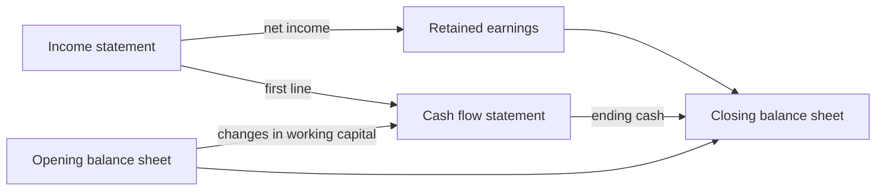

# How the three statements connect

Data FIN

After this lesson you can trace one number through all three statements, check that a set of statements ties out, and test how a change in one line flows to the others.

Before this: [The cash flow statement](04-the-cash-flow-statement.md). You need: a calculator.

## The idea

Lessons 2 to 4 built three statements for Northwind. They are not three separate reports. They are three views of the same events, and a few numbers appear in more than one. If you know where the links are, you can catch a mistake, spot an odd number in a real 10-K, and see what a decision does to the whole company.

The balance sheet is the hub. The income statement explains the change in retained earnings. The cash flow statement explains the change in cash.

Follow the arrows: net income goes to two places, retained earnings (a balance sheet line) and the top of the cash flow statement, and the cash flow statement ends in the cash line of the closing balance sheet.

## How it works

Five links tie Northwind's FY2025 statements together. Check each one in turn.

| Link | Check | Result |
|---|---|---|
| 1. Net income to retained earnings | Opening 275 + net income 165 - dividends 30 | 410, the closing balance |
| 2. Net income to cash flow | First line of CFO | 165 |
| 3. Cash flow to cash | Opening 150 + net change (-20) | 130, the closing balance |
| 4. PP&E | Opening 400 + capex 80 - depreciation 30 | 450, the closing balance |
| 5. Debt | Opening 300 - repayment 25 | 275, the closing balance |

The equity lines tie too: paid-in capital 300 + stock-based pay 30 + option proceeds 10 = 340, and treasury stock 0 - 100 buyback = -100. Then the equation closes: assets 1,075 = liabilities 425 + equity 650.

### Worked example: a change flows through

Suppose Northwind's D&A had been US$10 million higher in FY2025 (US$45 million, not US$35 million), with nothing else changed. Depreciation is a non-cash cost, so follow it:

1. Pretax income falls by 10, from 220 to 210. Tax at 25% falls from 55 to 52.5. Net income = 210 - 52.5 = US$157.5 million, down 7.5.
2. In CFO, net income is down 7.5 but the D&A add-back is up 10. CFO = 205 - 7.5 + 10 = US$207.5 million, up 2.5. The extra 2.5 is the tax saved (25% of 10).
3. Balance sheet: cash is up 2.5, PP&E is down 10 (more depreciation), so assets fall by 7.5.
4. Retained earnings is down 7.5 (lower net income). Liabilities are unchanged.

Assets fell 7.5 and equity fell 7.5, so the statements still balance. A higher non-cash charge cut profit and left cash slightly higher.

### Why this matters when you read a 10-K

A reader who sees only net income can be misled, and a reader who sees only cash can be misled in the other direction. The links tell you which question to ask:

- If net income rose but CFO did not, look at the working capital lines (receivables, inventory). Lesson 10 turns this into a test.
- If cash fell while profit rose, look at the financing section: buybacks, dividends and debt repayments, as in Northwind's case.
- If equity fell while profit rose, look for buybacks (treasury stock) or write-offs.

In a real filing, the links are less tidy. Companies add lines for deferred taxes, foreign currency effects and other income, and ending cash on the cash flow statement may include restricted cash, so it can differ from the balance sheet's cash line by a small amount that the notes explain. When a link looks off by a large amount, read the notes before you decide the filing has an error.

### For Canadians

The same links hold under IFRS. A Canadian company may classify interest paid or dividends paid as operating or financing, because IFRS gives a choice, so compare CFO across companies with that in mind.

## Common mistakes

- Assuming every number appears once. Net income appears in two statements, and a mismatch between them means a missed line, not a rounding error.
- Forgetting the balance sheet check when you change an assumption. If assets do not equal liabilities plus equity after your change, one side was missed.
- Mixing periods. The cash flow statement covers a year. The balance sheet is a date. Use the opening and closing balance sheets to explain the changes.

## Try it

1\. Opening retained earnings are US$410 million. Next year's net income is US$190 million and dividends are US$35 million. What is the closing balance?

Answer

410 + 190 - 35 = US$565 million.

2\. Northwind pays an extra US$10 million dividend in FY2025. What changes on the balance sheet, and does it still balance?

Answer

Cash falls by 10 (assets: 1,075 - 10 = 1,065) and retained earnings fall by 10 (equity: 650 - 10 = 640). Liabilities stay at 425. 425 + 640 = 1,065, so it balances. Net income and CFO do not change; CFF is 10 lower.

3\. Northwind's receivables are US$10 million higher at the end of FY2025 because customers pay later, with sales unchanged. Find the effect on net income, CFO, cash and total assets.

Answer

Net income does not change (the sales were already counted). CFO falls by 10 (receivables rose), so cash falls by 10. Receivables rise by 10, so total assets are unchanged at 1,075: cash down 10, receivables up 10.

4\. Northwind buys a US$40 million machine for cash on the last day of FY2025. What changes?

Answer

Capex of 40 adds to CFI (-40) and PP&E rises by 40. Cash falls by 40. Total assets are unchanged at 1,075. Net income is unchanged this year; depreciation starts next year.

## Practice today (10 min)

| Minutes | Task |
|---|---|
| 6 | In a real 10-K, check three links: net income on the income statement against the first line of the cash flow statement, ending cash against the balance sheet's cash, and the change in retained earnings against net income less dividends. |
| 4 | If one link does not tie, find the note or line that explains the difference. |

## Key terms

- **Tie out**: to check that a number agrees across statements.
- **Roll-forward**: opening balance plus additions minus reductions equals closing balance.
- **Closing balance sheet**: the balance sheet at the end of the period.

Next: [Margins and growth](06-margins-and-growth.md)
