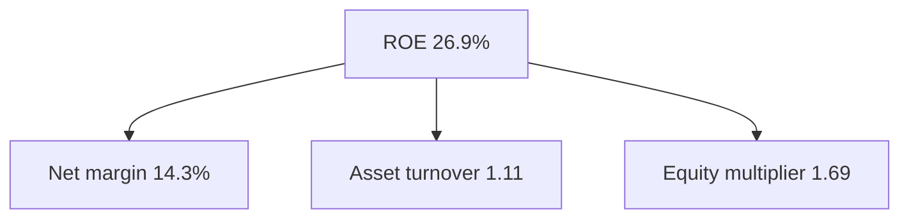

# Returns on capital

Data FIN

After this lesson you can work out ROE, ROA and ROIC, split ROE into its three parts with DuPont, and say what each one does and does not tell you.

Before this: [Margins and growth](06-margins-and-growth.md). You need: a calculator.

## The idea

Margins say how much profit a sales dollar leaves. They do not say how much money was tied up to make those sales. Two companies can each earn US$165 million: one with US$650 million of equity and one with US$3,000 million. The first uses its capital far better. **Returns on capital** divide profit by the money invested, so they measure how well a company turns funding into profit.

A balance sheet is a snapshot and profit covers a year, so we divide by the **average** of the opening and closing balances.

## How it works

### Three returns

\[ \text{ROE} = \frac{NI}{\bar{E}} \qquad \text{ROA} = \frac{NI}{\bar{A}} \qquad \text{ROIC} = \frac{\text{NOPAT}}{\bar{IC}} \]

- \(NI\) is net income, in US$ millions.
- \(\bar{E}\) is average shareholders' equity, and \(\bar{A}\) is average total assets.
- **NOPAT** is net operating profit after tax: EBIT x (1 - \(t\)), the profit from operations as if the company had no debt. \(t\) is the tax rate.
- \(\bar{IC}\) is average invested capital. This book uses debt + equity - cash. It is the money lenders and shareholders put in, less the cash sitting idle.

**Return on equity** (ROE) is profit per dollar of shareholders' money. **Return on assets** (ROA) is profit per dollar of everything the company owns. **Return on invested capital** (ROIC) is operating profit after tax per dollar of the capital that funds the operations. Definitions of ROIC vary between data providers (some subtract only excess cash, others add leases), so when you compare ROIC across sources, check the formula.

### Worked example: the FY2025 returns

Average equity = (575 + 650) / 2 = US$612.5 million. Average assets = (1,000 + 1,075) / 2 = US$1,037.5 million.

1. ROE = 165 / 612.5 = 26.9%.
2. ROA = 165 / 1,037.5 = 15.9%.
3. NOPAT = 235 x (1 - 0.25) = US$176.25 million.
4. Invested capital: FY2024 = 300 + 575 - 150 = 725. FY2025 = 275 + 650 - 130 = 795. Average = US$760 million.
5. ROIC = 176.25 / 760 = 23.2%.

Rounded to one decimal at the end.

ROE is higher than ROA because part of the funding is debt and other liabilities, so equity is a smaller base than assets. ROIC is lower than ROE here because the capital base counts debt as well as equity: the denominator is 760 against 612.5, while NOPAT (176.25) is only a little above net income (165).

### What ROIC means

A company creates value for shareholders when its ROIC is above its **cost of capital**, the return that its lenders and shareholders require. Northwind's ROIC of 23.2% is far above any plausible cost of capital (Part 10 shows how to estimate one: [Discount rates, CAPM and WACC](../10-valuation-and-research/04-discount-rates-capm-and-wacc.md)). A company with an ROIC below its cost of capital destroys value by growing, because each new dollar invested earns less than it costs.

### DuPont

The DuPont breakdown splits ROE into three ratios, so you can see where a high ROE comes from:

\[ \text{ROE} = \frac{NI}{R} \times \frac{R}{\bar{A}} \times \frac{\bar{A}}{\bar{E}} \]

- \(NI / R\) is net margin: profit per dollar of sales (lesson 6).
- \(R / \bar{A}\) is **asset turnover**: sales per dollar of assets. It measures how hard the assets work.
- \(\bar{A} / \bar{E}\) is the **equity multiplier**: assets per dollar of equity. It measures leverage, because more debt means more assets for each dollar of equity.

For Northwind: 165 / 1,150 = 14.3% net margin, 1,150 / 1,037.5 = 1.108 asset turnover, and 1,037.5 / 612.5 = 1.694 equity multiplier. Multiply: 0.1435 x 1.108 x 1.694 = 26.9%, the same ROE.

Two companies with the same ROE can be very different. One may earn a fat margin on few sales (a luxury brand), another a thin margin on high turnover (a grocer), another may reach the same ROE by borrowing heavily. The third kind is the fragile one. Buybacks also raise ROE by shrinking equity, without improving the business: if Northwind had not repurchased US$100 million of shares, its year-end equity would be 750, not 650.

### For Canadians

Canadian banks and insurers report ROE as a headline number, but their balance sheets are mostly financial assets, so ROA and DuPont work differently there. Treat banks as a separate case.

## Common mistakes

- Using only year-end equity or assets. If the balance sheet changed a lot during the year, the average is fairer. Say which one you used.
- Reading a high ROE as safe. A company with little equity left after losses or buybacks can show a huge ROE.
- Comparing ROIC from two data providers without checking the formula. Use the same one for every company.

## Try it

1\. A company has net income of US$50 million, average assets of US$500 million and average equity of US$200 million. Find ROA, ROE and the equity multiplier.

Answer

ROA = 50 / 500 = 10.0%. ROE = 50 / 200 = 25.0%. Equity multiplier = 500 / 200 = 2.5. Check: ROA x multiplier = 10.0% x 2.5 = 25.0%.

2\. A company has EBIT of US$100 million, a 21% tax rate, debt of US$300 million, equity of US$400 million and cash of US$100 million. Find NOPAT, invested capital and ROIC.

Answer

NOPAT = 100 x (1 - 0.21) = US$79 million. Invested capital = 300 + 400 - 100 = US$600 million. ROIC = 79 / 600 = 13.2%.

3\. Northwind's FY2025 year-end equity is US$650 million. Using year-end equity instead of the average, what is ROE? How would it differ if the US$100 million buyback had not happened (equity US$750 million)?

Answer

165 / 650 = 25.4%. Without the buyback: 165 / 750 = 22.0%. The buyback lifts ROE by 3.4 percentage points without changing profit.

4\. Company X has a net margin of 5%, asset turnover of 3.0 and an equity multiplier of 2.0. Company Y has a margin of 20%, turnover of 0.5 and a multiplier of 3.0. Compare their ROE.

Answer

X: 0.05 x 3.0 x 2.0 = 30.0%. Y: 0.20 x 0.5 x 3.0 = 30.0%. They have the same ROE from very different mixes: X from turnover, Y from margin and leverage.

## Practice today (10 min)

| Minutes | Task |
|---|---|
| 6 | For a real company, collect net income, EBIT, equity, total assets, debt and cash for the last two years. Compute ROE, ROA and ROIC with the formulas above. |
| 2 | Do the DuPont split of its ROE. |
| 2 | Write which of the three parts drives the result. |

## Key terms

- **Return on equity (ROE)**: net income divided by average shareholders' equity.
- **Return on assets (ROA)**: net income divided by average total assets.
- **NOPAT**: net operating profit after tax, EBIT times one minus the tax rate.
- **Invested capital**: debt plus equity minus cash.
- **Return on invested capital (ROIC)**: NOPAT divided by average invested capital.
- **Cost of capital**: the return lenders and shareholders require on the money they supply.
- **DuPont breakdown**: ROE split into net margin, asset turnover and the equity multiplier.
- **Asset turnover**: revenue divided by average total assets.
- **Equity multiplier**: average total assets divided by average equity.

Next: [Debt, liquidity and solvency](08-debt-liquidity-and-solvency.md)
