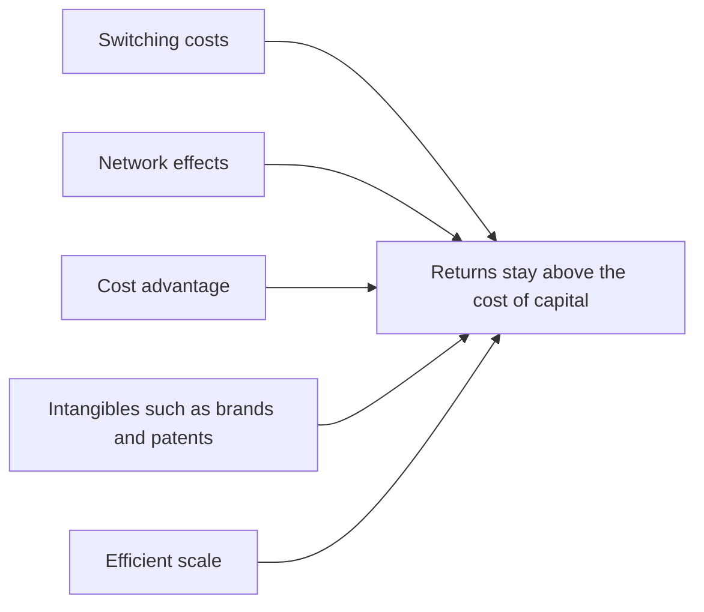

# Moats and qualitative research

Skill VAL

After this lesson you can test whether a company has a durable advantage, find the qualitative facts a valuation needs in its filings, and read analyst ratings and price targets for what they are.

Before this: [Comparables and industry KPIs](07-comparables-and-industry-kpis.md), [Returns on capital](../09-company-financials/07-returns-on-capital.md), [Filings and EDGAR](../09-company-financials/01-filings-and-edgar.md). You need: a calculator.

## The idea

A DCF needs a forecast of growth and margins for years. Numbers alone cannot say why a company's margins should stay high. When a business earns more than its cost of capital, competitors arrive. The reasons some companies keep that profit are qualitative: customers who will not leave, costs rivals cannot match, a position that cannot be copied.

A **moat** is a lasting competitive advantage that protects a company's returns from competition. This lesson names the common sources, shows how to look for them in the numbers, and then covers what to read and what to make of analyst opinions.

## How it works

### Sources of a moat

- Switching costs: changing supplier is expensive or risky, as with software that holds a customer's data and workflows.
- Network effects: each new user makes the service more useful to the others, as with a marketplace or payments network.
- Cost advantage: lower unit costs from scale, location or process, so the company can match a rival's price and still earn a profit.
- Intangible assets: brands, patents and regulatory licences that others cannot copy or get.
- Efficient scale: a market too small for a second profitable player, such as a pipeline between two cities.

Claiming a moat is easy, and many claims fail. Test it in the numbers.

### Testing a moat with numbers

1. Return on invested capital (ROIC) above the WACC, for many years. A moat that works shows up as a persistent spread.
2. Stable or rising gross margin. Falling margins with rising sales suggest price cuts to keep customers.
3. Market share steady or growing, from the 10-K or industry data.
4. Pricing power: the company raised prices and kept its customers.

Northwind's FY2025 ROIC is 23.2% (part 9, lesson 7) and its WACC is 9.1%. The gap lets us put a number on the value created each year, the **economic profit**:

\[ \text{Economic profit} = \text{NOPAT} - \text{WACC} \times \text{invested capital} \]

- NOPAT is US$176.25 million and invested capital is US$760 million (average, from part 9).

Economic profit = 176.25 - 0.091 x 760 = 176.25 - 69.16 = US$107.1 million a year. That is the surplus over what shareholders and lenders require. One year proves little, because a single good year can come from a cycle. Check ten years of ROIC in the filings. A company with a spread that lasts through a downturn has some advantage. A company that earns the spread only at the top of the cycle does not.

### Where to find the qualitative facts

| Source | What to look for |
|---|---|
| 10-K, Item 1 (Business) | How the company makes money, customers, competitors, regulation |
| 10-K, Item 1A (Risk factors) | What management says could go wrong; look at what changed since last year |
| 10-K, Item 7 (MD&A) | Management's explanation of results and the drivers of margins |
| Proxy statement | Pay and incentives (does pay reward growth at any cost?), insider ownership, board |
| Earnings calls ([Earnings season and earnings calls](../09-company-financials/11-earnings-season-and-calls.md)) | Tone, questions analysts ask, what management avoids |
| Customers, suppliers and competitors | Reviews, job posts, rivals' filings |

Quality of management cannot be measured directly. Look for evidence: capital allocation (did past acquisitions earn their cost of capital?), honesty about mistakes, and whether stated targets were hit.

### Analyst ratings and price targets

A **sell-side analyst** works for a brokerage or bank and publishes research on a group of stocks. Each report has a **rating** (usually some form of buy, hold or sell, in the firm's own words) and often a **price target**, the analyst's estimate of the stock price after a set time, usually 12 months.

A target is built from a valuation. For example, an analyst takes FY2027 EPS for Northwind of US$2.37 (net income of US$240.9 million on 101.5 million shares) and applies 22 times: 2.374 x 22 = US$52.22. Against a US$50.00 price that is 4.4% upside, which is below the 9.4% cost of equity (lesson 4). A target above the price does not by itself mean the stock is a good investment, because it must also beat the return you require.

What ratings and targets are:

- A summary of one person's valuation and a source of earnings estimates. The average of analysts' forecasts, the consensus, is what a forward P/E is usually built on.
- Information about changes: an upgrade, or a revision of estimates, tells you what an informed person now believes.

What they are not:

- Independent advice. A brokerage may also earn fees from the companies it covers. FINRA Rule 2241 ([FINRA, as of 2026](https://www.finra.org/rules-guidance/rulebooks/finra-rules/2241)) makes member firms manage these conflicts, forbids investment banking staff from approving research, and requires each report to disclose the analyst's and the firm's financial interests, define each rating with its time horizon, and show the share of the firm's ratings that are buy, hold and sell. Read those disclosures.
- A forecast with a probability. A target is a single number without a range.
- Tailored to you. Your horizon, tax account and risk are not the analyst's.

## Common mistakes

- Naming a moat without testing it. If ROIC has not exceeded the WACC through a downturn, call it a hope.
- Reading only the business section of the 10-K. The risk factors and the proxy hold the facts that change the thesis.
- Treating an analyst target as a promise.

## Try it

1\. A company has NOPAT of US$90 million, invested capital of US$600 million and a WACC of 9%. Find the ROIC and the economic profit.

Answer

ROIC = 90 / 600 = 15.0%. Economic profit = 90 - 0.09 x 600 = 90 - 54 = US$36 million.

2\. A second company has ROIC of 8% with a WACC of 9% and US$600 million of invested capital. NOPAT is 48. What is its economic profit?

Answer

48 - 0.09 x 600 = 48 - 54 = -US$6 million. It destroys value, however profitable it looks.

3\. An analyst expects FY2027 EPS of US$3.00 for Stock A and applies 18 times. The stock is at US$50 and your required return is 10%. What is the target, the upside, and does it beat your requirement?

Answer

Target = 3.00 x 18 = US$54. Upside = 54 / 50 - 1 = 8.0%. It does not beat 10% (and a dividend would have to make up the 2 percentage points).

4\. Name two sources of a moat and one number that would test each.

Answer

Switching costs: customer retention (net revenue retention above 100%). Cost advantage: gross or operating margin above peers across years.

## Practice today (10 min)

| Minutes | Task |
|---|---|
| 5 | Open the latest 10-K of a company you follow. Read Item 1A and write the three new or changed risks. |
| 3 | Find its ROIC for the last 5 years in a data site and write whether it stayed above 10%. |
| 2 | Write which moat source, if any, explains it. |

## Key terms

- **Moat**: a lasting competitive advantage that protects a company's returns.
- **Switching costs**: the cost or risk to a customer of changing supplier.
- **Network effect**: a service that gains value as more people use it.
- **Economic profit**: NOPAT minus the WACC times invested capital.
- **Sell-side analyst**: an analyst at a brokerage or bank who publishes research on stocks.
- **Rating**: an analyst's summary opinion, such as buy, hold or sell.
- **Price target**: an analyst's estimate of the stock price after a set time, usually 12 months.
- **Consensus**: the average of analysts' estimates.

Next: [Writing a stock pitch](09-writing-a-stock-pitch.md)
