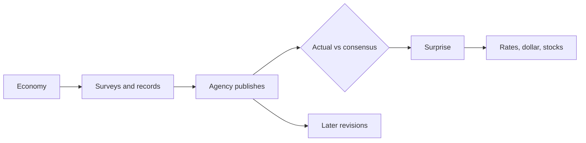

# How the economy is measured

Data MACRO

After this lesson you can name the agency behind each major US economic release, compare a headline number with its consensus, and say how revisions change what you thought you knew.

Before this: [What a stock is and why prices move](../01-how-markets-work/01-what-a-stock-is.md). The math book teaches the measurement maths, so this lesson links it: [percent change vs percentage points](https://faiyaz-svg.github.io/MathFromTheGroundUp/07-economics-math/01-measuring-the-economy/02-percent-change-vs-percentage-points/), [growth rates and CAGR](https://faiyaz-svg.github.io/MathFromTheGroundUp/07-economics-math/01-measuring-the-economy/03-growth-rates-and-cagr/), [index numbers](https://faiyaz-svg.github.io/MathFromTheGroundUp/07-economics-math/01-measuring-the-economy/04-index-numbers/), [GDP and the circular flow](https://faiyaz-svg.github.io/MathFromTheGroundUp/07-economics-math/01-measuring-the-economy/05-gdp-and-the-circular-flow/), [nominal vs real GDP](https://faiyaz-svg.github.io/MathFromTheGroundUp/07-economics-math/01-measuring-the-economy/06-nominal-vs-real-gdp-and-the-deflator/), [CPI and inflation](https://faiyaz-svg.github.io/MathFromTheGroundUp/07-economics-math/01-measuring-the-economy/07-cpi-and-inflation/) and [unemployment and labour statistics](https://faiyaz-svg.github.io/MathFromTheGroundUp/07-economics-math/01-measuring-the-economy/08-unemployment-rate-and-labour-statistics/). You need: a calculator.

## The idea

It is a Friday morning. A government agency publishes a report that says employers added 190,000 jobs last month. Within a second, stock index futures, Treasury yields and the dollar all move. Yet 190,000 is a large number of jobs by any normal standard. Why did anything move at all?

Because the market had already priced a guess. Economists at banks and data firms publish forecasts before each release, and a data vendor collects them. The middle of those forecasts is the **consensus**. If the consensus was 150,000, the report beat it by 40,000. That gap is the **surprise**, and the surprise is what moves prices, for the same reason a good earnings report that was fully expected leaves a stock flat (lesson 1 of Part 1, [What a stock is and why prices move](../01-how-markets-work/01-what-a-stock-is.md)).

This part is about the data as a trader meets it. The maths of CPI or GDP is in the math book. What you need here is who publishes each number, when, what the headline hides, and how the number can change later.

### Who publishes what

In the US, no single office owns "the economy". Each agency measures its own piece. The table lists the ones you will meet most, as of 2026.

| Publisher | Releases | How often |
|---|---|---|
| Bureau of Labor Statistics (BLS), part of the Labor Department | CPI, PPI, the jobs report (Employment Situation), JOLTS | Monthly |
| Bureau of Economic Analysis (BEA), part of the Commerce Department | GDP, personal income and outlays (which includes the PCE price index) | GDP quarterly, income and outlays monthly |
| Census Bureau, part of the Commerce Department | Retail sales and other business surveys | Monthly |
| Department of Labor | Weekly jobless claims | Weekly |
| The Federal Reserve | FOMC decisions, minutes, the balance sheet (H.4.1) | Eight meetings a year, balance sheet weekly |
| ISM and S&P Global | Purchasing managers' indexes (PMIs), surveys of purchasing executives | Monthly |
| Conference Board and University of Michigan | Surveys of consumer confidence and sentiment | Monthly |

BLS, BEA, Census and the Labor Department are federal statistical agencies, and their data is free to use. ISM, S&P Global, the Conference Board and the University of Michigan are private or university groups that run surveys; their headline numbers are public and the detail is often behind a paywall. Canada's equivalent is Statistics Canada, covered in lesson 11.

## How it works

Three habits make a release readable. Each one is a step.

1. Know whether you are looking at a level, a change or a rate. A level is the number itself (a CPI index of 320). A change is the difference from a prior period. A rate is a percentage change. A monthly percentage change and a yearly one are different numbers for the same data, and the report says which it is quoting.
2. Compare the headline with the consensus, then read the details. The **headline** is the single number in the report's first line. The details are the parts beneath it: a jobs report has the job count, the unemployment rate and the earnings figure, and they can point in different directions.
3. Expect revisions. A **revision** is a later change to a number the agency already published, as more survey responses arrive. The first estimate is a best guess from incomplete data.

The surprise is a plain difference:

\[ S = A - C \]

- \(S\) is the surprise, in the same unit as the release (jobs, percent, index points).
- \(A\) is the actual number reported.
- \(C\) is the consensus forecast.

A monthly rate can also be written as a yearly pace, called **annualizing**, to compare it with a yearly target:

\[ r_{\text{annual}} = (1 + r_{\text{month}})^{12} - 1 \]

- \(r_{\text{month}}\) is the monthly percentage change as a fraction (0.3% is 0.003).
- \(r_{\text{annual}}\) is the yearly pace if that monthly change repeated for 12 months.

### Worked example: a mixed jobs report

Everything here is made up. The consensus for job growth is +150,000, and the actual number is +190,000. The consensus for the unemployment rate is 4.2%, and the actual is 4.3%.

1. Job surprise: S = 190,000 - 150,000 = +40,000.
2. Unemployment surprise: 4.3% - 4.2% = +0.1 percentage points (a rate, so the change is in percentage points, not a percent).
3. Revisions: the two earlier months were published as +110,000 and +90,000, a total of 200,000. They are now revised to +95,000 and +75,000, a total of 170,000. The revision is 170,000 - 200,000 = -30,000.
4. Net new information on jobs: +40,000 - 30,000 = +10,000.

The headline beat by 40,000, but once the revision is counted, the picture improved by only 10,000 jobs, and the unemployment rate rose. A trader who reads only the headline sees a strong report. One who reads the details sees a mixed one.

A monthly price change of 0.3% is a yearly pace of 1.003^12 - 1 = 3.66%, which is 3.7% when rounded. A monthly change of 0.5% is 1.005^12 - 1 = 6.17%, which is 6.2% when rounded. A 0.2 percentage point difference in one month looks small, and it is a 2.5 percentage point difference in yearly pace.

The diagram shows the path from the economy to a price move.

## Common mistakes

- Reading a level as news. A jobs total of 160 million is a level. The number that matters on release day is the monthly change and how it compares with the consensus.
- Mixing up percent and percentage points. A rate rising from 4.2% to 4.3% is up 0.1 percentage points, which is a 2.4% rise in the rate itself. Say which you mean.
- Treating the first print as final. Payrolls and GDP are both revised, and the revision can be larger than the surprise.

## Try it

1\. The consensus for a retail sales report is +0.4% for the month, and the actual is +0.1%. What is the surprise?

Answer

S = 0.1 - 0.4 = -0.3 percentage points. The report missed the consensus.

2\. A price index rises 0.4% in a month. What is the yearly pace if that repeated for 12 months?

Answer

1.004^12 - 1 = 0.0491, which is 4.9%.

3\. Payrolls were first reported as +120,000, then revised to +150,000. The next month's first print is +100,000 against a consensus of +130,000. How big is the revision to the earlier month, and what is the new month's surprise?

Answer

Revision = 150,000 - 120,000 = +30,000. New surprise = 100,000 - 130,000 = -30,000. Net, the two cancel: +30,000 - 30,000 = 0.

4\. Which agency publishes the CPI, which the GDP report, and which the retail sales report?

Answer

CPI: BLS. GDP: BEA. Retail sales: the Census Bureau.

## Practice today (10 min)

| Minutes | Task |
|---|---|
| 5 | Open the [BLS release calendar](https://www.bls.gov/schedule/news_release/) and list the next three releases, with date and time. |
| 3 | Open the BEA [release schedule](https://www.bea.gov/news/schedule) and write down the next GDP and personal income and outlays dates. |
| 2 | Start a page in your [trade journal](../practice/trade-journal.md) with the heading "Macro log", and write today's date and the next release you will track. |

## Key terms

- **Consensus**: the middle of economists' forecasts for a release, collected by a data vendor.
- **Surprise**: the actual number minus the consensus.
- **Headline**: the main number in a report's first line.
- **Revision**: a later change to a number an agency already published.
- **Annualizing**: restating a one-month change as the yearly pace it would give if repeated for 12 months.

Next: [The Fed and the FOMC](02-the-fed-and-the-fomc.md)
