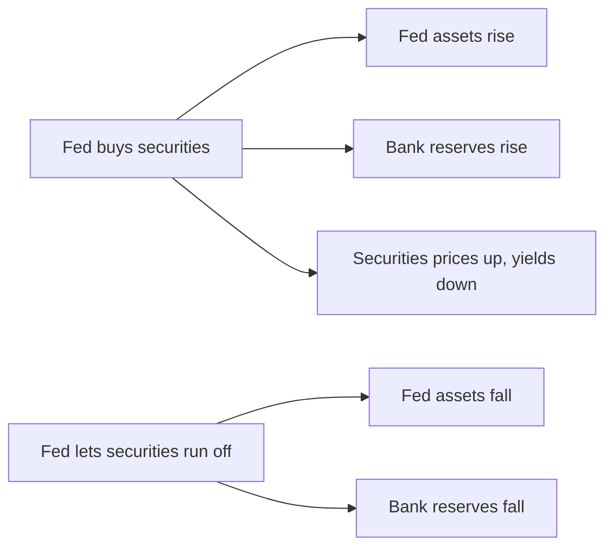

# QE, QT and liquidity

Idea MACRO

After this lesson you can describe the Fed's balance sheet, say what quantitative easing and quantitative tightening do to it, and say why "liquidity" explanations of stock prices are loose.

Before this: [The Fed and the FOMC](02-the-fed-and-the-fomc.md) and [Interest rates and asset prices](03-interest-rates-and-asset-prices.md). You need: a calculator.

## The idea

The Fed has a second tool besides the policy rate. When the policy rate is already near zero and the Fed wants to ease further, or when it wants to tighten without a rate hike, it can change the size of its own balance sheet.

A **balance sheet** lists what an institution owns (assets) and what it owes (liabilities). The Fed's assets are mostly securities it has bought, such as Treasuries. Its liabilities include currency in circulation and the **reserve balances** that banks hold at the Fed. The Fed publishes the figures weekly in the H.4.1 release, "Federal Reserve Balance Sheet: Factors Affecting Reserve Balances", every Thursday, generally at 4:30 p.m. ([Federal Reserve H.4.1](https://www.federalreserve.gov/releases/h41/), as of 2026).

## How it works

**Quantitative easing** (QE) means the Fed buys longer-term securities in large amounts. The Fed's own description says that after the global financial crisis it relied on large-scale purchases of longer-term securities through 2014 ([Federal Reserve, open market operations](https://www.federalreserve.gov/monetarypolicy/openmarket.htm)). Three things happen when it buys.

1. The Fed's assets rise by the amount bought.
2. The seller is paid with new reserve balances credited to a bank, so reserves rise by the same amount.
3. The extra demand for the securities raises their prices and lowers their yields, which lowers longer-term borrowing costs. Lesson 3 showed why a lower discount rate raises present values.

**Quantitative tightening** (QT) runs the other way. The Fed lets securities mature without replacing them, or sells them, so assets shrink and reserves in the banking system fall. The mechanics have extra steps, because the Treasury's own account at the Fed sits in between, but the direction is the same: a smaller balance sheet and fewer reserves.

### Worked example: a made-up balance sheet

Amounts are in US$ billions and are made up. The Fed starts with US$6,000 billion of assets, and US$3,000 billion of reserve balances.

QE: the Fed buys US$200 billion of securities.

1. Assets: 6,000 + 200 = US$6,200 billion.
2. Reserves: 3,000 + 200 = US$3,200 billion, a rise of 200 / 3,000 = 6.7%.

QT: the Fed then lets US$150 billion run off.

3. Assets: 6,200 - 150 = US$6,050 billion.
4. Reserves: 3,200 - 150 = US$3,050 billion.

The net change in assets is 6,050 - 6,000 = US$50 billion, which is 50 / 6,000 = 0.8% of the original. The balance sheet grew in QE and shrank in QT, and the net is small.

### Liquidity

Traders use **liquidity** in two ways, and both appear in this part. In Part 1 it meant how easily you can trade an asset without moving its price ([Bid, ask and the order book](../01-how-markets-work/04-bid-ask-and-the-order-book.md)). In macro it means the amount of money and reserves in the financial system. The Fed's balance sheet is one source, and the Fed also sets floors and ceilings on the overnight rate with other tools. The Fed describes an overnight reverse repo facility, used since 2015 as a supplementary tool, and standing repo operations since 2021 that help provide a ceiling on rates ([Federal Reserve, open market operations](https://www.federalreserve.gov/monetarypolicy/openmarket.htm), as of 2026).

Commentary often says that "liquidity" explains stock prices: more reserves, higher stocks. Treat that as a loose claim. Prices also respond to profits, rates and risk appetite, and these move together, so the balance sheet's own effect is hard to separate. This lesson cites no test showing that weekly changes in the balance sheet predict stock returns.

What the balance sheet does affect, more directly, is the Treasury market and long-term yields, which Part 12 covers ([Treasuries and TIPS](../12-bonds-and-the-yield-curve/02-treasuries-and-tips.md), and [The yield curve](../12-bonds-and-the-yield-curve/03-the-yield-curve.md)).

## Common mistakes

- Calling QE "printing money" and stopping there. The Fed swaps reserves for securities. The effect on yields and lending is what matters, and it is debated.
- Expecting QT to be the exact reverse of QE. The mechanics and the market's starting point are different.
- Using one weekly balance sheet number as a trading signal. Weekly H.4.1 changes are noisy and have no proven link to short-term stock moves.

## Try it

1\. The Fed starts with US$5,000 billion of assets and buys US$300 billion of securities. What are its new assets, in US$ billions, and the percentage rise?

Answer

5,000 + 300 = 5,300. Rise = 300 / 5,000 = 6.0%.

2\. The Fed's assets are US$5,300 billion and it runs off US$100 billion. What is the new total?

Answer

5,300 - 100 = US$5,200 billion.

3\. When does the Fed publish its weekly balance sheet?

Answer

The H.4.1 comes out every Thursday, generally at 4:30 p.m. ET (as of 2026).

4\. Name the two meanings of liquidity in this book.

Answer

How easily an asset trades without moving its price (Part 1), and the amount of money and reserves in the financial system (this lesson).

## Practice today (10 min)

| Minutes | Task |
|---|---|
| 6 | Open the latest [H.4.1](https://www.federalreserve.gov/releases/h41/). Write total assets, and the change from a week ago and a year ago. |
| 2 | Compute the percentage change from a year ago. |
| 2 | Write in your [trade journal](../practice/trade-journal.md) one sentence on whether the balance sheet is growing or shrinking. |

## Key terms

- **Balance sheet (the Fed's)**: the Fed's assets (securities it owns) and liabilities (currency and reserves).
- **Reserve balances**: deposits banks hold at the Fed.
- **Quantitative easing (QE)**: large purchases of longer-term securities by the central bank.
- **Quantitative tightening (QT)**: shrinking the balance sheet by letting securities mature or selling them.
- **Liquidity (macro)**: the amount of money and reserves in the financial system.
- **H.4.1**: the Fed's weekly balance sheet release.

Next: [The Bank of Canada and a macro week](11-the-bank-of-canada-and-a-macro-week.md)
