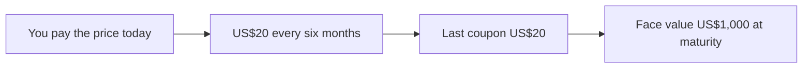

# Bond prices and yields

<span class="tag tag-idea">Idea</span> <span class="tag tag-part">BOND</span>

After this lesson you can price a bond from its coupon and yield, say why price and yield move in opposite directions, tell current yield from yield to maturity, and separate a bond's clean price from what you actually pay.

Before this: [Interest rates and asset prices](../11-macro-and-economic-data/03-interest-rates-and-asset-prices.md), and [Present value, NPV and bond prices](https://faiyaz-svg.github.io/MathFromTheGroundUp/07-economics-math/04-more-tools/01-present-value-npv-and-bond-prices/) in the math book. You need from the math book: a payment received in \(n\) periods is worth \(1/(1+i)^n\) today. You also need a calculator.

## The idea

A company or government can borrow from many investors at once by selling a **bond**: a loan split into small pieces that trade like stocks. Bond A is made up. It promises to pay US$1,000 on a fixed date 10 years from now, and US$40 a year in interest until then, paid as US$20 every six months.

The pieces have names. The US$1,000 is the **face value** (also called par), the amount repaid at the end. The date it is repaid is the **maturity**. The US$40 a year is the **coupon**, and as a share of face value it is the **coupon rate**: 40 / 1,000 = 4.00%. The coupon is fixed at issue and never changes.

What changes is the price. A bond quote is a percentage of face value, so a price of 92.205 means US$922.05 for a US$1,000 bond. Why pay less than US$1,000 for Bond A? Because new bonds from similar borrowers may pay 5%, and nobody pays full price for a 4% bond then. The price falls until Bond A earns about 5% too. That 5% is the bond's yield.



## How it works

### Price from yield

The price of a bond is the present value of everything it will pay, discounted at the market's yield. US convention is semiannual: coupons arrive twice a year, and the yield is quoted as a yearly rate compounded twice.

\[ P = \sum_{k=1}^{N} \frac{C}{(1+i)^k} + \frac{F}{(1+i)^N} \]

- \(P\) is the price today, in US$.
- \(F\) is the face value, US$1,000 here.
- \(C\) is the coupon paid each period: coupon rate times \(F\), divided by 2. For Bond A, 0.04 x 1,000 / 2 = US$20.
- \(i\) is the yield per period: the quoted yield \(y\) divided by 2.
- \(N\) is the number of periods: 2 per year times the years to maturity. For Bond A, \(N = 20\).

The first part adds up the coupons, the second discounts the face value. The coupons are a level stream, so the sum has the closed form \( C \times \frac{1-(1+i)^{-N}}{i} \), which the math book derives.

<div class="example" markdown>

### Worked example: a 10-year bond at a 5% yield

The market yield is 5%, so \(i\) = 0.05 / 2 = 0.025 and \(N\) = 20.

1. Coupons: 20 x (1 - 1.025^-20) / 0.025 = US$311.78.
2. Face value: 1,000 / 1.025^20 = US$610.27.
3. Price: 311.78 + 610.27 = US$922.05, quoted as 92.205.

At a 4% yield (equal to the coupon rate) the price is exactly US$1,000.00. The table shows other yields.

</div>

The table shows the pattern for Bond A.

| Yield | Price (US$) | Change from US$1,000 | Current yield |
|---|---|---|---|
| 3% | 1,085.84 | +8.6% | 3.68% |
| 4% | 1,000.00 | 0.0% | 4.00% |
| 5% | 922.05 | -7.8% | 4.34% |
| 6% | 851.23 | -14.9% | 4.70% |

Price and yield move in opposite directions: a higher yield discounts each future dollar more. The move is not symmetric. A 1 percentage point fall from 4% to 3% adds 8.6%, while a rise to 5% takes away 7.8%. Lesson 4 explains this with convexity ([Duration and convexity](04-duration-and-convexity.md)).

### Current yield and yield to maturity

The **current yield** is the annual coupon divided by the price:

\[ \text{CY} = \frac{\text{annual coupon}}{P} \]

For Bond A at US$922.05 it is 40 / 922.05 = 4.34%. It is quick to compute, and it ignores the gain you collect as the price returns to US$1,000 at maturity.

The **yield to maturity** (YTM) is the single yearly rate that makes the present value of all the bond's payments equal to its price. It answers: what do I earn per year if I buy at this price, collect every coupon and hold to maturity? There is no closed form for \(y\). You find it by trial or with a solver (see the code below). A bond priced at US$950 with Bond A's payments has a YTM of 4.63%, above its current yield of 4.21%, because the US$50 discount is also part of the return.

This is the number quoted as "the yield". It assumes you hold to maturity, the issuer pays in full, and you reinvest each coupon at the same rate. Part 11 shows how Fed decisions move yields ([The Fed and the FOMC](../11-macro-and-economic-data/02-the-fed-and-the-fomc.md)).

A real reference point: the US Treasury's 10-year par yield was 4.92% on November 20, 2026 ([Treasury daily par yield curve rates](https://home.treasury.gov/resource-center/data-chart-center/interest-rates/TextView?type=daily_treasury_yield_curve&field_tdr_date_value=2026)). A **par yield** is the coupon rate at which a new bond of that maturity would sell at face value. Bond A, with its 4% coupon, would price at US$928.02 at that yield.

### Clean price, dirty price and accrued interest

Bonds trade on any day, but coupons arrive on two. If you buy 60 days after the last coupon, the seller earned those 60 days of interest, and you pay for them. This is **accrued interest**:

\[ \text{Accrued} = C \times \frac{d}{D} \]

- \(C\) is the coupon for the period, US$20.
- \(d\) is the days since the last coupon, 60.
- \(D\) is the days in the coupon period, 182.

Accrued interest is 20 x 60 / 182 = US$6.59. The **clean price** is the quoted price without it. The **dirty price** (or full price) is what you pay: clean plus accrued. With a clean price of US$922.05, you pay US$928.64. Quotes are clean so the price does not jump up each day as interest builds and drop on the coupon date. At the next coupon you receive the full US$20, so the US$6.59 comes back.

## In code

The price formula and a bisection search for the yield (price falls as yield rises, so bisection works).

<details class="code" markdown>
<summary>In code</summary>

```python
def bond_price(face, coupon_rate, y, years):
    i = y / 2
    n = int(round(2 * years))
    coupon = face * coupon_rate / 2
    pv_coupons = sum(coupon / (1 + i) ** k for k in range(1, n + 1))
    return pv_coupons + face / (1 + i) ** n


def ytm(price, face, coupon_rate, years):
    lo, hi = 0.0, 0.5
    for _ in range(80):
        mid = (lo + hi) / 2
        if bond_price(face, coupon_rate, mid, years) > price:
            lo = mid
        else:
            hi = mid
    return mid


print(round(bond_price(1000, 0.04, 0.05, 10), 2))   # 922.05
print(round(100 * ytm(950, 1000, 0.04, 10), 2))     # 4.63
```

</details>

## Common mistakes

- Reading "yield" as the coupon rate. The coupon rate is fixed at issue. The yield changes every day with the price.
- Comparing bonds by current yield. It leaves out the gain or loss at maturity, so compare yield to maturity.
- Forgetting accrued interest in a trade's cost. The quote is clean, and the cash that leaves your account is dirty.

## Try it

1\. A 5-year bond has face value US$1,000 and a 3% coupon (US$15 every six months). The market yield is 4%. What is the price, and the current yield?

<details class="solution" markdown>
<summary>Answer</summary>

\(i\) = 0.02 and \(N\) = 10. Coupons: 15 x (1 - 1.02^-10) / 0.02 = US$134.74. Face: 1,000 / 1.02^10 = US$820.35. Price = US$955.09. Current yield = 30 / 955.09 = 3.14%.

</details>

2\. Bond A trades at US$950. Is its yield to maturity above or below its current yield of 4.21%? Say why, then give the YTM.

<details class="solution" markdown>
<summary>Answer</summary>

Above. At a discount you also earn the US$50 gain as the price returns to face value. Solving the price formula gives 4.63%.

</details>

3\. Treasury par yields for 10-year maturity were 4.92% on November 20, 2026. What would Bond A be worth at that yield?

<details class="solution" markdown>
<summary>Answer</summary>

\(i\) = 0.0246 and \(N\) = 20. The price is US$928.02, 7.2% below face value.

</details>

4\. You buy Bond A 91 days into a 182-day coupon period at a clean price of US$1,000. What accrued interest do you pay, and what is the dirty price?

<details class="solution" markdown>
<summary>Answer</summary>

Accrued = 20 x 91 / 182 = US$10.00. Dirty price = 1,000 + 10 = US$1,010.00.

</details>

<div class="practice" markdown>

## Practice today (10 min)

| Minutes | Task |
|---|---|
| 5 | Open the Treasury's daily par yield curve page (link above) and write down the 2-year, 5-year and 10-year yields for the latest date. |
| 5 | Price Bond A at each of those three yields with the code above. Which price is lowest, and why? |

</div>

## Key terms

- **Bond**: a loan sold in pieces that pays fixed interest and returns the face value at maturity.
- **Face value (par)**: the amount repaid at maturity, usually US$1,000 per bond.
- **Maturity**: the date the face value is repaid.
- **Coupon**: the fixed interest a bond pays, per year or per period.
- **Coupon rate**: the yearly coupon divided by face value.
- **Yield**: the yearly return a bond earns at its current price.
- **Current yield**: the annual coupon divided by the price.
- **Yield to maturity (YTM)**: the yearly rate that makes the present value of all payments equal the price.
- **Accrued interest**: interest earned since the last coupon date, paid by the buyer to the seller.
- **Clean price**: the quoted price without accrued interest.
- **Dirty price**: the clean price plus accrued interest, the amount paid.

Next: [Treasuries and TIPS](02-treasuries-and-tips.md)
