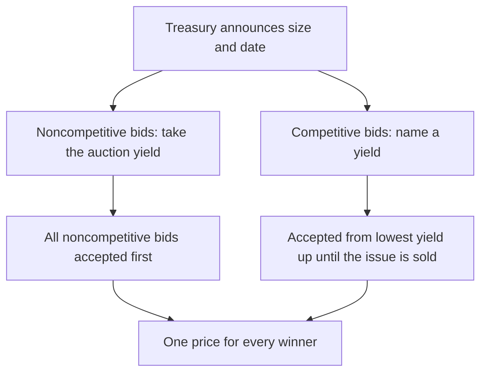

# Treasuries and TIPS

Idea BOND

After this lesson you can name the kinds of US Treasury securities, price a Treasury bill from its discount rate, adjust a TIPS for inflation, and work out the inflation rate the bond market is pricing in.

Before this: [Bond prices and yields](01-bond-prices-and-yields.md). You need: a calculator.

## The idea

The US government borrows by selling securities at auctions run by the Treasury. They are called **Treasuries**. The market treats the US government as the safest US dollar borrower, so a Treasury yield is the base rate that other bonds and loans are measured against. Part 10 used it as the risk-free rate in CAPM ([Discount rates, CAPM and WACC](../10-valuation-and-research/04-discount-rates-capm-and-wacc.md)).

Treasuries differ by maturity and by how they pay. As of 2026, [TreasuryDirect](https://www.treasurydirect.gov/marketable-securities/) lists these.

| Security | Maturity | How it pays |
|---|---|---|
| Bill | 4, 6, 8, 13, 17, 26 and 52 weeks | No coupon. Sold at a discount, pays face value at maturity |
| Note | 2, 3, 5, 7 and 10 years | Fixed coupon every six months |
| Bond | 20 and 30 years | Fixed coupon every six months |
| TIPS | 5, 10 and 30 years | Fixed coupon on a principal that tracks inflation |
| Floating rate note | 2 years | Interest paid every three months, moves with 13-week bill rates |

The minimum purchase for bills, notes, bonds and TIPS is US$100 ([TreasuryDirect, bills](https://www.treasurydirect.gov/marketable-securities/treasury-bills/)).

### How an auction works

Treasury sells each issue at an auction. Bidders say how much they want and, for large bidders, the yield they will accept. There are two kinds of bid. A **noncompetitive bid** accepts whatever yield the auction sets, and is limited to US$10 million per auction. A **competitive bid** names a yield, goes through a bank, broker or dealer, and can win at most 35% of the offering. The Treasury accepts all noncompetitive bids first, then competitive bids from the lowest yield upward until the issue is sold. Every winner gets the same yield as the highest accepted bid, which is why it is called a single-price auction ([TreasuryDirect, how auctions work](https://www.treasurydirect.gov/auctions/how-auctions-work/), as of 2026).

## How it works

### Bills and the discount basis

A bill pays no coupon. You buy it below face value and receive face value at maturity, and the difference is your interest. Bills are quoted with a **discount rate**, which measures the discount as a share of face value, on a 360-day year:

\[ P = F \left(1 - \frac{d \times t}{360}\right) \]

- \(P\) is the price in US$.
- \(F\) is the face value in US$.
- \(d\) is the discount rate as a fraction (4.00% is 0.04).
- \(t\) is the days to maturity.

The Treasury gives the same formula for bill prices ([TreasuryDirect, pricing](https://www.treasurydirect.gov/marketable-securities/understanding-pricing/)). The discount rate is not a return: it divides by face value, not by what you paid, and it uses 360 days. To compare a bill with a bond you want the **bond-equivalent yield** (also called the investment rate): the gain divided by the price, on a 365-day year.

\[ y_{BEY} = \frac{F - P}{P} \times \frac{365}{t} = \frac{365\, d}{360 - d\, t} \]

The second form is the one the New York Fed uses to convert the 3-month discount rate ([Estrella and Trubin, 2006](https://www.newyorkfed.org/medialibrary/media/research/current_issues/ci12-5.pdf), footnote 4). The two forms are the same algebra, valid for bills up to six months. The official rules are in 31 CFR 356, Appendix B.

### Worked example: a 26-week bill

A bill with US$10,000 face value matures in 182 days. The auction discount rate is 4.00%.

1. Price: 10,000 x (1 - 0.04 x 182 / 360) = US$9,797.78.
2. Interest: 10,000 - 9,797.78 = US$202.22.
3. Bond-equivalent yield: (202.22 / 9,797.78) x (365 / 182) = 4.14%.

The 4.00% discount rate understates the 4.14% you earn, because it divides by US$10,000 and not by the US$9,797.78 you paid.

### TIPS and inflation

A regular Treasury pays fixed dollars. If prices rise 4% a year, those dollars buy less each year. **Treasury Inflation-Protected Securities** (TIPS) fix this by adjusting the principal for inflation. The adjustment uses the Consumer Price Index (CPI). The coupon rate is fixed at auction, but it is paid on the adjusted principal, so the dollar coupon moves with the principal. At maturity you receive the adjusted principal or the original principal, whichever is greater, so deflation cannot take you below par ([TreasuryDirect, TIPS](https://www.treasurydirect.gov/marketable-securities/tips/), as of 2026).

\[ \text{Adjusted principal} = F \times \text{index ratio}, \qquad \text{index ratio} = \frac{\text{CPI reference at settlement}}{\text{CPI reference at issue}} \]

### Worked example: a TIPS after a year of inflation

A made-up TIPS has US$1,000 face value and a 1.50% coupon rate. CPI rises 3.00% from issue, so the index ratio is 1.0300.

1. Adjusted principal: 1,000 x 1.0300 = US$1,030.00.
2. Coupon for the year: 0.015 x 1,030.00 = US$15.45 (US$7.725 every six months).
3. If CPI later falls so the ratio is 0.9800, the maturity payment is the larger of 1,000 x 0.98 = US$980.00 and US$1,000.00, so US$1,000.00.

The yield on a TIPS is a **real yield**: it is earned on top of inflation. The yield on a regular Treasury of the same maturity is a **nominal yield**. The gap between them is the **breakeven inflation rate**, the yearly inflation at which both investments earn the same:

\[ \pi_{BE} = \frac{1 + y_{nom}}{1 + y_{real}} - 1 \approx y_{nom} - y_{real} \]

- \(y_{nom}\) is the nominal Treasury yield for the same maturity, as a fraction.
- \(y_{real}\) is the TIPS real yield for that maturity, as a fraction.
- \(\pi_{BE}\) is the breakeven inflation rate, as a yearly fraction.

With made-up numbers, a 10-year nominal yield of 4.00% and a 10-year TIPS real yield of 1.80% give 1.04 / 1.018 - 1 = 2.16%, close to the quick estimate of 4.00 - 1.80 = 2.20%. If inflation averages more than 2.16% over 10 years, the TIPS did better. If less, the regular note did. Breakeven is a market price, so it also holds a premium for inflation risk and liquidity. It is not a forecast. The Treasury publishes real yields daily next to the nominal yields.

### For Canadians

The Government of Canada also sells bills and coupon bonds. The Bank of Canada publishes benchmark yields for 2, 3, 5, 7 and 10 years and a long-term series, plus a long-term real return bond series, on its [Canadian bonds page](https://www.bankofcanada.ca/rates/interest-rates/canadian-bonds/) (as of 2026). The math book prices a Government of Canada bond in its [worked example](https://faiyaz-svg.github.io/MathFromTheGroundUp/07-economics-math/04-more-tools/01-present-value-npv-and-bond-prices/). How bond interest is taxed in each account is covered in [Account types for trading](../02-accounts-currency-and-taxes/01-account-types-for-trading.md).

## Common mistakes

- Treating the discount rate as the yield. Convert to the bond-equivalent yield first.
- Reading breakeven inflation as a forecast. It also moves with liquidity and risk premiums.
- Assuming a TIPS always beats a regular Treasury. It gains only if inflation exceeds the breakeven.

## Try it

1\. A 91-day bill with US$10,000 face value is auctioned at a 4.20% discount rate. What is the price and the bond-equivalent yield?

Answer

Price = 10,000 x (1 - 0.042 x 91 / 360) = US$9,893.83. Gain = US$106.17. Yield = 365 x 0.042 / (360 - 0.042 x 91) = 4.30%.

2\. A TIPS with US$5,000 face value and a 2.00% coupon rate has an index ratio of 1.0450. Find the adjusted principal and the coupon for one year.

Answer

Adjusted principal = 5,000 x 1.0450 = US$5,225.00. Coupon = 0.02 x 5,225 = US$104.50 a year.

3\. A 5-year nominal yield is 3.80% and the 5-year TIPS real yield is 1.60% (both made up). What is the breakeven inflation rate?

Answer

1.038 / 1.016 - 1 = 2.17%. The quick estimate is 3.80 - 1.60 = 2.20 percentage points.

4\. You expect inflation to average 3% a year over the 10 years in the 4.00% / 1.80% example. Which does better, the note or the TIPS?

Answer

The TIPS. Its return is about the real yield plus inflation: 1.018 x 1.03 - 1 = 4.85%, above the note's 4.00%. Breakeven was 2.16%, and 3% is above it.

## Practice today (10 min)

| Minutes | Task |
|---|---|
| 4 | On the Treasury's rates page, find the latest 10-year nominal par yield and the 10-year real yield. Compute breakeven inflation with the exact formula. |
| 3 | Open the TreasuryDirect auction results page and find the last 13-week bill auction: write the discount rate and the investment rate it reports. |
| 3 | Check your answer: does the investment rate match the formula above for the discount rate and the days to maturity? |

## Key terms

- **Treasuries**: debt securities sold by the US Treasury.
- **Treasury bill**: a Treasury with a maturity of one year or less that pays no coupon.
- **Treasury note**: a Treasury of 2 to 10 years that pays a coupon.
- **Treasury bond**: a Treasury of 20 or 30 years that pays a coupon.
- **Noncompetitive bid**: an auction bid that accepts the yield the auction sets.
- **Competitive bid**: an auction bid that names the yield the bidder will accept.
- **Single-price auction**: an auction in which every winner gets the same yield.
- **Discount rate**: a bill's discount as a share of face value, on a 360-day year.
- **Bond-equivalent yield**: a bill's gain divided by its price, on a 365-day year.
- **TIPS**: Treasury securities whose principal is adjusted for CPI inflation.
- **Index ratio**: the reference CPI at settlement divided by the reference CPI at issue.
- **Real yield**: a yield measured after inflation, as on a TIPS.
- **Nominal yield**: a yield not adjusted for inflation.
- **Breakeven inflation rate**: the yearly inflation at which a nominal Treasury and a TIPS of the same maturity earn the same.

Next: [The yield curve](03-the-yield-curve.md)
