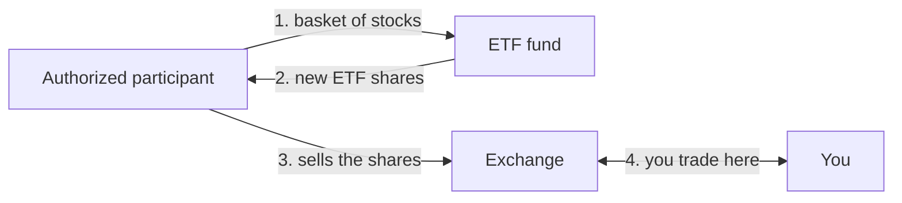

# How ETFs work

<span class="tag tag-idea">Idea</span> <span class="tag tag-part">ETF</span>

After this lesson you can say how an ETF's price stays close to the value of what it holds, work out a premium or discount, and explain why US ETFs rarely pay out capital gains.

Before this: [Indexes, sectors and market cap](../01-how-markets-work/10-indexes-sectors-and-market-cap.md), [Who is on the other side](../01-how-markets-work/06-who-is-on-the-other-side.md). You need: a calculator.

## The idea

You want to own 500 stocks, and you have US$2,000. A fund solves this: many people pool money, and one manager holds the stocks. An old-style **mutual fund** sells and buys back its shares at one price a day, set after the market closes. An **exchange-traded fund** (ETF) is a fund whose shares trade on an exchange all day, like a stock. You place a limit order ([Order types](../01-how-markets-work/05-order-types.md)) and someone takes the other side at a price you can see.

That raises a problem. If the fund holds US$250 million of stocks and the shares trade freely, why would the share price equal what the stocks are worth? Nobody sets it. The answer is a side channel that works at a much larger size than yours.

## How it works

The fund's **net asset value** (NAV) per share is what one share's slice of the holdings is worth:

\[ \text{NAV} = \frac{A - L}{N} \]

- \(A\) is the market value of everything the fund holds, in US$.
- \(L\) is what the fund owes (accrued fees, for example), in US$.
- \(N\) is the number of fund shares outstanding.
- NAV is in US$ per share.

The **market price** is the last trade on the exchange. The two can differ. The gap, as a percentage of NAV, is a **premium** when the price is above NAV and a **discount** when it is below:

\[ \text{premium or discount} = \frac{P - \text{NAV}}{\text{NAV}} \]

- \(P\) is the ETF's market price, in US$.

### Creation and redemption

Only a few large firms, called **authorized participants** (APs), can deal directly with the fund. An AP exchanges a **basket** (a list of the fund's stocks in the fund's proportions) for a block of new ETF shares called a **creation unit**. The AP can also hand a creation unit back and receive the basket: that is **redemption**. The SEC's ETF rule (Rule 6c-11) describes an ETF in these terms, as a fund that issues and redeems creation units with authorized participants for baskets and a cash balancing amount ([SEC's Rule 6c-11 release, Federal Register](https://www.federalregister.gov/documents/2018/07/31/2018-14370/exchange-traded-funds), as of 2026).



This is what keeps the price near NAV. If the ETF trades above NAV, an AP can buy the stocks, create shares and sell them at the higher price. That adds supply and pushes the price down. If it trades below NAV, the AP buys the cheap ETF shares, redeems them for the basket and sells the stocks. That adds demand and pushes the price up. The AP's profit is the gap, and chasing it closes the gap. (A market maker, from [Who is on the other side](../01-how-markets-work/06-who-is-on-the-other-side.md), often fills the AP role.)

<div class="example" markdown>

### Worked example: a premium and its arbitrage

Fund X is a made-up ETF. It holds US$250,000,000 of stocks, owes nothing, and has 5,000,000 shares. A creation unit is 50,000 shares.

1. NAV = 250,000,000 / 5,000,000 = US$50.00.
2. Fund X trades at US$50.12. Premium = (50.12 - 50.00) / 50.00 = 0.24%.
3. An AP buys a basket worth 50,000 x 50.00 = US$2,500,000 and delivers it. It receives 50,000 new shares and sells them at 50.12 for US$2,506,000.
4. Profit before costs = 2,506,000 - 2,500,000 = US$6,000.
5. Now the price is US$49.88. Discount = (49.88 - 50.00) / 50.00 = -0.24%. The AP buys 50,000 shares for US$2,494,000, redeems them for a basket worth US$2,500,000, and gains US$6,000 before costs.

For a large ETF of liquid stocks, many firms compete for that US$6,000, so gaps stay small. The mechanism is the same when the gap is larger.

</div>

### Where the gap can widen

The AP closes the gap at a cost, and it needs prices for the holdings. The gap is wider when the holdings are hard to price or trade: an ETF of foreign stocks while those markets are closed, or a bond ETF when bonds are hard to trade (part 12 shows this in [Bond ETFs, and rates against stocks](../12-bonds-and-the-yield-curve/06-bond-etfs-and-rates-vs-stocks.md)). The market price is then the better guide to what you can get, and NAV is a calculated estimate. Use limit orders, and look at the spread ([Bid, ask and the order book](../01-how-markets-work/04-bid-ask-and-the-order-book.md)).

## Why US ETFs are tax efficient

A mutual fund that has to pay a leaving investor sells stocks for cash. If it sells shares of Stock A bought at US$10 and now worth US$40, it realizes a gain of US$30 a share, and the law makes the fund pass that gain on to all its holders, including you if you did not sell. An ETF usually pays the AP in stocks instead of cash. This is an **in-kind** redemption, and the SEC's release notes that in-kind baskets can bring tax efficiencies to an ETF and its investors (same Federal Register release). The fund can hand over its lowest-cost shares and does not realize the gain.

Suppose a fund sells 1,000 shares of Stock A (cost US$10, price US$40) to meet redemptions. The gain is 1,000 x 30 = US$30,000. A holder of 1% of the fund is allocated US$300 of that gain with no sale of their own. The in-kind route avoids that, which is why many US ETFs have paid little or no capital gains. It is a tendency, not a promise: check the fund's distribution history.

<div class="canada" markdown>

### For Canadians

A Canadian-listed ETF trades on the TSX in CAD with the same creation and redemption idea, and its prospectus names the dealers that create and redeem units. The capital gains point above is about US funds under US rules. Whether a Canadian-listed ETF pays out gains depends on its own structure and distribution history, so read its page before you assume it. Lesson 3 covers the choice between the two listings ([US-listed or Canadian-listed ETFs](03-us-vs-canadian-listed-etfs.md)).

</div>

## In code

The premium is one line. Try it with the numbers above.

<details class="code" markdown>
<summary>In code</summary>

```python
def premium(price, nav):
    return (price - nav) / nav

nav = 250_000_000 / 5_000_000
print(nav, round(100 * premium(50.12, nav), 2), round(100 * premium(49.88, nav), 2))
```

</details>

## Common mistakes

- Treating NAV as a price you can trade at. You trade at the market price, and NAV is a value calculated from the holdings.
- Using a market order on a thinly traded ETF. The spread can be wide and the fill can be far from NAV.
- Assuming "ETF" means diversified or safe. An ETF holds whatever its rules say, including one narrow theme.

## Try it

1\. An ETF holds US$180,000,000 of assets, owes US$600,000 and has 3,000,000 shares. What is its NAV?

<details class="solution" markdown>
<summary>Answer</summary>

(180,000,000 - 600,000) / 3,000,000 = 179,400,000 / 3,000,000 = US$59.80.

</details>

2\. The same ETF trades at US$59.95. What is the premium?

<details class="solution" markdown>
<summary>Answer</summary>

(59.95 - 59.80) / 59.80 = 0.0025, so a 0.25% premium.

</details>

3\. At that premium, what does an AP do, and what happens to the ETF's price?

<details class="solution" markdown>
<summary>Answer</summary>

The AP buys the basket, delivers it for new shares and sells them at the higher price. The extra supply pushes the price back toward NAV.

</details>

4\. A fund sells 2,000 shares of Stock B (cost US$20, price US$26) for cash to meet a redemption. What gain does it realize, and how much is allocated to a holder of 0.5% of the fund?

<details class="solution" markdown>
<summary>Answer</summary>

Gain = 2,000 x (26 - 20) = US$12,000. A 0.5% holder is allocated 0.005 x 12,000 = US$60.

</details>

<div class="practice" markdown>

## Practice today (10 min)

| Minutes | Task |
|---|---|
| 4 | Open the quote page of any ETF in your broker app. Write its price and the fund's NAV from the issuer's page. Compute the premium or discount. |
| 3 | Write the bid, ask and spread of the same ETF. Compute the spread as a percentage of the ask. |
| 3 | Find the fund's capital gains distributions from the last five years on the issuer's page. Write them down. |

</div>

## Key terms

- **Mutual fund**: a pooled fund whose shares are bought and sold at one price per day.
- **Exchange-traded fund (ETF)**: a pooled fund whose shares trade on an exchange all day.
- **Net asset value (NAV)**: the value of the fund's holdings less liabilities, per share.
- **Premium or discount**: the percentage gap between an ETF's market price and its NAV.
- **Authorized participant (AP)**: a firm allowed to create and redeem ETF shares directly with the fund.
- **Basket**: the list of stocks, in the fund's proportions, swapped for ETF shares.
- **Creation unit**: the block of ETF shares an AP receives for a basket.
- **Redemption**: handing a creation unit back to the fund for the basket.
- **In-kind**: paid in securities instead of cash.

Next: [Index funds, fees and tracking](02-index-funds-fees-and-tracking.md)
