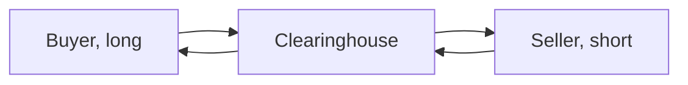

# What futures are

Idea FUT

After this lesson you can say what a futures contract is, work out the profit or loss on a long or a short position, and tell cash settlement from physical delivery.

Before this: [Short selling](../01-how-markets-work/08-short-selling.md), [R-multiples](../03-risk-and-position-sizing/02-r-multiples.md). You need: a calculator.

## The idea

A made-up stock index, Index X, stands at 6,000.00 points. You think it will rise over the next few hours. You could buy a fund that tracks it, which costs real cash for the full value of the shares. Or you could buy one **futures contract** on the index.

A futures contract is an agreement to buy or sell an asset at a price fixed today, on a date in the future. The asset is the **underlying**: an index, a barrel of oil, a bond, a currency. The contract has no price tag of its own in the sense a share does. Its price is the agreed price for the underlying, quoted the way the underlying is quoted (index points for an index).

Three features make a futures contract different from a private agreement between two people.

- It is **standardised**. The exchange fixes the size, the quality of the underlying, the expiry dates and the way prices move. Every contract of the same product and month is identical, so they can be traded freely.
- It is **exchange-traded**. Buyers and sellers meet on an exchange such as CME Group, with a public order book like the one in [Bid, ask and the order book](../01-how-markets-work/04-bid-ask-and-the-order-book.md).
- It is **cleared**. After a trade, a **clearinghouse** steps between the two sides and becomes the seller to every buyer and the buyer to every seller. You never depend on the other trader paying you. You depend on the clearinghouse, which collects deposits from everyone to cover its risk. The next lesson covers those deposits.

## Long and short

Buying a futures contract is going **long**. You gain when the price rises. Selling one is going **short**. You gain when the price falls. Selling short in futures needs no borrowed shares: you open the position with a sale, and the rules are the same as for a long position. This is a difference from stock short selling in [Short selling](../01-how-markets-work/08-short-selling.md), where you must borrow shares first.

Each contract has a **multiplier**, the dollars you gain or lose for a one-unit move in the quoted price. For the micro index contract in this part, the multiplier is US$5 per index point. The profit or loss on a position is:

\[ \text{P\&L} = (P_{\text{exit}} - P_{\text{entry}}) \times M \times n \quad \text{for a long position} \]

- \(P_{\text{entry}}\) and \(P_{\text{exit}}\) are the prices you traded at, in index points.
- \(M\) is the multiplier, in US$ per point.
- \(n\) is the number of contracts, a count.
- For a short position, reverse the sign: \((P_{\text{entry}} - P_{\text{exit}}) \times M \times n\).

### Worked example: a long and a short

Both trades use a made-up micro contract on Index X with a multiplier of US$5 per point.

1. Long 2 contracts at 6,000.00, exit at 6,025.00. The move is +25.00 points. P&L = 25.00 x 5 x 2 = US$250.00.
2. Short 1 contract at 6,000.00, buy back at 6,018.50. The price rose 18.50 points against you. P&L = (6,000.00 - 6,018.50) x 5 x 1 = -US$92.50.

The first trade controls 2 x 6,000 x 5 = US$60,000 of index exposure. It does not need US$60,000 in cash. It needs a deposit, which lesson 2 covers.

## Settlement at expiry

Every contract has an **expiration**, the last day it trades. A contract still open then is **settled**, in one of two ways.

With **cash settlement**, no asset changes hands. The exchange compares the contract price with a final settlement price based on the underlying, and the difference is paid in cash. Stock index futures settle this way, since nobody can deliver an index.

With **physical delivery**, the seller delivers the asset and the buyer pays for it. A crude oil contract on CME Group's NYMEX exchange, for example, calls for delivery of 1,000 barrels. Brokers do not want retail clients to receive barrels, and they usually require you to close or roll a physically settled position before the delivery period starts. Check your broker's cut-off dates before you hold one near expiry.

Most traders never reach settlement. They close the position before expiry with an opposite trade: sell what they bought, or buy back what they sold. Lesson 4 shows how to move a position to the next contract ([Expiry and rolling](04-expiry-and-rolling.md)).

## What you do not get

A share gives you ownership, a vote and dividends. A futures contract gives you only the price exposure. There are no dividends and no voting. The cost of holding a futures position instead of the underlying shows up in the price, which lesson 5 explains ([Contango, backwardation and basis](05-contango-backwardation-and-basis.md)).

### For Canadians

Futures trade on US exchanges (CME Group) and on the Montreal Exchange in Canada. Lesson 7 covers which you can reach from Wealthsimple and IBKR Canada, and the tax questions ([Futures in Canada](07-futures-in-canada.md)).

## Common mistakes

- Thinking the contract price is what you pay. A futures price is the agreed price for later. You post a deposit, not the full value.
- Forgetting the multiplier. A 10-point move is US$50 on one micro contract in this part, not US$10.
- Holding a physically settled contract into delivery by accident. Know the last day your broker lets you hold it.

## Try it

1\. You are long 3 contracts of the Index X micro future (US$5 per point) at 5,950.00 and sell at 5,982.50. What is the P&L?

Answer

The move is 5,982.50 - 5,950.00 = 32.50 points. P&L = 32.50 x 5 x 3 = US$487.50.

2\. You are short 4 contracts at 6,040.00 and buy them back at 6,052.25. What is the P&L?

Answer

(6,040.00 - 6,052.25) x 5 x 4 = -12.25 x 20 = -US$245.00.

3\. Why does an index future use cash settlement and a crude oil future physical delivery?

Answer

An index is a number, not an asset, so nobody can deliver it. The only possible settlement is a cash payment based on the index. Crude oil is a physical good that can be delivered at a named location.

4\. Who is on the other side of your futures trade after it is cleared?

Answer

The clearinghouse. It becomes the buyer to every seller and the seller to every buyer, so your claim is against it and not against the trader who took the other side.

## Practice today (10 min)

| Minutes | Task |
|---|---|
| 5 | Open a futures quote page in your broker or on CME Group's site. Write down the product name, the multiplier and whether it settles in cash or by delivery. |
| 5 | Pick one price move (for example 12 points) and compute the P&L for 1 long and 1 short contract on your product. |

## Key terms

- **Futures contract**: a standardised agreement to buy or sell an underlying at a fixed price on a set future date.
- **Underlying**: the asset a futures contract is based on.
- **Standardised**: the exchange fixes the contract's size, expiry and terms, so every contract of a product and month is identical.
- **Clearinghouse**: the body that becomes buyer to every seller and seller to every buyer.
- **Long**: a position that gains when the price rises.
- **Short**: a position that gains when the price falls.
- **Multiplier**: the dollars gained or lost per one-point move in the contract price.
- **Expiration**: the last day a contract trades.
- **Cash settlement**: the final difference is paid in cash and no asset is delivered.
- **Physical delivery**: the seller delivers the underlying and the buyer pays for it.

Next: [Margin, leverage and mark to market](02-margin-leverage-and-mark-to-market.md)
