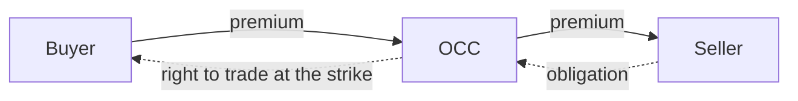

# Calls and puts

Idea OPT

After this lesson you can say what a call and a put give the buyer and the seller, read an option's terms, and work out what one contract costs and what it can win or lose.

Before this: [Short selling](../01-how-markets-work/08-short-selling.md), [Settlement, cash and margin](../01-how-markets-work/07-settlement-cash-and-margin.md). You need: a calculator.

## The idea

Stock A trades at US$50. You think it could rise past US$55 in the next three months, but you do not want to tie up US$5,000 for 100 shares, and you want a fixed limit on how much you can lose.

An **option** is a contract that gives its buyer a right, not an obligation, to trade a stock at a fixed price. You pay a fee for the right. If the trade turns out to be useful, you use the right. If not, you let it lapse and lose only the fee.

There are two kinds:

- A **call** gives the buyer the right to buy the stock at a fixed price.
- A **put** gives the buyer the right to sell the stock at a fixed price.

The seller of the option (the **writer**) takes the other side. The seller gets the fee and must trade at the fixed price if the buyer asks.

## The terms of a contract

Every listed option is defined by the same few terms.

| Term | Meaning | Stock A example |
|---|---|---|
| Underlying | The stock the option is about | Stock A |
| Type | Call or put | Call |
| **Strike price** | The fixed price at which the stock can be bought or sold | US$50 |
| **Expiry** | The last day the option exists | January 15, 2027 |
| **Premium** | The price of the option, quoted per share | US$3.25 |
| **Contract multiplier** | Shares covered by one contract | 100 |

The multiplier matters most. A US equity option contract normally covers 100 shares (as of 2026, per the [OCC equity options specifications](https://www.theocc.com/clearance-and-settlement/clearing/equity-options-product-specifications) and [Cboe's equity options specification](https://res.cboe.com/exchange_traded_stock/equity_options_spec)). A premium of US$3.25 means US$3.25 per share, so one contract costs 3.25 x 100 = US$325. Beginners often read a quote of 3.25 as US$3.25 in total. It is US$325.

Listed equity options expire on a set schedule. Monthly options expire on the third Friday of the month, and many stocks also have weekly expiries. January 15, 2027 is a third Friday. A contract that is not exercised or sold by expiry ends. An option with no value left is **worthless**, and the buyer's loss is the whole premium.

**American style** options can be exercised any day up to expiry, and **European style** options only at expiry. Options on single US stocks and ETFs are American style. Some index options are European style and settle in cash instead of shares. Lesson 14 covers exercise in detail ([Assignment, exercise and 0DTE](14-assignment-exercise-and-0dte.md)); here is the outline.

- To **exercise** is to use the right: a call holder buys 100 shares at the strike, a put holder sells 100 shares at the strike.
- When a holder exercises, the clearing system picks a seller at random and **assigns** them. An assigned call writer must deliver 100 shares at the strike. An assigned put writer must buy 100 shares at the strike.
- Most traders never exercise. They sell the option before expiry, because it usually has more value as an option than as a trade.

## Who is on the other side

You never face the other trader. The **Options Clearing Corporation (OCC)** is the clearinghouse for US listed options. It becomes the seller to every buyer and the buyer to every seller, the same arrangement futures use ([What futures are](../14-futures/01-what-futures-are.md)). Your broker collects the premium from you, and the OCC guarantees the contract.

### Worked example: a call against 100 shares

Stock A is at US$50. You compare two ways to get exposure to a rise.

1. Buy 100 shares: US$50 x 100 = US$5,000.
2. Buy 1 call, strike 50, premium 3.25: 3.25 x 100 = US$325.

At expiry, three prices for Stock A:

| Stock A at expiry | Shares: profit | Call: value | Call: profit |
|---|---|---|---|
| US$58 | US$800 | (58 - 50) x 100 = US$800 | 800 - 325 = US$475 |
| US$50 | US$0 | US$0 | -US$325 |
| US$48 | -US$200 | US$0 | -US$325 |

At US$58 the shares gain 800 / 5,000 = 16.0% and the call gains 475 / 325 = 146.2% of the money paid. At US$48 the shares lose US$200, and the call loses US$325, all of it. The call is a smaller bet with a bigger percentage swing, and it loses more than the shares when the stock goes nowhere. The stock must rise past 50 + 3.25 = US$53.25 before the call makes money. Lesson 2 draws this ([Payoff diagrams](02-payoff-diagrams.md)).

## What each side risks

| Position | Pays or receives | Best case | Worst case |
|---|---|---|---|
| Long call (buy) | Pays premium | Unlimited gain | Premium paid |
| Short call (sell) | Receives premium | Premium received | Unlimited loss |
| Long put (buy) | Pays premium | Strike x 100 less premium, if the stock goes to 0 | Premium paid |
| Short put (sell) | Receives premium | Premium received | Strike x 100 less premium, if the stock goes to 0 |

A buyer's loss is capped at the premium. A seller of a call has no cap on the loss, and a seller of a put can lose almost the full value of 100 shares. Selling an option with no cover can lose far more than the premium you collect, and brokers allow it only at higher approval levels. Lessons 9 to 13 go through what you can sell with a limited risk, starting with [Covered calls and cash-secured puts](09-covered-calls-and-cash-secured-puts.md).

The premium is the seller's pay for taking on that risk. For a long option the most you can lose is the premium, so the premium is your 1R, and part 3's sizing rules apply to it ([R-multiples](../03-risk-and-position-sizing/02-r-multiples.md)).

US brokers must give you the Options Disclosure Document, "Characteristics and Risks of Standardized Options", at or before the time they approve you to trade options (FINRA Rule 2360, per [FINRA's notice on the June 2024 edition](https://www.finra.org/rules-guidance/notices/information-notice-061824)). The OCC publishes it on its [Options Disclosure Document page](https://www.theocc.com/company-information/documents-and-archives/options-disclosure-document). Read it once; it covers exercise, assignment, adjustments and the risks of each position.

### For Canadians

The rules above are US rules, and they apply to US-listed options. Your Canadian broker has its own options application, approval levels and account limits, which differ by broker and by account (cash or margin, TFSA, RRSP or FHSA). Lesson 15 covers them ([Options in Canadian accounts](15-options-in-canadian-accounts.md)). Until then, check your broker's approval level before you plan any position that needs a sale.

## Common mistakes

- Reading the quote as the total cost. A quote of 3.25 is US$325 for one contract.
- Calling an option "cheap" because the premium is small. A US$0.10 option on a US$50 stock is cheap only if the stock is likely to move far enough, and it usually is not.
- Thinking you need to exercise to profit. Selling the contract back is usually how a trader collects.

## Try it

1\. You buy 3 calls at a premium of 1.40. How much do you pay?

Answer

1.40 x 100 x 3 = US$420.

2\. You buy 1 put on Stock A, strike 50, premium 2.75. At expiry the stock is US$44. What is your profit?

Answer

The put is worth (50 - 44) x 100 = US$600. You paid 2.75 x 100 = US$275. Profit = 600 - 275 = US$325.

3\. You sell 1 call, strike 50, for 3.25. At expiry Stock A is US$55 and you are assigned. What is your loss, and what did you have to do?

Answer

You deliver 100 shares at US$50 that are worth US$55: a loss of 5 x 100 = US$500 on the shares, offset by the US$325 premium. Net loss = 500 - 325 = US$175. You must find the shares (buy them in the market at US$55, or deliver ones you hold).

4\. Is a Stock A option that can be exercised on any day before expiry European or American style?

Answer

American style. European style allows exercise only at expiry.

## Practice today (10 min)

| Minutes | Task |
|---|---|
| 5 | Open the options page of any stock on your broker or platform. Write down one call and one put: strike, expiry, bid, ask and the cost of one contract (premium x 100). |
| 3 | Find the option's contract multiplier on your platform. Confirm it says 100. |
| 2 | Find the Options Disclosure Document on the OCC page and read its table of contents. |

## Key terms

- **Option**: a contract giving the buyer the right, not the obligation, to trade a stock at a fixed price.
- **Call**: the right to buy the stock at the strike.
- **Put**: the right to sell the stock at the strike.
- **Writer**: the seller of an option.
- **Strike price**: the fixed price at which the stock can be bought or sold.
- **Expiry**: the last day an option exists.
- **Premium**: the price of an option, quoted per share.
- **Contract multiplier**: the number of shares one contract covers, normally 100.
- **Worthless**: an option with no value left at expiry.
- **American style and European style**: exercisable any day up to expiry, or only at expiry.
- **Exercise**: using the right the option gives.
- **Assignment**: the selection of a writer who must meet the obligation when a holder exercises.
- **Options Clearing Corporation (OCC)**: the clearinghouse for US listed options.

Next: [Payoff diagrams](02-payoff-diagrams.md)
