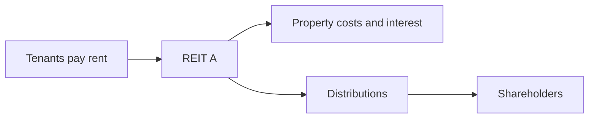

# REITs explained

Idea CMDTY

After this lesson you can say what a REIT is and how it earns money, state the US distribution rule and work out the minimum payout from a REIT's taxable income, and say how a Canadian REIT differs.

Before this: [The income statement](../09-company-financials/02-the-income-statement.md), [Dividends, splits and corporate actions](../01-how-markets-work/09-dividends-splits-and-corporate-actions.md). You need: a calculator.

## The idea

You want to own apartment buildings but have US$31.50 to spend, not US$30 million. REIT A is a made-up company that owns 40 apartment buildings. It collects rent from tenants, pays the costs of running the buildings and the interest on its loans, and sends most of what is left to its shareholders. You buy one share, and you own a very small slice of all 40 buildings.

A **real estate investment trust (REIT)** is a company or trust that owns, and usually operates, income-producing real estate, or holds loans secured by it, and pays most of its income out to investors. A REIT is traded like a stock, so you can buy and sell it in seconds, which you cannot do with a building.

## Kinds of REIT

An **equity REIT** owns properties and earns rent. A **mortgage REIT** (mREIT) holds mortgages or mortgage securities and earns interest, so its income depends on borrowing costs much more than rent does. A hybrid does both. Equity REITs are also grouped by property type: apartments, industrial and warehouse buildings, shopping centres, offices, health care, data centres, storage and others. Each type has its own tenants and its own cycle. Office leases run for years and apartment leases for months, so the income of each reacts to the economy at a different speed.

## The US rules

A US REIT is a company that elects REIT status and passes a set of tests. The tests that matter to an investor:

- **Distribution test.** The REIT's dividends paid deduction must be at least 90% of its REIT taxable income, which is computed before that deduction and without net capital gain ([IRS, Instructions for Form 1120-REIT](https://www.irs.gov/pub/irs-pdf/i1120rei.pdf), 2025 edition, as of 2026; the statute is [26 U.S.C. 857](https://www.law.cornell.edu/uscode/text/26/857)).
- **Asset and income tests.** At the end of each quarter at least 75% of total assets must be real estate, cash or government securities, and most of its income must come from real estate sources ([26 U.S.C. 856](https://www.law.cornell.edu/uscode/text/26/856)).
- **Ownership.** The shares must be held by at least 100 persons, per the IRS instructions.

In return, the REIT pays no corporate tax on the income it distributes. Its shareholders pay tax on the distributions instead. This one rule is why REITs have high dividend yields compared with most stocks. It also means a REIT keeps little cash for growth, so it often raises money by selling shares or borrowing.

### Worked example: the 90% rule

REIT A has US$42.0 million of REIT taxable income this year and 20 million shares. Its share price is US$31.50.

1. Minimum distribution: 0.90 x 42.0 = US$37.8 million.
2. Per share: 37.8 million / 20 million = US$1.89.
3. Dividend yield at the minimum: 1.89 / 31.50 = 0.060, which is 6.0%.

Taxable income is not the same as the profit on the income statement, because the tax code treats depreciation differently, so lesson 8 builds the measures investors use ([REIT metrics: FFO and cap rates](08-reit-metrics-ffo-and-cap-rates.md)). A REIT can pay more than 90%, and many pay close to all of it.

A distribution can have several parts for tax: ordinary income, capital gain, and a return of capital. The broker's year-end slip splits them, and each part is taxed differently. Part 2 covers how US withholding applies to dividends in each account ([US withholding tax and the W-8BEN](../02-accounts-currency-and-taxes/06-us-withholding-tax-and-w-8ben.md)). Check how it applies to REIT distributions with your broker before you buy one.

## Canadian REITs

A Canadian REIT is usually a trust, and you hold its units rather than shares. The Income Tax Act does not set a 90% payout rule. Instead it has rules for publicly traded trusts, the SIFT rules, which tax such a trust like a corporation unless it qualifies for the REIT exception by meeting asset and revenue tests during the year ([CRA, What is a SIFT trust](https://www.canada.ca/en/revenue-agency/services/tax/trust-administrators/specified-investment-flow-through-sift-trust-income-distribution-tax/what-a-sift-trust.html); the rules are in [section 122.1 of the Income Tax Act](https://laws-lois.justice.gc.ca/eng/acts/I-3.3/section-122.1.html)). A REIT that qualifies must be structured as a unit trust, generally a mutual fund trust, and passes its income through, so the unitholders are taxed on the distributions. The law does not fix a payout percentage.

### For Canadians

A Canadian REIT trades on the TSX in CAD. A US REIT trades in USD, so its return includes the currency effect of Part 2 ([Currency risk on US stocks](../02-accounts-currency-and-taxes/05-currency-risk-on-us-stocks.md)). Distributions are taxed differently by account: in a non-registered account they are taxable income, and in a TFSA they are not taxed by Canada. US withholding on US distributions depends on the account, as Part 2 explains. REIT ETFs exist in both countries ([US-listed or Canadian-listed ETFs](../13-etfs-portfolios-and-factors/03-us-vs-canadian-listed-etfs.md)). Check the fund's page for its holdings and fee.

## Common mistakes

- Treating the dividend yield as a safe return. A payout comes from cash flow, and a REIT can cut it.
- Comparing REIT dividends with stock dividends of the same size. The REIT's payout rule means it keeps little to reinvest.
- Assuming a REIT's net income shows its cash. Lesson 8 shows why real estate depreciation distorts it.

## Try it

1\. A US REIT has taxable income of US$60.0 million and 30 million shares. What is the minimum distribution in total and per share?

Answer

0.90 x 60.0 = US$54.0 million. Per share: 54.0 / 30 = US$1.80.

2\. A REIT share costs US$45.00 and pays US$2.70 a year. What is the dividend yield?

Answer

2.70 / 45.00 = 0.060, which is 6.0%.

3\. Is a company that owns 12 warehouses an equity REIT or a mortgage REIT? What about one that holds a portfolio of mortgage bonds?

Answer

The warehouse owner is an equity REIT (income is rent). The mortgage bond holder is a mortgage REIT (income is interest).

4\. Which country's REIT has a fixed 90% distribution test in its tax rules, and what does the other use instead?

Answer

The US has the 90% test. Canada has no fixed percentage; it taxes publicly traded trusts under the SIFT rules unless the trust meets the REIT exception tests.

## Practice today (10 min)

| Minutes | Task |
|---|---|
| 5 | Pick one REIT or REIT ETF from your broker's search. Write its property type, its dividend yield and whether it trades in USD or CAD. |
| 3 | Find its latest annual report on [EDGAR](../09-company-financials/01-filings-and-edgar.md) or SEDAR+ (Canada's filing system) and write what it says about its distribution policy. |
| 2 | Write in your [journal](../practice/trade-journal.md) which kind of REIT it is. |

## Key terms

- **Real estate investment trust (REIT)**: a company or trust that owns income-producing real estate, or loans secured by it, and pays most of its income to investors.
- **Equity REIT**: a REIT that owns properties and earns rent.
- **Mortgage REIT (mREIT)**: a REIT that holds mortgages or mortgage securities and earns interest.
- **Distribution test**: the US rule that a REIT must pay out at least 90% of its REIT taxable income.
- **Return of capital**: a part of a distribution that is not income and reduces your cost base.
- **SIFT rules**: Canadian tax rules for publicly traded trusts, with an exception for qualifying REITs.

Next: [REIT metrics: FFO and cap rates](08-reit-metrics-ffo-and-cap-rates.md)
