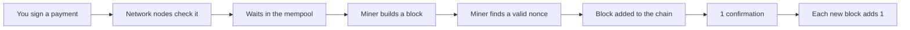

# What bitcoin is

<span class="tag tag-idea">Idea</span> <span class="tag tag-part">CRYPTO</span>

After this lesson you can say how bitcoin moves value without a bank, work out how much bitcoin will ever exist from the halving schedule, and explain what a confirmation tells you.

Before this: [Settlement, cash and margin](../01-how-markets-work/07-settlement-cash-and-margin.md). You need: a calculator.

## The idea

When you send C$100 to a friend by e-transfer, a bank keeps the ledger: it lowers your balance and raises theirs. You trust the bank to keep the ledger honestly and not to spend the same dollar twice. Now imagine no bank. Thousands of strangers each keep a copy of the ledger, and they agree on its contents by following the same rules. That is the design in the paper "Bitcoin: A Peer-to-Peer Electronic Cash System", posted in 2008 under the name Satoshi Nakamoto ([the whitepaper](https://bitcoin.org/bitcoin.pdf)). Nobody knows who Nakamoto is, and the book does not need to.

**Bitcoin** is both the network that keeps this ledger and its unit of account, written BTC. The ledger is a **blockchain**: a list of **blocks**, each holding a batch of transactions and the fingerprint (hash) of the block before it. Changing an old block would change its fingerprint and break every block after it.

The hard problem is agreement. If two people each broadcast a payment that spends the same coins, which one counts? The whitepaper's answer is **proof of work**. Special computers run by **miners** compete to find a number (a **nonce**) that makes the block's hash fall below a target. Finding it takes many guesses, and checking it takes one. The first miner to find one publishes the block and earns a reward. Everyone else accepts the longest chain of valid blocks, because it holds the most work.

## How it works

### From payment to confirmation

You sign a payment with your private key (lesson 2 covers keys). It spreads to the network, waits in the **mempool** (the pool of unconfirmed transactions), and a miner picks it up. When that miner's block is accepted, your payment has one **confirmation**. Each later block on top adds one more.



To reverse your payment, an attacker must redo the work for your block and every block after it, faster than the honest network adds new ones. The whitepaper (section 11) shows that the chance of catching up falls quickly as blocks pile up. That is why exchanges ask for several confirmations before they credit a deposit. The number is a choice each service makes.

### Proof of work in numbers

A hash function turns any input into a fixed-size string that looks random. Suppose the target says the hash must start with \(k\) zero bits.

\[ p = 2^{-k} \qquad \text{expected guesses} = 2^{k} \]

- \(k\) is the number of leading zero bits the hash must have.
- \(p\) is the chance that one guess works.
- Expected guesses is the average number of nonces a miner tries before one works.

With \(k = 16\), \(p = 1/65{,}536\). The network adjusts the target every 2,016 blocks (about two weeks) so blocks keep arriving about every 10 minutes, however much computing power joins or leaves.

### The supply schedule

The software pays the miner a **block subsidy** of new bitcoin. It started at 50 BTC per block and halves every 210,000 blocks. A **halving** is that cut in the subsidy. The 21 million cap and the halving rule are in the software's consensus rules, not in the whitepaper, so the cap lasts only as long as the network's users keep running that software.

\[ \text{supply} = 210{,}000 \times (50 + 25 + 12.5 + \dots) \]

- Each term is the subsidy in BTC per block during one period of 210,000 blocks.
- The sum approaches 100, so the supply approaches \(210{,}000 \times 100 = 21{,}000{,}000\) BTC.

<div class="example" markdown>

### Worked example: supply and new issuance

1. After four periods: 210,000 x (50 + 25 + 12.5 + 6.25) = 210,000 x 93.75 = 19,687,500 BTC issued. The fourth halving, at block 840,000 on April 20, 2024 (UTC), brought the subsidy to 3.125 BTC.
2. Blocks per day at one per 10 minutes: 24 x 6 = 144.
3. New bitcoin per day: 144 x 3.125 = 450 BTC. Per year: 450 x 365 = 164,250 BTC.
4. Yearly issuance as a share of supply: 164,250 / 19,687,500 = 0.83%.
5. Time per period: 210,000 blocks x 10 minutes = 2,100,000 minutes, which is about 4.0 years.

The software counts in whole satoshis (one hundred millionth of a BTC) and rounds down at each halving, so the exact total is 20,999,999.9769 BTC, a little under 21 million.

</div>

The figure shows the supply after each of the first six periods. Most of the supply arrives early, and the curve flattens toward the cap.


Source: the bitcoin subsidy schedule as coded in the consensus rules, as of 2026. Calculated here, no market data.

## In code

The code searches for a nonce so that the hash has 16 leading zero bits. The count of guesses is random but fixed for this header, and its average over many headers is \(2^{16}\).

<details class="code" markdown>
<summary>In code</summary>

```python
import hashlib

header = "coin-a-block-1|prev=0000|txs=3"
nonce = 0
while True:
    digest = hashlib.sha256(f"{header}|nonce={nonce}".encode()).hexdigest()
    if int(digest, 16) < 2 ** (256 - 16):
        break
    nonce += 1
print(nonce, digest)
```

For this header the loop stops at nonce 38,624, a little over half of the 65,536 guesses expected on average.

</details>

## Common mistakes

- Treating the 21 million cap as a promise from a company. It is a rule that the network's participants choose to enforce.
- Reading "10 minutes per block" as a guarantee. It is an average, and single blocks can take seconds or an hour.
- Thinking one confirmation is final. The risk of a reversal is small and falls with each block, but it is not zero.

## Try it

1\. After the third halving period, how many BTC have been issued?

<details class="solution" markdown>
<summary>Answer</summary>

210,000 x (50 + 25 + 12.5) = 210,000 x 87.5 = 18,375,000 BTC.

</details>

2\. A subsidy of 3.125 BTC per block, 144 blocks a day. How many BTC are issued in 30 days?

<details class="solution" markdown>
<summary>Answer</summary>

144 x 3.125 = 450 per day, so 450 x 30 = 13,500 BTC.

</details>

3\. A target needs 20 leading zero bits. What is the chance one guess works, and how many guesses are expected?

<details class="solution" markdown>
<summary>Answer</summary>

p = 2^-20 = 1/1,048,576, about 0.000095%. Expected guesses = 2^20 = 1,048,576.

</details>

4\. A block has 3 confirmations. How many blocks sit on top of the one holding your payment?

<details class="solution" markdown>
<summary>Answer</summary>

Two. The block holding the payment is confirmation 1, and each block after it adds one.

</details>

<div class="practice" markdown>

## Practice today (10 min)

| Minutes | Task |
|---|---|
| 5 | Open a public block explorer, find the latest block and write its height, its number of transactions and the time since the previous block. |
| 3 | Compute the subsidy of the block you found from its height (halve 50 once per 210,000 blocks) and check it against the explorer. |
| 2 | Write in your [trade journal](../practice/trade-journal.md) one sentence on what you would need to trust if you held bitcoin. |

</div>

## Key terms

- **Bitcoin**: the network that keeps a shared ledger without a bank, and its unit, BTC.
- **Blockchain**: a list of blocks, each holding transactions and the hash of the block before it.
- **Block**: a batch of transactions added to the chain together.
- **Proof of work**: the rule that a block counts only if its hash falls below a target, which takes many guesses to meet.
- **Miner**: a computer operator who competes to find a valid block.
- **Nonce**: the number a miner changes to search for a valid hash.
- **Confirmation**: a block on the chain that holds your transaction or builds on the block that does.
- **Block subsidy**: the new bitcoin paid to the miner of each block.
- **Mempool**: the waiting area of unconfirmed transactions.
- **Halving**: the cut of the block subsidy in half, every 210,000 blocks.

Next: [Blockchains, keys and wallets](02-blockchains-keys-and-wallets.md)
