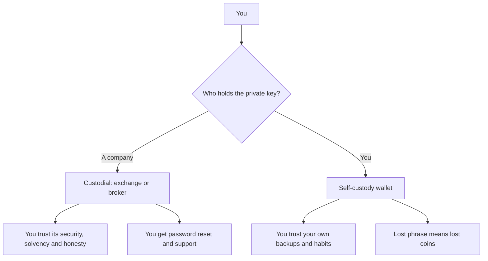

# Blockchains, keys and wallets

Idea CRYPTO

After this lesson you can say what a private key, a public key and a seed phrase are, tell hot wallets from cold wallets, and compare holding coins at an exchange with holding them yourself.

Before this: [What bitcoin is](01-what-bitcoin-is.md). You need: a calculator.

## The idea

A bank account has a name on it, and the bank checks your ID before it moves money. A blockchain has no names. It has **addresses**, which are long strings that receive coins, and it moves coins only when a payment carries a valid digital signature. So the question "who owns these coins?" has one answer: whoever can produce that signature, which means whoever holds the **private key**.

This is the rule to remember through the whole part: whoever has the private key controls the coins. If you lose the key, the coins are gone. If someone else copies it, the coins are theirs. No help desk can reverse either case on the blockchain itself.

## How it works

### Keys and addresses

Bitcoin and most other coins use **public-key cryptography** (the CS book's [SSH and keys](https://faiyaz-svg.github.io/CSFromTheGroundUp/02-operating-systems-and-linux/02-linux-command-line/10-ssh-and-keys/) lesson uses the same idea; this lesson needs only the idea). A private key is a very large random number. A mathematical one-way function turns it into a **public key**. Going forward is quick, and going back from the public key to the private key is not feasible with today's computers. The address is derived from the public key.

- The private key signs a payment. It is never sent anywhere.
- The public key lets anyone check that the signature is valid.
- The address is what you hand to a person who wants to pay you.

A **wallet** is software or a device that stores keys and builds signed payments. The coins themselves sit on the blockchain, not inside the wallet.

### Seed phrases

Remembering a 256-bit number is not realistic, so most wallets create a **seed phrase** (also called a recovery phrase): 12 or 24 words from a list of 2,048, which encodes the root secret from which all your keys are derived. The standard word list and method are BIP-39. Twelve words give 2,048^12 = 2^132 combinations, of which 128 bits are random and 4 are a checksum.

Anyone who sees the phrase can rebuild every key. It must never be typed into a website, photographed or stored in cloud notes. It is the thing to back up on paper or metal, in a place that survives a fire.

### Worked example: guessing a seed phrase

An attacker tries 1 trillion (10^12) phrases per second.

1. Random bits in a 12-word phrase: 128, so 2^128 = 3.4 x 10^38 possible phrases.
2. Seconds to try them all: 3.4 x 10^38 / 10^12 = 3.4 x 10^26.
3. Years: 3.4 x 10^26 / (365 x 24 x 3,600) = 1.1 x 10^19, about 11 billion billion years.

Guessing is not how seed phrases are lost. Phishing sites, malware, and copies kept in an email or a photo are.

### Hot and cold, custodial and self-custody

A **hot wallet** is connected to the internet: a phone app, a browser extension, or the balance at an exchange. It is quick to use and exposed to malware. A **cold wallet** keeps the keys offline, for example on a dedicated hardware device or a paper backup, and signs only when you plug it in.

The second split is about who holds the key. In **custodial** storage, a company holds the keys and you hold a claim on it, the way you hold a claim on a bank. In **self-custody**, you hold the keys, and nobody can freeze your coins or lose them for you.

Neither is safe by default. The risks differ:

| | Custodial | Self-custody |
|---|---|---|
| Who can move the coins | The company, and you through it | Only the holder of the keys |
| Main risk | Hack, fraud, freeze, bankruptcy | Lost or stolen phrase, phishing, mistakes |
| If you forget a password | Reset through the company | Nothing can be done |
| Setup effort | Low | Higher |

An exchange balance is a promise from the exchange, and it is only as good as the exchange. Lesson 8 covers the Mt. Gox and FTX cases, where customers learned this.

### What a transaction fee is

Each payment pays a **transaction fee** to the miner who includes it. Miners pick the highest-paying transactions first when blocks are full, so a fee works like a bid for space in the next block. Fees depend on demand for block space and on the payment's data size, not on the amount sent.

### For Canadians

Crypto held at a Canadian platform is custodial. Wealthsimple's crypto page says most coins sit in offline cold storage with custodial partners, with the rest in hot wallets, and that these holdings are not covered by CIPF, CDIC or other investor protection schemes ([Wealthsimple Crypto](https://www.wealthsimple.com/en-ca/product/crypto), as of 2026). Lesson 4 covers how to check a platform's registration and what the rules say about custody.

## Common mistakes

- Typing a seed phrase into a website or support chat. Real wallet makers and exchanges never ask for it.
- Splitting trust badly: keeping the only copy of the phrase on the same phone as the wallet app. Keep a separate backup.
- Assuming a hardware wallet removes all risk. It protects the key from malware, and a fake support message can still talk you into approving a bad transaction.

## Try it

1\. A 24-word phrase uses the same list of 2,048 words. How many bits of entropy does it carry, and how does that compare with 12 words?

Answer

Each word carries 11 bits (2,048 = 2^11). 24 words carry 24 x 11 = 264 bits, of which 256 are random and 8 are checksum. 12 words carry 132 bits, of which 128 are random. The 24-word phrase has 2^128 times as many possibilities.

2\. You keep C$8,000 of coins at an exchange and the exchange freezes withdrawals. Who holds your private keys, and what do you hold?

Answer

The exchange holds the keys. You hold a claim on the exchange, not coins you can move yourself.

3\. Name one risk of a hot wallet and one of a cold wallet.

Answer

A hot wallet is exposed to malware and phishing because it is online. A cold wallet can be lost, damaged or stolen along with its backup, and it needs a careful setup.

4\. A wallet shows your address on a screen. Is it safe to post it publicly?

Answer

Yes for receiving, in the sense that it cannot be used to spend your coins. It does let anyone see the address's balance and history, so it costs some privacy.

## Practice today (10 min)

| Minutes | Task |
|---|---|
| 4 | Pick an exchange or broker that you use or might use. Write down whether it is custodial, where it says it stores coins, and whether holdings are covered by CIPF or CDIC. |
| 4 | Write a one-line rule for how you would back up a seed phrase, and one place where you would never store it. |
| 2 | Add a line in your [trade journal](../practice/trade-journal.md): "If this platform froze withdrawals tomorrow, I would lose access to C$___." |

## Key terms

- **Address**: a string derived from a public key that receives coins.
- **Private key**: the secret number that signs payments. Whoever holds it controls the coins.
- **Public key**: the number derived from the private key that lets others verify a signature.
- **Public-key cryptography**: a system in which a signature made with a private key can be checked with the public key.
- **Wallet**: software or a device that stores keys and signs payments.
- **Seed phrase**: 12 or 24 words that encode the root secret from which a wallet's keys are made.
- **Hot wallet**: a wallet connected to the internet.
- **Cold wallet**: a wallet whose keys stay offline.
- **Custodial**: a company holds the keys on your behalf.
- **Self-custody**: you hold the keys yourself.
- **Transaction fee**: the payment to a miner for including a transaction in a block.

Next: [Ethereum, stablecoins and DeFi](03-ethereum-stablecoins-and-defi.md)
