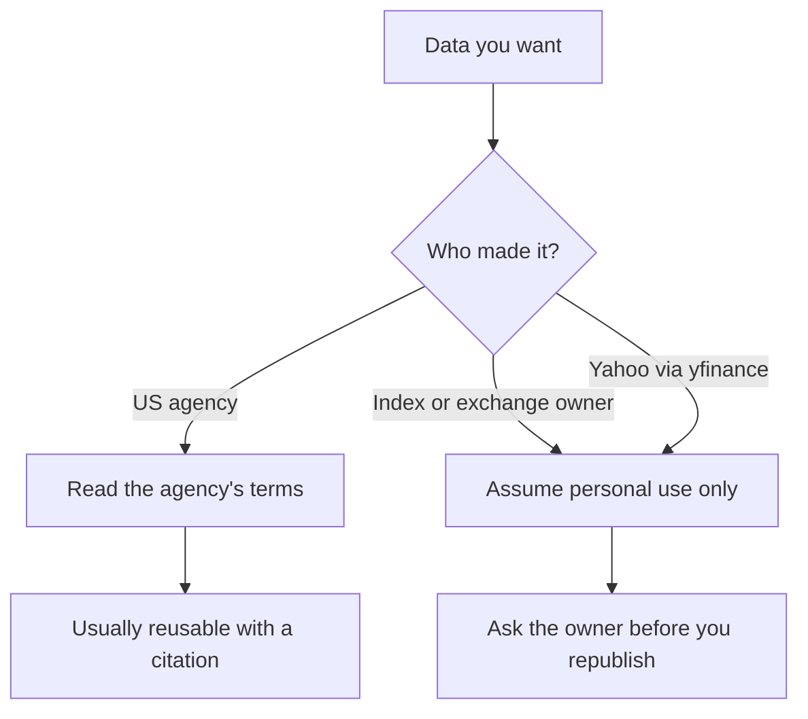

# Free data sources and their licences

<span class="tag tag-data">Data</span> <span class="tag tag-part">DATA</span>

After this lesson you can name the free sources for filings, economic data, prices and positioning, say what each one asks of you, and tell whether you may share what you download.

Before this: [Filings and EDGAR](../09-company-financials/01-filings-and-edgar.md). You need: a browser, and Python if you try the code box.

## The idea

Most of this part reads data that someone else collects: insider filings, fund holdings, short interest, futures positions. All of it is free to look at. Free to look at is not always free to copy, and the rules differ by source. Two questions apply to every source in this lesson:

1. What does the provider ask of me when I download (a key, a header, a speed limit)?
2. What may I do with the data afterwards: use it myself, or republish it?

Using data for yourself, in your own notebook, is the low-risk case. **Republishing** means putting the data, or a chart that reproduces it, where other people can see it: a website, a newsletter, a paid course. Republishing is where licences bite. This book follows the same rule: its price charts are drawn from made-up data, because real price history is licensed.

## How it works

### US government sources

Data made by US federal agencies is usually open, but each agency states its own terms, so read them.

| Source | What it holds | What it asks | Reuse, as of 2026 |
|---|---|---|---|
| [SEC EDGAR APIs](https://www.sec.gov/search-filings/edgar-application-programming-interfaces) | Filings and XBRL facts | No key. Declare a User-Agent with your contact details. Maximum 10 requests per second | SEC filings are public documents |
| [BLS](https://www.bls.gov/opub/copyright-information.htm) | Jobs, CPI, productivity | Cite the source | BLS says its published material is in the public domain, except previously copyrighted photographs and illustrations |
| [BEA](https://www.bea.gov/help/faq/145) | GDP, PCE | The API needs a free registration (a UserID) | BEA says material on its site is public domain unless stated otherwise, and asks for a citation |
| [Treasury Fiscal Data](https://fiscaldata.treasury.gov/about-us/) | Yields, debt, auctions | See the API documentation | Treasury says the data may be copied, adapted and redistributed for commercial and non-commercial use |
| [CFTC](https://www.cftc.gov/MarketReports/CommitmentsofTraders/index.htm) | Commitments of Traders | Free downloads | Check the notice on the CFTC site before you republish |

The SEC states the rate limit and the User-Agent request on its [Accessing EDGAR data](https://www.sec.gov/search-filings/edgar-search-assistance/accessing-edgar-data) page: "Current max request rate: 10 requests/second", and it reserves the right to limit rates further. A User-Agent is a text header that tells the server who is calling. Use your own name and a working email, not a made-up one.

### FRED and copyrighted series

**FRED** is a database run by the Federal Reserve Bank of St. Louis. It collects thousands of series from government and private sources. You need a free API key to use its API, and the [terms of use](https://fred.stlouisfed.org/docs/api/terms_of_use.html) say that some series are copyrighted and marked in their notes. The API does not override that copyright. For third-party data, the terms say you must ask the data owner before using it for anything beyond your own personal use.

The S&P 500 series (SP500) is the example. Its notes on [FRED](https://fred.stlouisfed.org/series/SP500) say S&P Dow Jones Indices owns the copyright, that reproduction in any form needs its written permission, and that FRED carries 10 years of daily history. So a plot in your private notebook is fine, and a copy of the series on a public website is not.

### Yahoo Finance and yfinance

**yfinance** is an open-source Python package that downloads Yahoo Finance data. It is unofficial. Its [README](https://github.com/ranaroussi/yfinance) says it is not affiliated with Yahoo, that it is meant for research and educational use, and that the Yahoo API is intended for personal use only. It can break when Yahoo changes its pages. Use it to learn and to explore, and do not build anything you need to rely on, or publish, on it.



The diagram sorts a source by who owns the data, which decides what you may do next.

<div class="example" markdown>

### Worked example: pulling 500 companies from EDGAR

You want the XBRL facts for 500 companies, one request each. The limit is 10 requests per second.

1. Fastest possible time: 500 / 10 = 50 seconds.
2. A loop that waits 0.11 seconds between requests sends 1 / 0.11 = 9.09 requests per second, which stays under the limit. Waiting alone takes 500 x 0.11 = 55 seconds, and the downloads add time on top.
3. A loop with no wait can burst far above 10 per second, and the SEC may block your address.

</div>

<details class="code" markdown>
<summary>In code</summary>

The snippet downloads the company name for two companies and waits between requests. The SEC asks automated clients to identify themselves, so replace the placeholder with your own name and email. A made-up contact defeats the purpose of the header.

```python
# needs internet
import time
import requests

headers = {"User-Agent": "Your Name your.email@example.com"}

for cik in ["0000320193", "0000789019"]:
    url = f"https://data.sec.gov/api/xbrl/companyfacts/CIK{cik}.json"
    facts = requests.get(url, headers=headers, timeout=30).json()
    print(cik, facts["entityName"])
    time.sleep(0.11)
```

</details>

<div class="canada" markdown>

### For Canadians

Canadian filings live on SEDAR+, and Canadian insider reports on SEDI (lesson 2). For Canadian economic data, Statistics Canada publishes under an [Open Licence](https://www.statcan.gc.ca/en/terms-conditions/open-licence) that lets you use, publish and distribute its information if you keep a source notice and do not imply that Statistics Canada endorses you (as of 2026).

</div>

## Common mistakes

- Treating "free" as "copyable". A free download can still be copyrighted, as the S&P 500 series on FRED is. Read the series notes.
- Sending requests with no User-Agent, or someone else's. Use your own contact details.
- Building a routine on yfinance and finding it broken on the day you need it. Keep a saved copy of what you analyse.

## Try it

1\. You need the facts for 2,000 filers, one request each, at the SEC limit. What is the shortest possible time?

<details class="solution" markdown>
<summary>Answer</summary>

2,000 / 10 = 200 seconds, which is 3 minutes and 20 seconds, before any download time.

</details>

2\. You plot the FRED S&P 500 series in a private notebook. Then you put the same series on a public web page. Which step needs permission, and from whom?

<details class="solution" markdown>
<summary>Answer</summary>

The public web page. FRED's notes say S&P Dow Jones Indices owns the copyright and reproduction needs its written permission. The private plot is personal use.

</details>

3\. Which of these need a key or registration: EDGAR, FRED, BEA's API?

<details class="solution" markdown>
<summary>Answer</summary>

FRED (a free API key) and BEA's API (a free UserID). EDGAR needs no key, only a User-Agent header with your contact details.

</details>

4\. Why is yfinance a poor base for a number you plan to publish?

<details class="solution" markdown>
<summary>Answer</summary>

It is unofficial, it can break when Yahoo changes, and its README says the Yahoo API is for personal use only. Publishing the data goes beyond that.

</details>

<div class="practice" markdown>

## Practice today (10 min)

| Minutes | Task |
|---|---|
| 4 | Open the terms page of two sources above. For each, write one line: what it asks, and whether you may republish. |
| 4 | Register for a free FRED API key, or open the EDGAR access page and write down the rate limit in your journal notes. |
| 2 | Add a "data sources" page to your [trade journal](../practice/trade-journal.md) notes, with a column for the licence. |

</div>

## Key terms

- **Republishing**: making data, or a chart that reproduces it, visible to others.
- **User-Agent**: a header that tells a server who is sending the request.
- **Rate limit**: the most requests a server allows per second.
- **FRED**: the Federal Reserve Bank of St. Louis database of economic series.
- **yfinance**: an unofficial Python package for Yahoo Finance data.
- **Public domain**: free of copyright, so reusable without permission.

Next: [Insider trades and Form 4](02-insider-trades-form-4.md)
