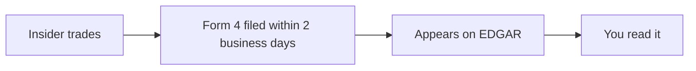

# Insider trades and Form 4

<span class="tag tag-data">Data</span> <span class="tag tag-part">DATA</span>

After this lesson you can read a Form 4, tell a market purchase from a stock award or a tax withholding, and say what research found about insider buying and selling.

Before this: [Free data sources and their licences](01-free-data-sources.md), [Filings and EDGAR](../09-company-financials/01-filings-and-edgar.md). You need: a browser.

## The idea

On Thursday, November 19, 2026, the chief financial officer of Stock A buys 5,000 shares at US$20.00 with her own money. Within two business days the purchase appears on EDGAR. A trader scanning filings sees it and asks what she knows.

The people who file are **insiders**: a company's officers, its directors and anyone who owns more than 10% of a class of its shares. The SEC's [investor bulletin on insider transactions](https://www.investor.gov/introduction-investing/general-resources/news-alerts/alerts-bulletins/investor-bulletins-69) describes three forms. **Form 3** is the first report, due within 10 days of becoming an insider. **Form 4** reports a transaction, and is due within two business days after it. **Form 5** is a year-end catch-up, due within 45 days after the fiscal year ends, for transactions that were exempt or not reported earlier.

Insider means a legal role here, not a rumour. These trades are legal when the insider does not use secret information, and the filing is how the public sees them.



The two-business-day gap is the reader's delay: the price may have moved before you see the form.

## How it works

A Form 4 lists each transaction with a date, a number of shares, a price and a **transaction code**, a letter that says what kind of transaction it was. The code matters more than the size. These are the commonly used ones, from the SEC bulletin above (the full list is in the General Instructions to Form 4):

| Code | Meaning |
|---|---|
| P | Purchase of securities on an exchange or from another person |
| S | Sale of securities on an exchange or to another person |
| A | Grant, award or other acquisition from the company, such as stock or an option |
| M | Exercise or conversion of a derivative security received from the company |
| F | Payment of the exercise price or tax using part of the securities received |
| D | Sale or transfer of securities back to the company |
| G | Gift of securities |
| J | Other, explained in a footnote |

Only P and S are decisions to trade in the open market with real money. A, M and F are compensation mechanics: the company hands out shares, the insider exercises options, and shares are withheld to pay tax. Treating a large F or A line as a "sale" or a "buy" is the main reading error.

<div class="example" markdown>

### Worked example: four lines on one Form 4 day

Stock A's insiders file these (made-up numbers):

| Insider | Code | Shares | Price (US$) | Value (US$) |
|---|---|---|---|---|
| CFO | P | 5,000 | 20.00 | 100,000 |
| CEO | S | 30,000 | 22.00 | 660,000 |
| Director | A | 10,000 | 0.00 | none (award) |
| CEO | F | 4,000 | 22.00 | 88,000 (tax) |

1. The CFO put US$100,000 of her own cash in: 5,000 x 20.00.
2. The CEO sold 30,000 x 22.00 = US$660,000. After the sale he holds 400,000 shares, so he sold 30,000 / (400,000 + 30,000) = 7.0% of his holding.
3. The director's A line is a grant, so no cash moved.
4. The F line is tax paid in shares: 4,000 x 22.00 = US$88,000, which is not a sale decision.

Only lines 1 and 2 are open-market trades. The SEC bulletin notes that insiders sell for many reasons, including liquidity and diversification, so line 2 says little by itself.

</div>

### What research found

Lakonishok and Lee studied NYSE, AMEX and Nasdaq companies from 1975 to 1995 in ["Are Insider Trades Informative?"](https://econpapers.repec.org/RePEc:oup:rfinst:v:14:y:2001:i:1:p:79-111) (Review of Financial Studies, 2001). By their abstract, insiders in aggregate are contrarian, buying after price falls. Their activity predicts market moves better than simple contrarian rules, and it predicts individual stock returns mainly in smaller firms. The predictive content came from purchases, and insider selling showed no predictive ability. They also found that prices moved very little around the trades or the filings. Two limits follow: the sample ends in 1995, before the two-business-day rule (2002), and the result is an average, not a signal for one filing.

## In code

The submissions endpoint lists a company's recent filings. The snippet prints the latest Form 4 filing dates for one company. Replace the placeholder header with your own name and email, because the SEC asks for a real contact.

<details class="code" markdown>
<summary>In code</summary>

```python
# needs internet
import requests

headers = {"User-Agent": "Your Name your.email@example.com"}
url = "https://data.sec.gov/submissions/CIK0000320193.json"
recent = requests.get(url, headers=headers, timeout=30).json()["filings"]["recent"]

form4 = [d for d, f in zip(recent["filingDate"], recent["form"]) if f == "4"]
print(form4[:5])
```

Each Form 4 is a document you open from the filing index. Its table uses the codes above.

</details>

<div class="canada" markdown>

### For Canadians

Canadian insiders file on SEDI, the System for Electronic Disclosure by Insiders. The general deadline is five calendar days, set by National Instrument 55-104, so it is looser than the US two business days ([Alberta Securities Commission](https://asc.ca/issuer-regulation/insider-reporting), as of 2026). A US-listed company's insiders file Form 4 on EDGAR even if you hold it from Toronto.

</div>

## Common mistakes

- Counting every line as a trade. Filter to P and S first, then read the footnotes.
- Treating a sale as a warning. Insiders sell to pay taxes, buy houses and diversify.
- Ignoring the delay. The form appears up to two business days after the trade, so the move may be done.

## Try it

1\. An officer trades on Monday, November 16, 2026. By when must the Form 4 be filed?

<details class="solution" markdown>
<summary>Answer</summary>

Two business days after: Tuesday is day 1 and Wednesday, November 18, 2026 is day 2.

</details>

2\. A director buys 12,000 shares at US$18.50 with code P. What was the cash value?

<details class="solution" markdown>
<summary>Answer</summary>

12,000 x 18.50 = US$222,000.

</details>

3\. A Form 4 shows 6,000 shares with code F at US$40.00. Is this a sale you should read as bearish?

<details class="solution" markdown>
<summary>Answer</summary>

No. F is payment of tax or an exercise price with shares from the company. 6,000 x 40.00 = US$240,000 went to tax, which is a mechanical step.

</details>

4\. Why does the Lakonishok and Lee result make a purchase more useful than a sale?

<details class="solution" markdown>
<summary>Answer</summary>

Their abstract says the predictive content came from purchases, and selling showed no predictive ability. Insiders have many reasons to sell, and few to buy except a view on the price.

</details>

<div class="practice" markdown>

## Practice today (10 min)

| Minutes | Task |
|---|---|
| 5 | On EDGAR, open the filings list of a company you follow and filter by form type 4. Open two and write the code, shares and price for each line. |
| 3 | Mark each line as an open-market trade (P or S) or mechanics (A, M, F, D, G). |
| 2 | Write one sentence on what the line does and does not tell you. Keep it in your [trade journal](../practice/trade-journal.md) notes. |

</div>

## Key terms

- **Insider**: an officer, a director or an owner of more than 10% of a class of a company's shares.
- **Form 3**: the first report of an insider's holdings.
- **Form 4**: the report of an insider's transaction, due within two business days.
- **Form 5**: the year-end report of transactions not reported earlier.
- **Transaction code**: the letter on a Form 4 that names the kind of transaction.
- **SEDI**: the Canadian system for insider reports.

Next: [13F holdings](03-13f-holdings.md)
