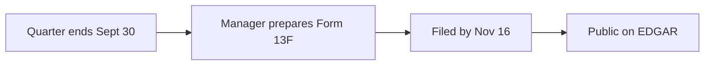

# 13F holdings

Data DATA

After this lesson you can find a large manager's quarterly holdings on EDGAR, work out a position's size and change, and say what a 13F cannot show.

Before this: [Insider trades and Form 4](02-insider-trades-form-4.md). You need: a browser.

## The idea

A fund with hundreds of millions of dollars moves markets, so its holdings are public with a delay. Every quarter, large managers file **Form 13F**, a report of the US-listed stocks and some options they hold. Reading a few of them shows what big investors own, how concentrated they are and what they added or cut.

The catch is the delay. The report says what the manager held on the last day of a quarter, and it arrives weeks later.

### Who files and when

The SEC's [Form 13F FAQ](https://www.sec.gov/divisions/investment/13ffaq.htm) (as of 2026) says an institutional investment manager that uses US interstate commerce and has investment discretion over US$100 million or more in Section 13(f) securities must file. **Investment discretion** means the manager decides what to buy and sell. **Section 13(f) securities** are the securities on the SEC's official list: mainly US exchange-traded stocks, closed-end funds and ETFs, some convertible bonds and some options. Open-end mutual funds are not on it.

The manager tests the US$100 million level on the last trading day of each month. Once it is met, the manager files for the quarters that follow. Each report is due within 45 days after the quarter ends, with no extensions. The FAQ lists the 2026 dates: May 15 for the first quarter, August 14 for the second, November 16 for the third, and February 16, 2027 for the fourth. A date that falls on a weekend or holiday moves to the next business day.

The positions are dated Sept 30, and the filing can arrive 47 days later.

## How it works

On EDGAR, search the manager's name and filter by form type 13F-HR. The filing has an information table: one row per security with its name, the number of shares and the value on the last day of the quarter.

### Worked example: reading a position

Fund X (made-up) holds Stock A. Its 13F for the third quarter of 2026 shows 650,000 shares. The second-quarter report showed 500,000. The price on September 30, 2026 was US$48.00 (made-up), and the whole portfolio was worth US$400 million.

1. Change in shares: 650,000 - 500,000 = 150,000, so 150,000 / 500,000 = +30%.
2. Position value: 650,000 x 48.00 = US$31,200,000.
3. Portfolio weight: 31,200,000 / 400,000,000 = 7.8%.
4. Age at the deadline: September 30 to November 16 is 47 days.

Fund X added shares and Stock A is 7.8% of the portfolio. Nothing says when in the quarter it bought, or whether it sold half on October 2.

### What a 13F does not show

The FAQ says a 13F lists long positions only: short positions are excluded and are not netted against longs. Options appear only when the manager holds puts or calls on the official list, and options the manager wrote are not reported. Positions under both 10,000 shares and US$200,000 may be left out. A manager that holds a stock and is short a similar one looks fully long. A manager that holds a stock and hedges it with futures or swaps shows only the stock.

So a 13F is a delayed, partial picture. It does not give timing, it does not give the cost of the position, and it cannot show why the manager holds it.

Treat it as context. This lesson cites no study of returns from following 13F filings, because none was checked for this edition. Do not read a manager's quarter-end list as a recommendation.

### For Canadians

A 13F covers securities on the SEC list, and the FAQ counts foreign companies only if their shares trade on a US exchange or the Nasdaq National Market System. A stock listed only on the TSX is not in it. Your own TFSA, RRSP or margin holdings at Wealthsimple or IBKR are private, and no filing shows them.

## Common mistakes

- Reading a 13F as current. It is a photograph of one day, up to 47 days old at the deadline.
- Reading it as the whole portfolio. Shorts, most derivatives and non-US holdings are missing.
- Copying a position without its context. You do not know the manager's cost, hedges or time horizon.

## Try it

1\. By when must the fourth-quarter 2026 13F be filed, and why is it not February 14?

Answer

February 16, 2027 (the SEC's list). Forty-five days after December 31 is February 14, 2027, a Sunday, and the deadline then moves to the next business day.

2\. A manager holds 2,000,000 shares worth US$30.00 each in a US$500 million portfolio. What weight is that?

Answer

2,000,000 x 30.00 = US$60,000,000. 60,000,000 / 500,000,000 = 12.0%.

3\. A fund is long US$50 million of Stock B and short US$50 million of Stock C. What does its 13F show for these two?

Answer

Only the Stock B long. The short is not reported and is not netted, so the filing looks fully long.

4\. A fund's holding of Stock A went from 500,000 to 650,000 shares between quarters. Can you say it bought 150,000 shares on a particular day?

Answer

No. The change is net over the quarter. The fund could have bought more and sold some, on any day.

## Practice today (10 min)

| Minutes | Task |
|---|---|
| 5 | On EDGAR, open the two latest 13F-HR filings for one manager. Pick three stocks and write the share change and percentage change. |
| 3 | For each, compute the portfolio weight from the value column and the table's total. |
| 2 | Write what the filing cannot show for this manager, in one sentence, in your [trade journal](../practice/trade-journal.md) notes. |

## Key terms

- **Form 13F**: a quarterly report of holdings by managers with US$100 million or more in 13(f) securities.
- **Investment discretion**: the power to decide what a fund buys and sells.
- **Section 13(f) securities**: the securities on the SEC's official list for 13F reporting.
- **Information table**: the 13F table of securities, shares and values.

Next: [Short interest and borrow](04-short-interest-and-borrow.md)
