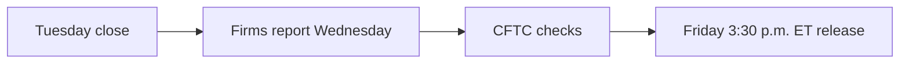

# The Commitments of Traders report

Data DATA

After this lesson you can pick the right Commitments of Traders report, compute a group's net position and its share of open interest, and say what positioning data can and cannot tell you.

Before this: [What futures are](../14-futures/01-what-futures-are.md), [Index futures: ES, MES, NQ and MNQ](../14-futures/03-index-futures.md). You need: a calculator.

## The idea

Every futures trade has a buyer and a seller, so total long positions equal total short positions in a contract. The interesting question is who holds which side. The CFTC, the US futures regulator, answers it each week in the **Commitments of Traders** report (COT). It sorts the largest traders into groups and shows how many contracts each group is long and short.

Two terms from futures first. **Open interest** is the number of contracts that exist and have not been closed or settled (part 15 defines it for options: [The options chain and moneyness](../15-options/03-the-chain-and-moneyness.md)). A **reportable position** is a position above the size at which the CFTC requires a trader to be reported, so small traders appear only as a leftover group.

### The schedule

The [CFTC's COT page](https://www.cftc.gov/MarketReports/CommitmentsofTraders/index.htm) says the report is generally published on Friday at 3:30 p.m. ET, with data as of the close on the Tuesday before. The CFTC receives firm data on Wednesday morning and checks it for Friday. Holidays can shift the release.

On October 27, 2026, the CFTC announced in [release 9316-26](https://www.cftc.gov/PressRoom/PressReleases/9316-26) that it plans to publish twice a week, by the end of 2026: Monday data on Wednesday and Wednesday data on Friday, both at 3:30 p.m. ET, cutting the lag from three days to two. The release gives no start date. When this lesson was written the CFTC's COT page still described a weekly release, so check the CFTC release schedule for the current rhythm before you build a routine on it.

### Which report

| Report | Groups | Covers |
|---|---|---|
| Legacy | Commercial and non-commercial | All reported contracts |
| Disaggregated | Producer/merchant/processor/user, swap dealers, managed money, other reportables | Physical commodity contracts |
| Traders in Financial Futures (TFF) | Dealer/intermediary, asset manager/institutional, leveraged funds, other reportables | Financial contracts, such as stock index futures |

The **Supplemental** report covers 13 selected agricultural contracts. The Legacy split is old and coarse: "commercial" means a trader the CFTC classes as hedging a commercial business, and everyone else is "non-commercial". The Disaggregated and TFF reports split the groups by who they are, which is clearer. For stock index futures, use TFF.

## How it works

For one group in one contract:

\[ N = L - S \qquad \text{Share of open interest} = \frac{N}{OI} \]

- \(L\) is the group's long positions, in contracts.
- \(S\) is the group's short positions, in contracts.
- \(N\) is the net position in contracts. It is negative when the group is net short.
- \(OI\) is open interest, in contracts.

To compare a net position with its own history, use its **percentile**: where today's \(N\) sits between the lowest and highest \(N\) in a past window.

### Worked example: leveraged funds in a stock index future

A made-up TFF line for one contract. Leveraged funds hold 120,000 long and 180,000 short contracts. Open interest is 1,000,000. Over the last three years their net position ranged from -150,000 to +90,000. Last week it was -45,000.

1. Net position: 120,000 - 180,000 = -60,000.
2. Share of open interest: -60,000 / 1,000,000 = -6.0%.
3. Weekly change: -60,000 - (-45,000) = -15,000.
4. Percentile in the range: (-60,000 - (-150,000)) / (90,000 - (-150,000)) = 90,000 / 240,000 = 37.5%.
5. Timing: data as of Tuesday, November 17, 2026 is released Friday, November 20, 3:30 p.m. ET, three days later.

The group is net short and below the middle of its own range. That describes a position. It does not say what comes next.

The diagram shows the weekly release path that the twice-weekly plan would shorten.

### What positioning can and cannot tell you

It tells you how large groups were positioned on one day, and how that changed. Extreme readings show crowding: many traders on one side means a large group would have to exit if the price turned.

It does not tell you why a group holds a position. A "leveraged funds" net short in an index future can be a hedge against a long stock book, or a pair trade, and the report cannot separate them. A "commercial" trader can speculate. The report gives no entry prices, no stops and no timing, and its Tuesday data is already days old when you read it. This lesson cites no study that positioning predicts returns, because none was checked for this edition, so treat COT as context.

### For Canadians

The COT covers CFTC-regulated US markets. Canadian contracts such as the SXF (part 14, [Futures in Canada](../14-futures/07-futures-in-canada.md)) are not in it. A Canadian can read the data free: the CFTC publishes it for everyone.

## Common mistakes

- Reading "commercials are net long" as "smart money is bullish". Commercials hedge a business, and the hedge may have nothing to do with a view.
- Using Legacy groups for a financial contract. TFF is the report built for it.
- Forgetting the lag. Friday's report describes Tuesday.

## Try it

1\. A group holds 250,000 long and 310,000 short contracts, with open interest 1,200,000. Net position and share of open interest?

Answer

250,000 - 310,000 = -60,000. -60,000 / 1,200,000 = -5.0%.

2\. A group's net position ranged from -80,000 to +120,000 over three years and is now +60,000. What percentile?

Answer

(60,000 - (-80,000)) / (120,000 - (-80,000)) = 140,000 / 200,000 = 70.0%.

3\. Which report would you open for stock index futures, and which groups does it show?

Answer

Traders in Financial Futures: dealer/intermediary, asset manager/institutional, leveraged funds and other reportables.

4\. Leveraged funds are net short in an index future. Name two reasons that do not mean they expect a fall.

Answer

They may be hedging a long stock portfolio, or holding the short as one leg of a pair or basis trade. The report shows net positions, not purpose.

## Practice today (10 min)

| Minutes | Task |
|---|---|
| 5 | Open the TFF report from the CFTC page for the S&P 500 future. Write long, short and open interest for leveraged funds and asset managers. |
| 3 | Compute each group's net position and share of open interest. |
| 2 | Write the "as of" date and the release date, and the gap in days. |

## Key terms

- **Commitments of Traders (COT)**: the CFTC's report of futures positions by trader group.
- **Reportable position**: a position large enough that the trader must be reported.
- **Net position**: longs minus shorts for a group.
- **Legacy report**: the COT report that splits traders into commercial and non-commercial.
- **Disaggregated report**: the COT report for physical commodities with four finer groups.
- **Traders in Financial Futures (TFF)**: the COT report for financial contracts.

Next: [Options flow](06-options-flow.md)
