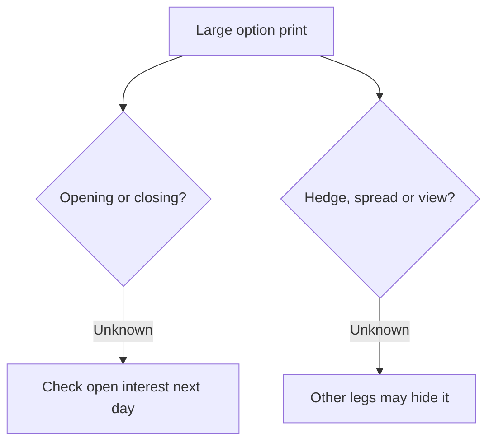

# Options flow

Data DATA

After this lesson you can read an options flow line (volume, open interest, premium, sweep, block), compute the numbers a flow screen shows, and say what the data cannot tell you.

Before this: [The options chain and moneyness](../15-options/03-the-chain-and-moneyness.md), [What sets an option's price](../15-options/04-what-sets-an-option-price.md). You need: a calculator.

## The idea

A flow screen shows a big options trade the moment it prints: 4,200 calls on Stock A, bought for US$1.35 each. Social media calls it "smart money". Before agreeing, ask what the trade actually shows.

**Options flow** is the stream of option trades, filtered to the large or unusual ones. Part 15 defined **volume** (contracts traded today) and **open interest** (contracts that exist and have not been closed or exercised). Open interest updates once a day, so it lags volume. A flow line compares the two.

### The vocabulary

**Unusual activity** is a label for a contract whose volume is far above its usual level or above its open interest. A common screen is volume divided by open interest above some number. Vendors pick their own cut-offs, so the label means little without the number.

**Premium** is the total money paid for the contracts: contracts x price x 100 (a standard US equity option covers 100 shares). A US$567,000 premium looks big, but compare it with the stock's usual option volume.

A **block** is a large single trade, often arranged between two parties and printed in one piece. A **sweep** is an order split into pieces and sent to several exchanges at once so it fills fast, usually by taking the best offers on each. Vendors define both terms in their own way, and there is no single size at which a trade becomes a block.

Many flow tools also tag a trade as "at the ask" or "at the bid". A trade at the ask suggests the buyer was the one in a hurry. That is a guess from the price, since the tape (the record of trades) does not name the buyer.

## How it works

### Worked example: one flow line

Stock A (made-up) trades at US$50.00. Its 55 call, expiring in 30 days, prints 4,200 contracts at US$1.35. Open interest before today was 600. The next morning, open interest reads 4,500.

1. Volume over open interest: 4,200 / 600 = 7.0.
2. Premium: 4,200 x 1.35 x 100 = US$567,000.
3. Break-even at expiry for a buyer: 55.00 + 1.35 = US$56.35, which is (56.35 - 50.00) / 50.00 = 12.7% above the current price.
4. Open interest change: 4,500 - 600 = 3,900.

Open interest rose by almost the day's volume, so most of the contracts were opened on net. Even so, you cannot say who bought and who sold, whether the buyer was opening a new position or closing an old one, or whether the call is one leg of a larger trade.

### What the tape cannot tell you

1. **Who is on each side.** Every trade has a buyer and a seller. The seller is often a market maker (part 1, [Who is on the other side of your trade](../01-how-markets-work/06-who-is-on-the-other-side.md)) who hedges the position by trading the stock.
2. **Opening or closing.** The trade print does not say. Only the next day's open interest hints at it, and only in aggregate.
3. **The reason.** A call purchase can be a bet on a rise, a hedge against a short stock position, the leg of a spread, or part of a trade built around earnings. A single print hides the other legs.
4. **The timing.** A large trade can be a view held for months or a one-day trade.

The one academic finding is about better data than you can see. Pan and Poteshman ([Review of Financial Studies, 2006](https://econpapers.repec.org/RePEc:oup:rfinst:v:19:y:2006:i:3:p:871-908)) built put-call ratios from option volume that buyers initiated to open new positions. Stocks with low ratios outperformed stocks with high ratios by more than 40 basis points on the next day and more than 1% over the next week. Their dataset identified opening buys, which a public tape does not. Their result does not show that the flow screen you can see has the same value, and this lesson cites no test of public flow screens.

Every branch ends in an unknown, which is why a single print is weak evidence.

### For Canadians

Flow screens cover US-listed options. Whether you can trade options in a TFSA, RRSP or FHSA, and which strategies your broker permits, is covered in part 15 (Options in Canadian accounts<!-- link: ../15-options/15-options-in-canadian-accounts.md -->).

## Common mistakes

- Reading "bought at the ask" as "a bullish view". The buyer may be hedging, and the seller may be the one with a view.
- Quoting premium without context. US$567,000 on a stock whose usual option volume is millions of dollars a day is ordinary.
- Skipping the next day's open interest. It is the only hint about opening or closing.

## Try it

1\. A contract trades 1,500 contracts with open interest 250. Volume over open interest?

Answer

1,500 / 250 = 6.0.

2\. 800 puts trade at US$2.20. What is the premium?

Answer

800 x 2.20 x 100 = US$176,000.

3\. Open interest was 250 before a day with 1,500 contracts traded, and it reads 1,650 the next morning. What does that suggest, and what does it not show?

Answer

The change is +1,400, almost the whole volume, so most trades opened positions on net. It does not show who bought, who sold, or why.

4\. Name two reasons someone might buy a call that have nothing to do with expecting a rise.

Answer

Hedging a short stock position, and buying it as one leg of a spread. One leg of a multi-leg trade can look bullish alone.

## Practice today (10 min)

| Minutes | Task |
|---|---|
| 4 | On a chain for a liquid stock, find the contract with the largest volume. Write volume, open interest and premium (volume x price x 100). |
| 3 | Next morning, read the new open interest and compute the change. |
| 3 | Write three possible reasons for the trade, and what data would separate them. |

## Key terms

- **Options flow**: the stream of option trades, filtered to large or unusual ones.
- **Unusual activity**: a label for volume far above normal or above open interest.
- **Premium**: the total price paid for option contracts, contracts x price x 100.
- **Block**: a large option trade printed as one piece.
- **Sweep**: an order split across exchanges to fill at once.
- **Tape**: the record of trades as they print.

Next: [Base rates, calibration and forecast logs](07-base-rates-calibration-and-forecast-logs.md)
