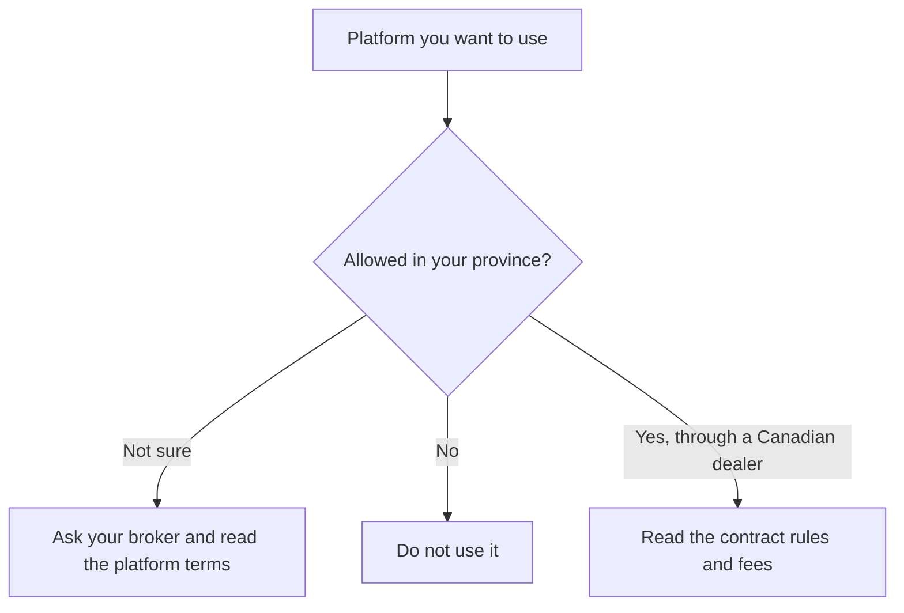

# Prediction markets

Idea Review DATA

After this lesson you can read a prediction market price as a probability, work out the all-in cost and break-even of a contract, explain the favourite-longshot bias, and say what you must check before using a platform from Ontario.

Before this: [Base rates, calibration and forecast logs](07-base-rates-calibration-and-forecast-logs.md). You need: a calculator.

## The idea

A **prediction market** lets people trade contracts on whether an event will happen. A common form is the **event contract**: it pays US$1.00 if the event happens and US$0 if it does not. A contract on "the next US CPI report shows a monthly rise of 0.3% or more" trades at US$0.62. Buying it costs US$0.62, and you collect US$1.00 if the event happens.

If many traders with different information set the price, it reads as the market's probability: US$0.62 means about 62%. That makes a price directly comparable to your forecast log from lesson 7. You can record your probability and the market's, and score both with the Brier score.

The reading is approximate: the price includes spreads and fees, and some traders are not trying to get the probability right.

## How it works

### Prices, spreads and fees

A contract has a **bid** (the best price a buyer offers) and an **ask** (the best price a seller wants), as in the order book of part 1 ([Bid, ask and the order book](../01-how-markets-work/04-bid-ask-and-the-order-book.md)). Buying costs the ask plus any fee. The probability you need for the trade to break even is that all-in cost, because each contract pays US$1.00 or nothing.

\[ \text{EV} = p - (A + c) \qquad p^{*} = A + c \]

- \(p\) is your probability that the event happens, as a fraction.
- \(A\) is the ask price you pay, in US$ per contract.
- \(c\) is the fee per contract, in US$.
- \(\text{EV}\) is the expected profit per contract, in US$.
- \(p^{*}\) is the break-even probability.

### Worked example: one made-up contract

The CPI contract has a bid of US$0.60 and an ask of US$0.64. Assume a fee of US$0.02 per contract (made-up; real fee schedules differ by platform and price, so read yours).

1. Midpoint: (0.60 + 0.64) / 2 = US$0.62, which reads as 62%.
2. All-in cost to buy: 0.64 + 0.02 = US$0.66, so the break-even probability is 66%.
3. If your probability is 70%: EV = 0.70 - 0.66 = +US$0.04 per contract, or 0.04 / 0.66 = 6.1% of the cost.
4. If your probability is 65%: EV = 0.65 - 0.66 = -US$0.01. You disagree with the midpoint and still lose on average.
5. Selling straight back at the bid, US$0.60, loses 0.66 - 0.60 = US$0.06, which is 9.1% of the cost.

The spread and fee move the break-even from 62% to 66%. The edge you need is the distance to 66%, not to 62%.

### The favourite-longshot bias

The **favourite-longshot bias** is a pattern in betting markets where unlikely outcomes (longshots) are overpriced and likely ones (favourites) are underpriced. Snowberg and Wolfers studied it in horse racing and found that their data favour misperceptions of probability over risk-love as the cause ([Journal of Political Economy, 2010](https://www.nber.org/papers/w15923)). For Kalshi, Bürgi, Deng and Whelan analysed over 300,000 contracts and report a systematic favourite-longshot bias, stronger for takers than for makers ([UCD working paper, 2025](https://www.ucd.ie/economics/t4media/WP2025_19.pdf)). A **taker** trades against a resting order and pays the spread, and a **maker** posts the resting order. The authors also note some evidence that the bias is shrinking over time. In practice: a 5% contract may be worth less than 5%, and the cheap-looking contracts are where a taker's fees and bias cost the most.

### Who runs these markets

Kalshi describes itself as an exchange regulated by the US CFTC, and states its status on its [regulatory page](https://kalshi.com/regulatory). Polymarket runs an international platform and, separately, a US operation that has had a CFTC designation. Its status changes, so read the company's own pages.

### For Canadians

Whether you may legally use a given prediction market from Ontario is for you to check. This lesson cannot confirm it, and it can change. What the official sources say as of 2026:

- In an April 2025 decision ([Ontario Securities Commission v Blockratize Inc., 2025 ONCMT 7](https://capitalmarketstribunal.ca/sites/default/files/2025-04/rad_20250417_osc-blockratize-2.pdf)), the Capital Markets Tribunal approved a settlement in which the OSC alleged that the operators of Polymarket breached the binary options prohibition (Multilateral Instrument 91-102) by offering such contracts to Ontario residents between June 16, 2020 and May 26, 2023.
- On August 27, 2026 the CSA and CIRO issued a [joint notice](https://www.bcsc.bc.ca/about/media-room/news-releases/2026/64-prediction-markets-csa-and-ciro-provide-guidance-on-certain-types-of-event-contracts). They say sports and entertainment event contracts should not be regulated within securities and derivatives law, and that CIRO will not approve dealers to offer them. Other event contracts are still being assessed. Two CIRO dealer members are authorized for a limited set of event contracts, on terms CIRO set. Anyone trading event contracts that are securities or derivatives must follow securities law.

Ask your own broker which event contracts, if any, it offers you, and ask your provincial regulator or a lawyer whether a platform may be used from Ontario. Do not rely on a VPN or on a forum post.

## Common mistakes

- Reading a price as a probability without the spread and fee. Use the all-in cost as the break-even.
- Buying cheap longshots because the payout looks large. The favourite-longshot bias says they tend to be overpriced.
- Assuming a platform is legal for you because it is popular. Check it for your province.

## Try it

1\. A contract has a bid of US$0.30 and an ask of US$0.34, and a fee of US$0.01. What does the midpoint read as, and what is the break-even probability?

Answer

Midpoint (0.30 + 0.34) / 2 = US$0.32, which is 32%. All-in cost 0.34 + 0.01 = 0.35, so the break-even is 35%.

2\. Your probability is 45%, the ask is US$0.40 and the fee is US$0.02. EV per contract and per cent of cost?

Answer

EV = 0.45 - 0.42 = +US$0.03. As a share of cost: 0.03 / 0.42 = 7.1%.

3\. Why does a 4-cent spread matter more on a US$0.05 contract than on a US$0.50 one?

Answer

It is 4 / 5 = 80% of the cheaper price and 4 / 50 = 8% of the dearer one.

## Part check

Six questions on the whole part.

1\. You must pull company facts for 300 filers from EDGAR, one request each. What is the shortest possible time at the SEC's limit?

Answer

300 / 10 = 30 seconds (the SEC's limit is 10 requests per second, as of 2026), and you must send a User-Agent with your own contact details.

2\. An officer buys shares on Wednesday, November 18, 2026. By when is the Form 4 due, and what code marks an open-market purchase?

Answer

Two business days: Thursday is day 1 and Friday, November 20, 2026 is day 2. The code is P.

3\. The second-quarter 13F is due 45 days after June 30, 2026. What date, and name two things the filing does not show.

Answer

August 14, 2026. It does not show short positions (long positions only), and it shows no timing within the quarter. Options a manager wrote are also not reported.

4\. Short interest is 10.5 million shares and average daily volume is 3.5 million. Days to cover?

Answer

10.5 / 3.5 = 3.0 days.

5\. You forecast 0.7 for an event that happens, 0.2 for one that does not, and 0.5 for one that does not. Brier score?

Answer

(0.7 - 1)^2 = 0.09, (0.2 - 0)^2 = 0.04, (0.5 - 0)^2 = 0.25. The mean is 0.38 / 3 = 0.1267.

6\. A contract has an ask of US$0.40 and a fee of US$0.02. Your probability is 50%. EV per contract?

Answer

All-in cost 0.42. EV = 0.50 - 0.42 = +US$0.08. The break-even probability is 42%.

## Practice today (10 min)

| Minutes | Task |
|---|---|
| 4 | Pick one event you have an opinion on. Write your probability in your forecast log before looking at any market price. |
| 3 | Look at a price for a similar event on a platform your broker offers. Do not trade. Write the midpoint, the spread and the fee. |
| 3 | Compute the break-even probability and compare it with yours. Link this entry in your [trade journal](../practice/trade-journal.md) notes. |

## Key terms

- **Prediction market**: a market where contracts pay out on whether an event happens.
- **Event contract**: a contract that pays a fixed amount if an event happens and nothing if not.
- **Break-even probability**: the all-in cost of a contract, which is the probability at which its expected profit is zero.
- **Favourite-longshot bias**: the pattern where unlikely outcomes are overpriced and likely ones underpriced.
- **Maker**: the trader who posts a resting order.
- **Taker**: the trader who trades against a resting order and pays the spread.

Next: [Python and pandas for prices](../20-quant-track-in-python/01-python-and-pandas-for-prices.md)
