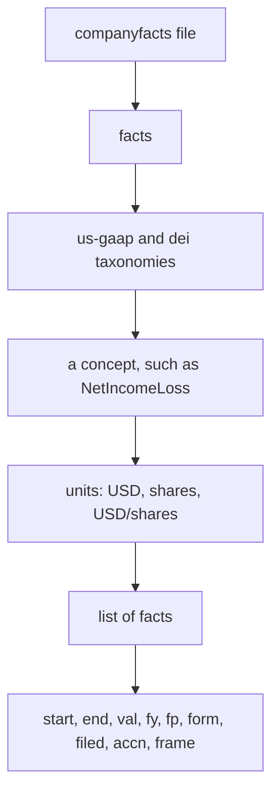

# Fundamentals from EDGAR

<span class="tag tag-code">Code</span> <span class="tag tag-part">QUANT</span>

After this lesson you can read an EDGAR companyfacts file into pandas, pick the right annual and quarterly values out of its repeated entries, derive a fourth quarter, and use the filing date so a test does not use a number before it was public.

Before this: [Filings and EDGAR](../09-company-financials/01-filings-and-edgar.md), [Margins and growth](../09-company-financials/06-margins-and-growth.md), [Python and pandas for prices](01-python-and-pandas-for-prices.md). You need: Python with pandas.

## The idea

Lesson 1 of part 9 showed that one call to EDGAR returns every number a company has tagged in its filings. Raw, the answer is a large nested structure with the same figure repeated in several places. A reader who takes the last entry for "revenue" gets a mix of annual totals, quarterly numbers and year-to-date sums.

This lesson works on a small file with the same shape: [northwind-facts.json](../assets/data/northwind-facts.json). It holds Northwind Tools' numbers from part 9 (FY2024 revenue of US$1,000 million and net income of US$123 million, FY2025 revenue of US$1,150 million and net income of US$165 million) plus made-up earlier and quarterly values. It is made up, so it is not on EDGAR, but it is laid out as an SEC companyfacts file is.

## How it works

The structure is the same for every company:



A **concept** is a tagged line item, named in the **us-gaap** taxonomy (the US accounting standard's list of tags): Revenues, NetIncomeLoss, Assets. Each concept has a **unit**: `USD` for money, `shares` for counts, and `USD/shares` for per-share amounts such as EPS. Under the unit sits a list of facts, and each fact has these fields:

| Field | Meaning |
|---|---|
| `start`, `end` | The period the number covers. A balance sheet item such as Assets has only `end`, because it is a level on one date. |
| `val` | The value, in the unit (whole dollars here, not millions). |
| `form` | The filing it came from: 10-K or 10-Q. |
| `fy`, `fp` | The fiscal year and fiscal period of the filing: FY, Q1, Q2 or Q3. These describe the filing, not the period of the number. |
| `filed` | The date the filing was made public. |
| `accn` | The filing's accession number. |
| `frame` | A calendar label such as CY2024 or CY2025Q3, attached to one fact per period. |

Four traps follow from that table, and each has a step.

1. **Repeats.** A 10-K includes the prior year's figures, so FY2023 revenue appears in the FY2023 10-K and again in the FY2024 10-K, with `fy` = 2024. If a company restates, the two values differ. Sort by `filed` and keep the latest for each `end` date.
2. **Durations.** A 10-Q reports a quarter and also the year to date. The Q2 10-Q has a three-month fact and a six-month fact. Compute the length from `start` and `end` and keep about 90 days for a quarter, about 365 for a year.
3. **No fourth quarter.** The 10-K covers the whole year and companies do not file a Q4 10-Q. Derive it: Q4 = FY - (Q1 + Q2 + Q3).
4. **When it was known.** A number is in the file with a `filed` date, and a test that uses a value before that date uses information nobody had. Lesson 8 treats this as lookahead.

<details class="code" markdown>
<summary>In code</summary>

```python
import json

doc = json.load(open("northwind-facts.json"))
gaap = doc["facts"]["us-gaap"]
print(doc["entityName"], list(gaap))
print(list(gaap["EarningsPerShareBasic"]["units"]))
rows = gaap["Revenues"]["units"]["USD"]
print(len(rows))
r = rows[1]
print(r["end"], r["val"], r["fy"], r["form"], r["filed"])
```

The file has four concepts: Revenues, NetIncomeLoss, EarningsPerShareBasic and Assets. EPS sits under the unit `USD/shares`. Revenues has 9 facts. The second one is revenue for the year ending 2023-12-31, 880,000,000, but its `fy` is 2024 and its form is a 10-K filed 2025-02-19: the FY2023 figure repeated in the FY2024 report.

</details>

Now the first three steps in code. `table()` turns a concept into a DataFrame with a `days` column, and two small functions pick annual and quarterly rows.

<details class="code" markdown>
<summary>In code</summary>

```python
import json
import pandas as pd

gaap = json.load(open("northwind-facts.json"))["facts"]["us-gaap"]

def table(concept, unit="USD"):
    df = pd.DataFrame(gaap[concept]["units"][unit])
    df["days"] = (pd.to_datetime(df["end"]) - pd.to_datetime(df["start"])).dt.days
    return df

rev, ni = table("Revenues"), table("NetIncomeLoss")
year = lambda df: df[df["days"] > 350].sort_values("filed").drop_duplicates("end", keep="last").set_index("end")["val"]
quarter = lambda df: df[df["days"] < 100].set_index("end")["val"]

fy_rev, fy_ni = year(rev), year(ni)
print((fy_rev / 1e6).to_dict())
print(fy_rev.pct_change().dropna().round(3).to_dict())
print((fy_ni / fy_rev).round(3).to_dict())
print((quarter(rev) / 1e6).to_dict())
print("Q4 revenue", fy_rev["2025-12-31"] - quarter(rev).sum(), "Q4 net income", fy_ni["2025-12-31"] - quarter(ni).sum())
```

Annual revenue is 880.0, 1,000.0 and 1,150.0 (US$ millions) for 2023, 2024 and 2025. Growth is 0.136 (13.6%) in 2024 and 0.15 (15.0%) in 2025. Net margin, net income over revenue, is 0.111, 0.123 and 0.143. The three quarterly revenues for 2025 are 270.0, 290.0 and 295.0, so Q4 revenue is 1,150 - 855 = 295 million (the code prints 295000000), and Q4 net income is 165 - 123 = 42 million (42000000).

</details>

The six-month and nine-month year-to-date facts carry no `frame`, while the standalone quarters and the years do. The `frame` label marks the fact the SEC picked as the clean calendar period. The next snippet shows the frames and the point-in-time rule.

<details class="code" markdown>
<summary>In code</summary>

```python
import json
import pandas as pd

rows = json.load(open("northwind-facts.json"))["facts"]["us-gaap"]["Revenues"]["units"]["USD"]
df = pd.DataFrame(rows)
df["days"] = (pd.to_datetime(df["end"]) - pd.to_datetime(df["start"])).dt.days
annual = df[df["days"] > 350].sort_values("filed")
for asof in ("2025-01-31", "2025-06-30", "2026-03-01"):
    last = annual[annual["filed"] <= asof].drop_duplicates("end", keep="last").iloc[-1]
    print(asof, last["end"], last["val"] / 1e6)
print(df[df["frame"].notna()][["end", "days", "fp", "frame"]].to_string())
```

On January 31, 2025 the latest annual revenue anyone could see is FY2023's 880.0 million; the FY2024 10-K was filed on February 19, 2025. On June 30, 2025 it is 1,000.0 (FY2024). On March 1, 2026 it is 1,150.0 (FY2025, filed February 18, 2026). The frame table lists 6 facts, one per period: CY2023, CY2024, CY2025Q1, CY2025Q2, CY2025Q3 and CY2025.

</details>

A backtest that gives a stock "FY2024 revenue" on December 31, 2024 uses a number that came out seven weeks later. Join on the `filed` date, never on `end`.

### The live version

The SEC's data is free and needs no key. It does ask for a real contact in the User-Agent header, and it limits you to 10 requests per second ([Accessing EDGAR data](https://www.sec.gov/search-filings/edgar-search-assistance/accessing-edgar-data), as of 2026). Replace the placeholder with your own name and email; do not leave the example text in. The second call uses a **frame**: one fact for every company that reported a concept for a calendar period, so a single download compares thousands of firms. The format is `CY2024` for a year and `CY2024Q3` for a quarter, and `CY2024Q4I` for a balance sheet level on one date ([SEC EDGAR APIs](https://www.sec.gov/search-filings/edgar-application-programming-interfaces)). Part 19 covers the licences of free data ([Free data sources and their licences](../19-data-flows-and-forecasting/01-free-data-sources.md)).

<details class="code" markdown>
<summary>In code</summary>

```python
# needs internet
import requests
import pandas as pd

headers = {"User-Agent": "Your Name your.email@example.com"}   # the SEC asks for a real contact
base = "https://data.sec.gov/api/xbrl"

facts = requests.get(f"{base}/companyfacts/CIK0000320193.json", headers=headers, timeout=30).json()
rows = facts["facts"]["us-gaap"]["NetIncomeLoss"]["units"]["USD"]
print(facts["entityName"], len(rows))

frame = requests.get(f"{base}/frames/us-gaap/NetIncomeLoss/USD/CY2024.json", headers=headers, timeout=30).json()
top = pd.DataFrame(frame["data"]).sort_values("val", ascending=False)
print(top[["entityName", "val"]].head(5))
```

</details>

The real files are not as tidy as Northwind's. Companies choose different concepts for the same idea (revenue may be `Revenues`, `RevenueFromContractWithCustomerExcludingAssessedTax` or another tag), so a screen over many companies needs a list of fallbacks per line item.

## Common mistakes

- Taking the last row of a concept. It may be a quarter or a year-to-date figure from the newest filing.
- Treating `fy` and `fp` as the period of the number. They describe the filing, so the FY2023 figure can carry `fy` = 2024.
- Using `end` as the date a number was known. The number was public on `filed`, often weeks later.

## Try it

1\. Revenue facts for Northwind: year to date to June 30, 2025 is 560 million and the second quarter alone is 290 million. What was revenue in the first quarter, and how can you check it?

<details class="solution" markdown>
<summary>Answer</summary>

560 - 290 = 270 million for Q1. The file has a separate Q1 10-Q fact for January 1 to March 31, 2025 of 270 million, so the two agree.

</details>

2\. Net income for 2025 is 165 million and the 10-Q facts give 36, 42 and 45 million for the three quarters. What is Q4 net income, and what share of the year is it?

<details class="solution" markdown>
<summary>Answer</summary>

Q4 = 165 - (36 + 42 + 45) = 165 - 123 = 42 million. As a share of the year: 42 / 165 = 25.5%.

</details>

3\. Net margin for 2025 and the change in net margin from 2024, in percentage points.

<details class="solution" markdown>
<summary>Answer</summary>

2025: 165 / 1,150 = 14.3% (rounded). 2024: 123 / 1,000 = 12.3%. The change is 14.35 - 12.30 = 2.05, about 2 percentage points.

</details>

4\. A backtest rebalances on January 31 each year and uses the latest annual revenue. Which year's revenue does it hold on January 31, 2025, and what is wrong with using FY2024 there?

<details class="solution" markdown>
<summary>Answer</summary>

It holds FY2023 revenue (880 million), because FY2024 was filed on February 19, 2025. Using FY2024 on January 31 uses a number that was not public for another 19 days, which is lookahead.

</details>

<div class="practice" markdown>

## Practice today (10 min)

| Minutes | Task |
|---|---|
| 5 | Run the second snippet. Add the `Assets` concept (it has no `start`, so skip the `days` column) and print total assets for 2024 and 2025. |
| 3 | Pick a real company on [EDGAR](https://www.sec.gov/edgar/search/) and find its CIK. Write it padded to 10 digits. |
| 2 | Write down the User-Agent line you would use, with your real name and email. |

</div>

## Key terms

- **Concept**: a tagged line item in a filing, such as NetIncomeLoss.
- **us-gaap**: the taxonomy (list of tags) for US accounting standards.
- **Unit**: what a fact is measured in: USD, shares or USD/shares.
- **Frame**: a calendar-period label, such as CY2024Q3, used to line facts up across companies.
- **Year to date (YTD)**: a total from the start of the fiscal year to the end of a quarter.
- **Point in time**: using only the values that had been filed by a given date.

Next: [Macro data from FRED and Treasury](05-macro-data-from-fred-and-treasury.md)
