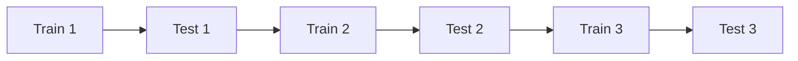

# Overfitting and out-of-sample testing

<span class="tag tag-idea">Idea</span> <span class="tag tag-part">QUANT</span>

After this lesson you can show by simulation why the best of many rules looks good by luck, split data into a training and a test period, and explain what the deflated Sharpe ratio and the multiple-testing hurdle correct.

Before this: [Backtesting concepts and biases](08-backtesting-concepts-and-biases.md), [Modern portfolio theory](../13-etfs-portfolios-and-factors/08-modern-portfolio-theory.md) (for the Sharpe ratio). The math book covers [multiple testing and p-hacking](https://faiyaz-svg.github.io/MathFromTheGroundUp/05-university-core/08-statistics/07-multiple-testing-and-p-hacking/). You need: Python with pandas and numpy.

## The idea

Suppose you test 200 trading rules and keep the one with the best result. How good is it likely to be on the next year of data? If the rules have no skill, the answer is "no better than chance", yet the best of 200 will have a result that looks excellent. Picking the winner after seeing the data builds the luck into the number.

You can see this with rules that are pure chance. Each one flips a coin every day and goes long or short the index. None of them knows anything.

## How it works

The test is to hold back data. Split the history into a **training** (in-sample) period, where you pick the rule, and a **test** (out-of-sample) period, which the rule has never seen. The result on the test period is the honest one, because nothing was chosen to fit it.

The **Sharpe ratio** from part 13 is the average excess return divided by its standard deviation, scaled to a year. Here, with no risk-free rate, it is `mean / std * sqrt(252)` of the rule's daily returns. Download [index-x-3y.csv](../assets/data/index-x-3y.csv) (made up, 782 days: 781 returns), use the first 520 returns for training and the last 261 for testing.

<details class="code" markdown>
<summary>In code</summary>

```python
import numpy as np
import pandas as pd

ret = pd.read_csv("index-x-3y.csv", parse_dates=["date"], index_col="date")["close"].pct_change().dropna()
train, test = ret.iloc[:520], ret.iloc[520:]            # about 2 years, then about 1 year

def sharpe(r):
    return r.mean() / r.std() * np.sqrt(252)

rng = np.random.default_rng(7)
positions = rng.choice([-1, 1], size=(200, len(ret)))   # 200 coin-flip "rules": long or short each day
rules = pd.DataFrame(positions.T, index=ret.index)
in_sample = rules.iloc[:520].mul(train, axis=0).apply(sharpe)
out_sample = rules.iloc[520:].mul(test, axis=0).apply(sharpe)
best = in_sample.idxmax()
print(round(in_sample.max(), 2), round(out_sample[best], 2), round(out_sample.mean(), 2))
print(round(in_sample.mean(), 2), round(in_sample.std(), 2))
print(round(np.corrcoef(in_sample, out_sample)[0, 1], 2))
```

The best of the 200 coin-flip rules has an in-sample Sharpe ratio of 1.91, which would look like a great strategy. On the test period the same rule has 0.78, and the average of all 200 rules out of sample is -0.11. In sample the rules average -0.10 with a standard deviation of 0.68. The correlation between the in-sample and out-of-sample Sharpe of the 200 rules is 0.02: how a rule did on the first data says nothing about the second.

</details>

The figure plots each rule: in-sample Sharpe across, out-of-sample up. A pattern that carried over would slope upward. It is a cloud, and the best in-sample rule (the large dot) is nothing special on the test period.


The best rule's 0.78 out of sample is still above zero, and that is also luck. With about one year of daily data, the error on an annual Sharpe ratio is about 1, so one test year cannot separate a Sharpe of 0.8 from zero. A test period needs to be long, and a single test on one rule is the only kind that counts as clean. If you look at the test period, pick again and re-test, the test period has become training data.

### Walk-forward testing

A **walk-forward** test repeats the split through time: fit on one window, test on the next, then slide both windows forward and repeat, collecting only the test windows. It mimics what you would have done live, which is to refit as new data came in. This lesson does not build it. It is a way of organising the split, and the same rules apply: nothing from a test window may influence the choice made for it.



### Multiple testing and the deflated Sharpe ratio

Two published ideas put numbers on the best-of-many problem.

Harvey, Liu and Zhu (2016) looked at the hundreds of factors published in finance research and argued that, because so many were tried, a new factor should clear a t-statistic of about 3.0, not the usual 2.0 ([Review of Financial Studies, 29(1), 5-68](https://doi.org/10.1093/rfs/hhv059)).

Bailey and López de Prado (2014) proposed the **deflated Sharpe ratio**, which asks how likely it is that a strategy's true Sharpe ratio is above zero after allowing for the number of trials and the shape of the returns ([Journal of Portfolio Management, 40(5), 94-107](https://doi.org/10.3905/jpm.2014.40.5.094)). Two steps:

1. The best of \(N\) trials with no skill is expected to reach
\[ E[\max] \approx \sigma_{SR}\left[(1-\gamma)\,Z^{-1}\!\left(1 - \tfrac{1}{N}\right) + \gamma\, Z^{-1}\!\left(1 - \tfrac{1}{Ne}\right)\right] \]
where \(\sigma_{SR}\) is the spread of Sharpe ratios across the trials, \(\gamma \approx 0.5772\) is the Euler-Mascheroni constant, \(Z^{-1}\) is the inverse of the standard normal distribution function and \(e\) is Euler's number.
2. The probability that the true Sharpe ratio exceeds a benchmark \(SR_0\) (here the expected maximum) is
\[ \Phi\!\left(\frac{(\widehat{SR} - SR_0)\sqrt{T-1}}{\sqrt{1 - \hat\gamma_3\,\widehat{SR} + \tfrac{\hat\gamma_4 - 1}{4}\,\widehat{SR}^2}}\right) \]
where \(\widehat{SR}\) is the found Sharpe ratio, \(T\) the number of returns, \(\hat\gamma_3\) the skewness, \(\hat\gamma_4\) the kurtosis (3 for a normal distribution), and \(\Phi\) the standard normal distribution function. All Sharpe ratios here are per period, not annualised.

<details class="code" markdown>
<summary>In code</summary>

```python
from statistics import NormalDist
import numpy as np

def expected_max_sharpe(n_trials, sr_std):
    """Expected best Sharpe from n_trials rules with no skill (Bailey and Lopez de Prado, 2014)."""
    g = 0.5772156649                      # Euler-Mascheroni constant
    z = NormalDist().inv_cdf
    return sr_std * ((1 - g) * z(1 - 1 / n_trials) + g * z(1 - 1 / (n_trials * np.e)))

def prob_true_sharpe_above(sr, sr0, t, skew=0.0, kurt=3.0):
    """Sharpe ratios per period (not annualised); t is the number of periods."""
    z = (sr - sr0) * np.sqrt(t - 1) / np.sqrt(1 - skew * sr + (kurt - 1) / 4 * sr ** 2)
    return NormalDist().cdf(z)

d = np.sqrt(252)
for n in (10, 200, 1000):
    print(n, round(expected_max_sharpe(n, 0.68 / d) * d, 2))
sr, t = 1.91 / d, 520
print(round(prob_true_sharpe_above(sr, 0.0, t), 3))
print(round(prob_true_sharpe_above(sr, expected_max_sharpe(200, 0.68 / d), t), 3))
```

With a spread of 0.68 between trials (the in-sample value above), the best of 10 trials is expected to reach an annual Sharpe of 1.07 by luck, the best of 200 reaches 1.88, and the best of 1,000 reaches 2.21. Our best rule had 1.91, almost exactly what luck delivers from 200 tries. Treated as a single trial, a Sharpe of 1.91 over 520 days has a probability of 0.997 of being above zero. After allowing for 200 trials the probability falls to 0.517, a coin flip. The code assumes normal returns (skew 0, kurtosis 3).

</details>

The deflated Sharpe ratio needs an honest count of trials, which is the hard part: every parameter, every variant and every rule you looked at counts, including the ones you did not write down.

## What to do about it

1. Decide the rule before you look at the data, and write it down.
2. Count your trials.
3. Hold back a test period, look at it once, and accept the answer.
4. Prefer rules with a reason (an economic story) over rules with only a fit.
5. Expect live results to be worse than any backtest. McLean and Pontiff (2016) found published predictors lost 58% of their return after publication ([Journal of Finance](https://doi.org/10.1111/jofi.12365)).

## Common mistakes

- Re-using the test period. After a second look it is training data.
- Counting only the final rule as one trial. All the variants you tried count.
- Reading an out-of-sample Sharpe of 0.78 over one year as proof. Its error is about as large as the number.

## Try it

1\. You test 20 rules and report the best, which has a p-value of 0.04 on its own. If none of the rules has skill, what is the chance that at least one of 20 reaches a p-value of 0.05 or less?

<details class="solution" markdown>
<summary>Answer</summary>

Each rule has a 5% chance. The chance that none of 20 does is 0.95^20 = 0.358, so the chance at least one does is 1 - 0.358 = 0.642, about 64%.

</details>

2\. Rule A has an in-sample Sharpe of 1.5 and an out-of-sample Sharpe of 0.4. Rule B has 0.9 and 0.8. Which would you prefer, and why?

<details class="solution" markdown>
<summary>Answer</summary>

Rule B. Its two numbers are close, which is what a rule with a real pattern looks like. Rule A lost most of its edge on data it did not see, as a rule fit to noise would.

</details>

3\. A found annual Sharpe of 1.0 over 252 daily returns. Using the rough error of about 1 for one year, is it distinguishable from zero?

<details class="solution" markdown>
<summary>Answer</summary>

The estimate is 1.0 and its error is about 1, so it is one error away from zero. A 95% range is about -1 to 3. It cannot be told apart from zero.

</details>

4\. Harvey, Liu and Zhu argue for a t-statistic hurdle near 3.0. In lesson 7 the momentum spread had t = 1.12 over 23 months. If the mean and standard deviation stayed the same, how many months would reach t = 3.0?

<details class="solution" markdown>
<summary>Answer</summary>

t grows with sqrt(months). Needed factor: 3.0 / 1.12 = 2.68, squared 7.17. Months = 23 x 7.17 = 165, about 14 years of monthly data.

</details>

<div class="practice" markdown>

## Practice today (10 min)

| Minutes | Task |
|---|---|
| 5 | Change the seed in the first snippet to 8 and 9 and write the best in-sample Sharpe and its out-of-sample value each time. |
| 3 | Change 200 rules to 20 rules and write the best in-sample Sharpe. |
| 2 | Write the number of rules, parameters and variants you have tried in your own testing this month. |

</div>

## Key terms

- **In-sample**: the data used to choose or fit a rule.
- **Out-of-sample**: data the rule never saw when it was chosen.
- **Train and test split**: dividing history into a period for choosing and a period for judging.
- **Walk-forward test**: repeating the split through time, fitting on one window and testing on the next.
- **Sharpe ratio**: average excess return divided by the standard deviation of returns, annualised.
- **Deflated Sharpe ratio**: a Sharpe ratio corrected for the number of trials and the shape of the returns.
- **Multiple testing**: running many tests, so that some pass by chance.

Next: [Performance metrics](10-performance-metrics.md)
