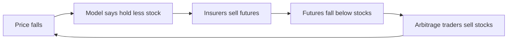

# 1929 and 1987

Case study HIST

After this lesson you can explain how borrowed money turned a price fall into forced selling in 1929, how rule-based selling made the fall bigger in 1987, and work out both effects with numbers.

Before this: [Settlement, cash accounts and margin](../01-how-markets-work/07-settlement-cash-and-margin.md), [Risk first](../03-risk-and-position-sizing/01-risk-first.md). You need: a calculator.

## The idea

Two crashes, 58 years apart, broke at different points. In 1929 the weak point was **leverage**: investors held stock bought with borrowed money, so a small fall forced them to sell. In 1987 the weak point was a rule: a trading strategy that sold automatically when prices fell, so the selling pushed prices down and triggered more selling.

## 1929: borrowed money

The Federal Reserve's history of the crash says the Dow Jones Industrial Average rose from 63 in August 1921 to 381 in September 1929, about sixfold. It closed at 381.17 on September 3, 1929. On Monday, October 28, it fell nearly 13%, and on Tuesday, October 29, nearly 12%. By mid-November it had lost almost half its value. It closed at 41.22 on July 8, 1932, which is 89% below the peak, and did not regain its 1929 high until November 23, 1954 ([Federal Reserve History, Stock Market Crash of 1929](https://www.federalreservehistory.org/essays/stock-market-crash-of-1929), as of 2026).

The same essay says buyers typically put down 10% of the price and borrowed the rest, using the stock they bought as **collateral** (an asset a lender can sell if the loan is not repaid). A lender who sees the collateral fall asks for more cash. If the buyer cannot pay, the lender sells the stock.

### Worked example: a 10% down purchase

You buy US$10,000 of Stock A with US$1,000 of your own money and a US$9,000 loan.

1. The price falls 5%. The stock is worth US$9,500. You still owe US$9,000, so your own money is US$500. You lost 50% of it on a 5% fall.
2. The price falls 10%. The stock is worth US$9,000, the same as the loan. Your own money is US$0.
3. At that point the lender has no cushion, so the lender asks for cash or sells.

A forced sale happens at the market price, whatever it is. If many borrowers are in the same position, their sales push the price down for all of them.

The figure shows the same arithmetic for three loan sizes. Look at how fast the red line reaches zero: the larger the loan, the smaller the fall you can survive.

The second effect is recovery. A fall of 89% needs a gain of 1 / (1 - 0.89) - 1 = 8.09, which is 809%, to get back to the start ([Risk first](../03-risk-and-position-sizing/01-risk-first.md) shows this formula). The Dow took 22 years to do it.

### What changed afterwards

Congress passed the Securities Act of 1933, which requires companies selling securities to disclose key facts, and the Securities Exchange Act of 1934, which created the SEC ([SEC, about the securities laws](https://www.sec.gov/about/about-securities-laws), as of 2026). Margin lending is regulated too: a US broker lends at most 50% of the price on a new stock purchase, a rule covered in [Settlement, cash accounts and margin](../01-how-markets-work/07-settlement-cash-and-margin.md).

## 1987: a rule that sold into a fall

On Monday, October 19, 1987, the Dow fell 22.6%, or 508 points, the largest one-day percentage fall in its history ([Federal Reserve History, Stock Market Crash of 1987](https://www.federalreservehistory.org/essays/stock-market-crash-of-1987), as of 2026). The Fed's essay names **portfolio insurance** as one cause: a hedging technique using futures and options that accelerated the decline because initial losses triggered further selling.

The Presidential Task Force on Market Mechanisms (the Brady Commission) described the mechanism in its January 1988 report. Portfolio insurance used computer models, derived from options theory, to set how much of a portfolio to hold in stock and how much in cash at each market level. Most insurers adjusted that ratio by trading stock index futures rather than stocks. A typical model called for selling more than 20% of the portfolio after a 10% fall in the market. The report says sources put US$60 billion to US$90 billion of equity assets under portfolio insurance at the time, and that this amount had grown more than fourfold during 1987.

On October 19, three portfolio insurers sold a little under US$2 billion of stock directly and futures worth US$2.8 billion of stock. The report concluded that this price-insensitive selling led other traders to sell ahead of it. The Fed's essay adds that stock trades settled after three days and futures after one, a mismatch that nearly stopped trading on October 20.

### Worked example: a toy feedback loop

This is not a model of 1987. It shows why a rule that sells after a fall can make the fall larger. Assume US$75 billion under insurance (the middle of the Brady range), a rule that sells 20% of holdings for every 10% fall, and a market that drops 0.4% for each US$1 billion sold. Each round's fall comes from the previous round's selling.

1. A first shock of 10% makes the insurers sell 2 x 0.10 x 75 = US$15.0 billion.
2. That selling drops the market 0.4 x 15.0 = 6.0%. On the remaining US$67.5 billion of holdings, the rule sells 2 x 0.06 x 67.5 = US$8.1 billion.
3. That drops the market 3.24%, and the next round sells US$4.11 billion, and so on.
4. After six rounds the market is down 20.45% from the start, about twice the first shock.

Each round is smaller than the last, so the loop settles. If each US$1 billion moved the market more, the rounds would not shrink.

### What changed afterwards

Exchanges added **circuit breakers**, which pause trading after a large fall in an index. Part 1 covers them ([Market hours and the opening and closing auctions](../01-how-markets-work/03-market-hours-and-auctions.md)), and lesson 4 shows them in use in 2020.

## The risk lesson for you

Leverage turns a small fall into a forced sale, and your broker decides when, not you. A rule that sells into a fall, whether it is a portfolio insurer's model or your own stop orders, adds to the fall when many people hold the same rule. Part 3 sizes positions so that no single fall forces you out ([Fixed fractional sizing](../03-risk-and-position-sizing/04-fixed-fractional-sizing.md)).

## Common mistakes

- Reading "10% down" as "10% risk". With a loan of 90% of the price, a 10% fall is a 100% loss of your own money.
- Treating a stop order as a guarantee. In a crash many stops trigger together and fill far from the stop price ([Order types](../01-how-markets-work/05-order-types.md)).
- Assuming a hedging rule is safe because each user hedges. Many hedgers selling at once is itself a trade.

## Try it

1\. You buy US$20,000 of Stock A with US$4,000 of your own money and a US$16,000 loan. How far must the price fall before your own money is gone?

Answer

Your own money is gone when the stock is worth the loan: 16,000 / 20,000 = 80% of the price, so a fall of 20%.

2\. In exercise 1, the price falls 8%. How much of your own money is left, in US$ and in percent?

Answer

The stock is worth 20,000 x 0.92 = US$18,400. Subtract the US$16,000 loan: US$2,400 is left, which is 2,400 / 4,000 = 60% of what you put in. You lost 40% on an 8% fall.

3\. The Dow fell from 381.17 to 41.22. What was the percentage fall, and what gain gets back to 381.17?

Answer

Fall = 1 - 41.22 / 381.17 = 0.8919, so 89.2% (the Fed's essay says 89%). Gain needed = 381.17 / 41.22 - 1 = 8.25, which is 825%.

4\. In the toy loop, the first shock is 5% instead of 10%, and the other numbers are the same. What does the insurers' first sale come to, and how much does it move the market?

Answer

2 x 0.05 x 75 = US$7.5 billion. That drops the market 0.4 x 7.5 = 3.0%, which is 0.6 of the first shock. In the 10% case the second fall was also 0.6 of the first (6.0 / 10), so the loop scales with the size of the shock.

## Practice today (10 min)

| Minutes | Task |
|---|---|
| 5 | Open your broker's margin page. Write the initial and maintenance margin for a US stock, then work out the price fall at which a purchase with 50% down hits the maintenance level. |
| 3 | In your [trade journal](../practice/trade-journal.md), write one rule of yours that sells automatically (a stop, a trailing stop) and what happens to it if the market gaps down 10%. |
| 2 | Read the first two paragraphs of the Federal Reserve's 1987 essay linked above. |

## Key terms

- **Leverage**: holding a position larger than your own money by borrowing.
- **Collateral**: assets a lender can sell if a loan is not repaid.
- **Forced sale**: a sale the lender triggers, at the market price at that moment.
- **Portfolio insurance**: a 1980s strategy that cut stock holdings by selling index futures as prices fell.
- **Circuit breaker**: a pause in trading after an index falls by a set percentage.

Next: [LTCM and the dot-com bubble](02-ltcm-and-the-dot-com-bubble.md)
