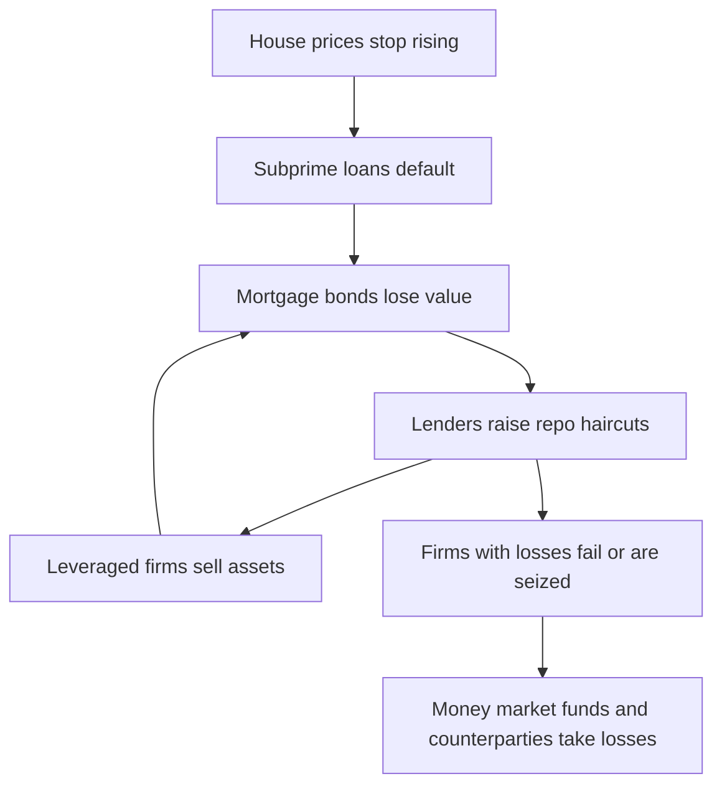

# The 2008 financial crisis

Case study HIST

After this lesson you can describe the chain from US mortgages to bank failures in 2008, work out why short-term borrowing at high leverage is fragile, and name the risks the crisis added to a portfolio: counterparty, liquidity and correlation.

Before this: [LTCM and the dot-com bubble](02-ltcm-and-the-dot-com-bubble.md), [Credit spreads and high yield](../12-bonds-and-the-yield-curve/05-credit-spreads-and-high-yield.md). You need: a calculator.

## The idea

A mortgage is a loan secured on a house. In the 2000s, lenders made many loans to borrowers with weak credit (**subprime** loans), packaged them into bonds called **mortgage-backed securities** (MBS), and sold them to investors. Banks and other firms financed large holdings of these bonds with short-term borrowing. When house prices stopped rising, the loans went bad, the bonds lost value, and firms that had borrowed overnight could not roll the loans over.

The Federal Reserve's history of the period says subprime lending was funded by private-label mortgage-backed securities whose risk was poorly understood. When house prices peaked, borrowers could no longer settle their debts by refinancing or selling, so losses rose for lenders and investors, and the collapse of subprime bond funding cut lending, pushed prices down further and led to more foreclosures ([Federal Reserve History, Subprime Mortgage Crisis](https://www.federalreservehistory.org/essays/subprime-mortgage-crisis), as of 2026).

## The timeline

| Date | Event | Source |
|---|---|---|
| April 2007 | New Century Financial, a leading subprime lender, files for bankruptcy | Fed History |
| Summer 2008 | Fannie Mae and Freddie Mac are seized by the federal government | Fed History |
| September 15, 2008 | Lehman Brothers Holdings files for Chapter 11 bankruptcy | SEC |
| September 16, 2008 | The Reserve Primary Fund, a money market fund, falls below US$1 per share | SEC |
| December 16, 2008 | The FOMC sets the federal funds target range at 0 to 1/4% | [FOMC statement](https://www.federalreserve.gov/newsevents/pressreleases/monetary20081216b.htm) |

A **money market fund** invests in short-term debt and aims to keep its price at US$1 per share. When it falls below that, it has "broken the buck". The Reserve Primary Fund held US$785 million of Lehman securities. It became unable to meet investors' requests to withdraw money, and the SEC later alleged that its manager had significantly understated the volume of those requests ([SEC press release 2009-104](https://www.sec.gov/news/press/2009/2009-104.htm), as of 2026).

## What broke: leverage and short-term funding

The Financial Crisis Inquiry Commission, set up by Congress to find the causes, reported in 2011. It found that many financial institutions and households had borrowed heavily. By one measure, the five major investment banks had leverage ratios as high as 40 to 1 in 2007, and much of their borrowing was overnight, so it had to be renewed every day ([FCIC report, Conclusions](https://fcic-static.law.stanford.edu/cdn_media/fcic-reports/fcic_final_report_conclusions.pdf), as of 2026). It gives Bear Stearns at the end of 2007 as an example: US$11.8 billion of equity and US$383.6 billion of liabilities.

### Worked example: Bear Stearns at the end of 2007

Assets equal equity plus liabilities, so assets were 11.8 + 383.6 = US$395.4 billion.

1. Leverage = 395.4 / 11.8 = 33.5 to 1.
2. Equity is 11.8 / 395.4 = 2.98% of assets. A fall of about 3% in the value of the assets removes it.
3. At the FCIC's 40 to 1 figure, the cushion is 1 / 40 = 2.5%.

With a cushion of about 3%, the question is never only "what are the assets worth" but "will lenders keep lending".

### The repo run

Much of this borrowing was through **repurchase agreements** (repos). In a repo you sell a bond for cash today and agree to buy it back tomorrow at a slightly higher price, so it works as a loan secured by the bond. The lender lends less than the bond is worth. The gap is the **haircut**.

### Worked example: a haircut rises

This uses made-up numbers. A firm owns US$100 of bonds and borrows against them in repos with a 2% haircut, so it can borrow US$98 and its own equity is US$2. Its leverage is 100 / 2 = 50 to 1.

1. Lenders become nervous and raise the haircut to 5%. Against the same bonds the firm can now borrow US$95.
2. It must find US$3 more cash. It has only US$2 of equity, and it cannot sell new shares in a panic.
3. To keep its equity of US$2 at a 5% haircut, the firm can hold only 2 / 0.05 = US$40 of bonds. It must sell US$60, which is 60% of its portfolio.

Selling US$60 of bonds into a market where other firms are doing the same lowers the price of the bonds, and a lower price makes the next haircut rise more likely.

## What it added to a portfolio's risks

Three risks stand out, and each connects to a part of this book.

Counterparty risk: the firm on the other side of a trade can fail. Lehman's bankruptcy turned out to touch money market funds, which most investors considered the same as cash. Part 18 describes the same risk in crypto ([Hacks and collapses](../18-crypto/08-hacks-and-collapses.md)).

Liquidity risk: assets you can sell on a normal day cannot be sold at a normal price on a bad one. Lesson 4 shows it in 2010 and 2020.

Correlation: assets that look different can depend on the same thing. Mortgage bonds in different cities and tranches all depended on US house prices. Part 3 covers this for positions in one portfolio ([Portfolio heat and correlation](../03-risk-and-position-sizing/07-portfolio-heat-and-correlation.md)).

The Fed's response also matters for later lessons: it lowered rates to nearly zero and held them there, which is the background for the low-rate years before 2022 (lesson 7).

## Common mistakes

- Blaming one cause. The FCIC and the Fed's history both describe a chain: lending standards, bond ratings, leverage, short-term funding and a run.
- Treating a safe label as safe. A money market fund, a highly rated bond and a bank deposit are different promises; check what backs each.
- Looking only at the asset side. A firm's survival depends on how it is funded.

## Try it

1\. A firm has US$30 billion of equity and US$870 billion of liabilities. What is its leverage and the fall in assets that removes its equity?

Answer

Assets = 30 + 870 = US$900 billion. Leverage = 900 / 30 = 30 to 1. Equity is 30 / 900 = 3.33% of assets, so a 3.33% fall removes it.

2\. A firm owns US$200 of bonds with a 4% haircut and equity of US$8. The haircut rises to 8%. How many dollars of bonds can it hold with the same equity, and how much must it sell?

Answer

Equity is 8 / 200 = 4% of the bonds, matching the 4% haircut. At 8%, it can hold 8 / 0.08 = US$100 of bonds. It must sell 200 - 100 = US$100, half of the portfolio.

3\. The Reserve Primary Fund fell below US$1 per share. An investor held 10,000 shares and the value fell to US$0.97 a share. What is the investor's loss?

Answer

The loss is (1.00 - 0.97) x 10,000 = US$300, or 3%. (This uses a made-up value of US$0.97 to show the arithmetic.)

## Practice today (10 min)

| Minutes | Task |
|---|---|
| 4 | Read the SEC press release linked above and write down the date and the amount of Lehman securities the fund held. |
| 3 | List the places your cash is held (broker cash, a money market ETF, a savings account). For each, write who the counterparty is and what protects the money (see lesson 9 for CIPF). |
| 3 | In your [trade journal](../practice/trade-journal.md), write which of your holdings would fall together if one thing happened (for example a rise in rates). |

## Key terms

- **Subprime loan**: a loan to a borrower with a weak credit record.
- **Mortgage-backed security (MBS)**: a bond paid from the payments on a pool of mortgages.
- **Money market fund**: a fund holding short-term debt that aims to keep its price at US$1 per share.
- **Repurchase agreement (repo)**: a sale of a bond with an agreement to buy it back, used as a secured loan.
- **Haircut**: the gap between the value of the collateral and the amount lent against it.
- **Counterparty risk**: the risk that the firm on the other side of a contract fails to pay.
- **Liquidity risk**: the risk that you cannot sell without a large price drop.

Next: [The 2010 flash crash and the 2020 COVID crash](04-flash-crash-2010-and-covid-2020.md)
