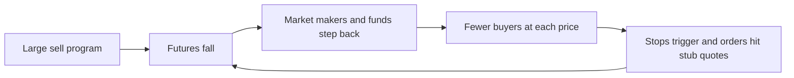

# The 2010 flash crash and the 2020 COVID crash

Case study HIST

After this lesson you can explain how one large order and thin liquidity produced the May 6, 2010 flash crash, say what a market order does against a stub quote, and describe how circuit breakers and the Fed acted in March 2020.

Before this: [Bid, ask and the order book](../01-how-markets-work/04-bid-ask-and-the-order-book.md), [Market hours and the opening and closing auctions](../01-how-markets-work/03-market-hours-and-auctions.md), [The 2008 financial crisis](03-the-2008-crisis.md). You need: a calculator.

## The idea

Both episodes are about **liquidity**: whether there is someone to trade with at a price near the last one. In 2010 liquidity vanished for about 20 minutes, with no news to explain it. In 2020 it thinned across the whole market, including the market for US Treasuries, while the news was real.

## May 6, 2010

The CFTC and SEC staff wrote a joint report on that day ([CFTC-SEC, Findings Regarding the Market Events of May 6, 2010](https://www.sec.gov/news/studies/2010/marketevents-report.pdf), as of 2026). Its numbers:

- Major equity indices, in both futures and stocks, were already down more than 4% from the prior close when, that afternoon, they fell a further 5% to 6% in a matter of minutes, then recovered almost as quickly.
- At 2:32 p.m. ET a large trader, a mutual fund complex, began a program to sell 75,000 E-Mini S&P 500 futures contracts (worth about US$4.1 billion) as a hedge against a stock position.
- It used an automated algorithm set to sell at 9% of the trading volume of the previous minute, without regard to price or time. On an earlier occasion the same trader had taken more than 5 hours to sell the first 75,000 contracts of a larger program. On May 6 the algorithm finished in 20 minutes.
- At 2:45:28 p.m. the CME paused E-Mini trading for five seconds. When it resumed, buyers returned.
- Over 20,000 trades in more than 300 securities were executed at prices more than 60% away from their values moments before, some as low as a penny or as high as US$100,000.

The prices of a penny and US$100,000 came from **stub quotes**. A market maker has to quote a bid and an ask continuously. When a market maker stops trading in a stock, the exchange can post a quote far from the market, such as a bid of US$0.01, only to meet that duty. A market sell order that reaches an empty book fills against it.

### Worked example: a market order meets a stub quote

You hold 100 shares of Stock A, which traded at US$40.00 a moment ago, and place a market sell order. The book has no buyers near US$40. The best bid is a stub quote of US$0.01.

1. Expected proceeds: 100 x 40.00 = US$4,000.
2. Actual proceeds at the stub: 100 x 0.01 = US$1.00.
3. Loss against the last price: US$3,999.

A limit sell at US$39.00 would not have filled, so you would still hold the shares. Part 1 describes this choice ([Order types](../01-how-markets-work/05-order-types.md)). The report notes that many stop-loss orders, triggered by falling prices, found reduced buying interest and added to the fall.

### Worked example: why a participation algorithm can run away

A rule that sells 9% of the previous minute's volume sells more when volume rises. Selling itself adds to volume, and traders passing contracts back and forth add more (the report says high-frequency traders traded over 27,000 contracts in 14 seconds, about 49% of the volume in that period).

1. To sell 75,000 contracts at 9% of volume, the whole market must trade 75,000 / 0.09 = 833,333 contracts.
2. In 20 minutes that is an average of 41,667 contracts a minute.
3. Suppose normal volume is 10,000 a minute. The algorithm would sell 900 a minute at that volume. At 41,667 a minute it sells 3,750 a minute, which is 4.2 times faster, and the faster pace pushes the price down further.

The volumes in step 3 are made up. The report's point is that the algorithm watched volume, not price, so it sold faster into the very fall it helped cause.

## March 2020

In February 2020, concern about COVID-19 began to move markets. On Friday, February 21, the S&P 500 fell 1.1%. The next steps come from an NYSE filing with the SEC that describes the events ([NYSE rule filing, Release No. 34-92428](https://sec.gov/files/rules/sro/nyse/2021/34-92428.pdf), as of 2026).

A **market-wide circuit breaker** halts trading in all US stocks when the S&P 500 falls by a set percentage from the prior close. The Level 1 limit is 7%, Level 2 is 13% and Level 3 is 20%. A Level 1 halt before 3:25 p.m. ET lasts 15 minutes. In March 2020 Level 1 halts happened four times: March 9, 12, 16 and 18. On March 9, the S&P 500 crossed the 7% threshold at 9:34:13 a.m. and halted for 15 minutes. After trading resumed it recovered to a 5.5% fall, and it closed down 7.6% from Friday's close.

### Worked example: where the halts sit

With a made-up prior close of 3,000.00 for the index:

1. Level 1 (7%): 3,000 x 0.93 = 2,790.00.
2. Level 2 (13%): 3,000 x 0.87 = 2,610.00.
3. Level 3 (20%): 3,000 x 0.80 = 2,400.00, where trading stops for the rest of the day.

On March 9 the index crossed the Level 1 line, recovered to 5.5% down after the halt, and still closed down 7.6%. The halt paused trading; it did not stop the fall.

### The Fed and the Treasury market

At the same time, investors sold even the safest assets to raise cash. Staff of the Federal Reserve Bank of New York describe this "dash for cash": massive customer selling overwhelmed dealers' capacity to trade, and Treasury market liquidity deteriorated to its worst level since the global financial crisis, which led the Fed to start large asset purchases ([FRBNY Staff Report 1146](https://www.newyorkfed.org/medialibrary/media/research/staff_reports/sr1146.pdf), as of 2026). On March 15, 2020 the FOMC lowered the federal funds target range to 0 to 1/4 percent and said it would increase its holdings of Treasury securities by at least US$500 billion and of agency mortgage-backed securities by at least US$200 billion ([Federal Reserve press release](https://www.federalreserve.gov/newsevents/pressreleases/monetary20200315a.htm), as of 2026).

## The risk lesson for you

Your stop-loss and market orders are only as good as the book they meet. In a fast market use limit orders, and size positions assuming your exit fills worse than planned (part 3: [Slippage, gaps and costs](../03-risk-and-position-sizing/06-slippage-gaps-and-costs.md)). When everything falls together, assets you thought were different (stocks and Treasuries) can fall together for a few days because people sell what they can sell.

## Common mistakes

- Using a market order in a fast market. The fill can be far from the last price.
- Expecting a circuit breaker to stop the fall. It gives time to take stock; the price can reopen lower.
- Assuming a safe asset keeps its price in a crisis. Treasuries are safe from default, not from price swings.

## Try it

1\. An algorithm sells at 9% of volume. What total volume is needed to sell 30,000 contracts?

Answer

30,000 / 0.09 = 333,333 contracts.

2\. You hold 250 shares of Stock A last traded at US$25.00. A market sell fills at a stub quote of US$0.01. What is the loss against the last price?

Answer

Expected 250 x 25.00 = US$6,250. Actual 250 x 0.01 = US$2.50. Loss = US$6,247.50.

3\. The index's prior close is 4,000.00 (made-up). Where are the three circuit breaker levels?

Answer

Level 1: 4,000 x 0.93 = 3,720.00. Level 2: 4,000 x 0.87 = 3,480.00. Level 3: 4,000 x 0.80 = 3,200.00.

4\. The Fed said it would buy at least US$500 billion of Treasuries and US$200 billion of agency MBS. What is the combined minimum?

Answer

500 + 200 = US$700 billion.

## Practice today (10 min)

| Minutes | Task |
|---|---|
| 4 | Open your broker's order ticket. Find whether it offers marketable limit orders, and write the cap you would use for a US$50 stock in a fast market. |
| 4 | Read the executive summary of the CFTC-SEC report (first two pages) and write down two causes it names. |
| 2 | Look up today's limit up-limit down bands for one stock on your broker or on the exchange site, and write them in your [trade journal](../practice/trade-journal.md). |

## Key terms

- **Liquidity**: how easily you can trade at a price near the last one.
- **Stub quote**: a placeholder quote far from the market, posted to meet a duty to quote.
- **Participation algorithm**: an order program that trades a set share of market volume.
- **Market-wide circuit breaker**: a halt in all US stocks after the S&P 500 falls 7%, 13% or 20% from the prior close.
- **Dash for cash**: selling of safe assets to raise cash in a crisis.

Next: [GameStop and meme stocks](05-gamestop-and-meme-stocks.md)
