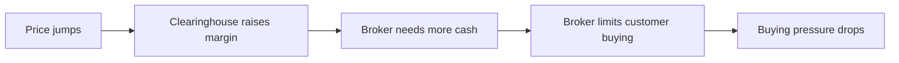

# GameStop and meme stocks

Case study HIST

After this lesson you can describe what the SEC staff found about GameStop in January 2021, work out how a short seller's loss grows when the price rises, and explain why brokers restricted trading.

Before this: [Short selling](../01-how-markets-work/08-short-selling.md), [Settlement, cash accounts and margin](../01-how-markets-work/07-settlement-cash-and-margin.md). You need: a calculator.

## The idea

A **meme stock** is a stock whose price is driven by attention on social media more than by the company's results. In January 2021, GameStop (GME) was the largest case. The SEC's staff wrote a report on it, and this lesson uses their numbers ([SEC staff, Report on Equity and Options Market Structure Conditions in Early 2021, October 14, 2021](https://www.sec.gov/files/staff-report-equity-options-market-struction-conditions-early-2021.pdf), as of 2026). The staff report is the source for every GME number here unless another is named.

## What happened

| Date (2021) | What the staff report says |
|---|---|
| January 11 | GME reaches an intraday high of US$20.65, about 17% above the prior close, after news of a board appointment |
| January 13 | Close rises to US$31.40 from US$19.95; volume about 144 million shares against about 7 million the day before |
| January 22 | Price rises from US$43 to US$72 (71%) in about three hours |
| January 27 | Close of US$347.51, more than 1,600% above the January 11 close |
| January 28 | Intraday high of US$483.00 |

From January 13 to 29 an average of about 100 million GME shares traded per day, over 1,400% more than before.

### Short interest

A **short seller** borrows shares and sells them, hoping to buy them back cheaper (part 1 explains: [Short selling](../01-how-markets-work/08-short-selling.md)). **Short interest** is the number of shares sold short, often shown as a percent of the **float**, the shares available to trade. The staff report says GME short interest as a percent of float reached 122.97% in January 2021. Short interest can exceed 100% because the same share can be lent and sold short more than once. Through most of 2020 it hovered around 100%, and the staff noted that few stocks, if any, have more than 50% on a given date.

Borrowing was costly. The cost to borrow GME was above 100% a year in the second quarter of 2020, and around 25% in January 2021. Between January 2007 and July 2018 average lending fees were 1.5%.

### Was it a short squeeze?

A **short squeeze** is a rise in price that forces short sellers to buy back shares, which pushes the price up more. The staff report says that while a squeeze did not appear to be the main driver of events, the high short interest and the cost of shorting made the stock risky to short.

It also looked at a **gamma squeeze**, where market makers who sold call options buy the stock to hedge as the price rises (part 15: [Delta and gamma](../15-options/06-delta-and-gamma.md)). Retail options volume in GME rose from US$58.5 million on January 21 to US$563.4 million on January 22 and peaked at US$2.4 billion on January 27. But the increase was mostly in puts, not calls, and market makers were buying calls, not writing them, so the staff did not find evidence of a gamma squeeze.

### Worked example: a short against a rising price

This uses a made-up stock. You sell short 1,000 shares of Stock A at US$20.00, posting a 50% initial margin of US$10,000, with a 25% yearly borrow fee.

1. Proceeds: 1,000 x 20.00 = US$20,000.
2. Borrow fee: 20,000 x 0.25 = US$5,000 a year, or about US$13.70 a day.
3. At US$30 the loss is (30 - 20) x 1,000 = US$10,000, which is all of the margin posted. Your broker will ask for more.
4. If the price reached US$348, about 17.4 times the starting price, the loss is (348 - 20) x 1,000 = US$328,000, which is 32.8 times the margin.

A long position can lose at most what you paid. A short has no upper limit on the loss. The figure shows the line.

## Why brokers restricted trading

Clearing works through a clearinghouse, here the National Securities Clearing Corporation (NSCC). Brokers that clear through it must post a deposit against the risk that trades fail before they settle. On January 27 NSCC made intraday margin calls totaling US$6.9 billion on 36 members, which brought the total required margin to US$25.5 billion. Of the US$6.9 billion, US$2.1 billion was mark-to-market and US$4.8 billion was a special charge for unusual volatility.

The staff report says some brokers with mainly individual customers restricted some trading in these stocks. One broker raised the margin requirement on GME in customer accounts to 80%, then 100%, and cut limits on option contracts. The brokers that restricted trading said they were reacting to the clearinghouse's margin calls and capital charges. The report also records an earlier theory, that hedge funds pressured brokers, and notes that witnesses at a Congressional hearing testified it was not the cause.

## The risk lesson for you

Three things in this case concern you directly. Shorting has unlimited loss and a cost that can change (the borrow fee). A thinly traded stock with extreme attention can move by multiples in days, in both directions: GME's volume and price both fell back after late January. And your broker can change its rules in a day, including margin rates and what you can buy, so a plan that depends on holding one stock needs a way out that does not rely on any one broker.

### For Canadians

Shorting needs a margin account, and IBKR Canada does not allow margin in a TFSA, RRSP or FHSA (as of 2026, see [Settlement, cash accounts and margin](../01-how-markets-work/07-settlement-cash-and-margin.md)). Part 2 covers CIRO's margin rules and the rates your broker sets on top of them ([Margin rules in Canada](../02-accounts-currency-and-taxes/10-margin-rules-in-canada.md)). A US stock held at a Canadian broker is still subject to the broker's own restrictions.

## Common mistakes

- Reading a high short interest as a signal that a squeeze is coming. The report found the squeeze was not the main driver, and short interest above 100% reflects re-lending as well.
- Selling short a stock with a high borrow cost without adding the fee. At 25% a year it is a large part of a trade's cost.
- Averaging into a position because the price looks too high or too low. Margin calls do not wait for you to be right.

## Try it

1\. You short 500 shares of Stock A at US$40.00 with a 50% initial margin. At what price is the margin gone?

Answer

Margin = 0.5 x 500 x 40 = US$10,000. The loss equals it when (P - 40) x 500 = 10,000, so P = US$60.00.

2\. A stock has a float of 50 million shares and short interest of 122.97% of float. How many shares are sold short?

Answer

1.2297 x 50 million = 61.485 million shares.

3\. What does a 25% yearly borrow fee cost per day on a US$20,000 short?

Answer

20,000 x 0.25 / 365 = US$13.70 a day, or US$5,000 over a year.

4\. GME closed at US$347.51 on January 27 and the staff say that is more than 1,600% above the January 11 close. What is the largest January 11 close that fits?

Answer

A 1,600% rise means 17 times the starting price, so the start is below 347.51 / 17 = US$20.44.

## Practice today (10 min)

| Minutes | Task |
|---|---|
| 4 | Open your broker's page for a heavily shorted US stock. Write its borrow fee (if shown) and short interest, and work out the fee in US$ per day on a US$5,000 short. |
| 4 | Read the table of contents of the SEC staff report (link above) and open section 3.5 on clearing margin. Write one sentence on what NSCC did on January 27. |
| 2 | In your [trade journal](../practice/trade-journal.md), write a rule for what you will do if a stock you hold rises or falls 50% in a day without news. |

## Key terms

- **Meme stock**: a stock whose price is driven mainly by attention on social media.
- **Float**: the shares of a company available to trade.
- **Short squeeze**: a price rise that forces short sellers to buy, pushing the price up further.
- **Gamma squeeze**: a price rise driven by market makers buying stock to hedge call options they sold.
- **Clearinghouse**: an institution that stands between buyers and sellers and collects margin to cover failed trades.

Next: [Archegos and SVB](06-archegos-and-svb.md)
