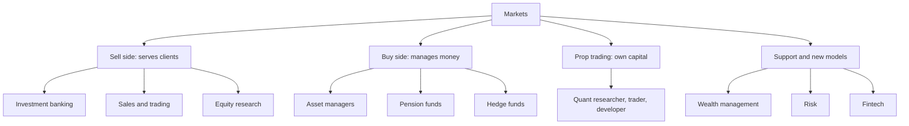

# The map of finance jobs

Career CAREER

After this lesson you can sort finance jobs into sell side, buy side, prop trading and quant roles, say what each does in a day, and see where a computer science degree fits.

Before this: [Who is on the other side](../01-how-markets-work/06-who-is-on-the-other-side.md) and [Exchanges and where your order goes](../01-how-markets-work/02-exchanges-and-where-orders-go.md). You need: nothing.

## The idea

A client wants to sell US$200 million of Stock A without moving the price. A bank trader takes the other side of the trade, then spends the day selling it off in pieces. A fund analyst reads Stock A's filings and decides whether the fund owns it. A prop firm's algorithm quotes a bid and an ask on Stock A all day and earns the spread. A risk analyst checks that none of the three can lose more than their limit. All four work in finance, and they have very different days.

Finance jobs sort by one question: whose money is it, and who pays you? Everything else follows from that.

Look at the first split. The sell side sells services (advice, trade execution, research) and is paid in fees and spreads. The buy side buys securities with other people's money and is paid a share of what it manages.

## How it works

### The sell side

**Investment banking** advises companies on raising money (selling new shares or bonds) and on mergers and acquisitions. The work is mostly building models and presentations for deals. **Sales and trading** is the desk that deals with clients' orders: sales people talk to the clients, and traders hold the risk and price the trade. **Equity research** analysts write reports and price targets on a group of stocks ([Moats and qualitative research](../10-valuation-and-research/08-moats-and-qualitative-research.md) defines the sell-side analyst).

### The buy side

An **asset manager** runs mutual funds and ETFs, charging a percentage of assets. A **pension fund** invests retirement savings for members. Canada has several very large ones, including CPP Investments, Ontario Teachers' Pension Plan, OMERS, PSP Investments and CDPQ, and they invest in public stocks, private companies and infrastructure. A **hedge fund** is a private fund for large investors that can short, use leverage and trade many assets, usually charging a management fee plus a share of profits.

### Prop trading and quant roles

A **proprietary (prop) trading firm** trades its own capital rather than clients' money. Many are market makers (part 1 explains the role). A **quant** uses math, statistics and code to price risk and find trades. The titles differ by firm, but three roles recur:

- A quant researcher looks for patterns in data, tests them and builds models.
- A quant trader makes pricing and risk decisions, often on a market-making desk, using models and judgment.
- A quant developer builds the systems: data pipelines, low-latency order code, research tools.

### Other roles

**Wealth management** and advisory staff help individuals plan and invest, and the role depends on client skills as much as markets. The **risk** team measures what the firm can lose and sets limits. **Fintech** companies build trading apps, payments and data products, and they hire software engineers much like any tech firm.

| Role | A day looks like | Skills that matter | CS fit |
|---|---|---|---|
| Investment banking analyst | Models, decks, deal checklists, long hours | Accounting, valuation, Excel | Low to medium |
| Sales and trading | Watching orders and prices, talking to clients | Quick math, markets, communication | Medium |
| Equity research | Reading filings, updating models, writing | Financial statements, writing | Medium |
| Asset manager or fund analyst | Reading, modelling, pitching ideas | Valuation, judgment | Medium |
| Quant researcher | Data cleaning, tests, models | Statistics, Python | High |
| Quant trader | Pricing, risk, fast decisions | Probability, mental math | High |
| Quant developer | Production code, systems | Software engineering | Very high |
| Risk | Reports, limits, stress tests | Statistics, communication | High |
| Fintech engineer | Product code | Software engineering | Very high |

### For Canadians

Toronto's Bay Street is the centre of Canadian finance. The capital markets arms of the big banks are there: RBC Capital Markets, BMO Capital Markets, TD Securities, CIBC Capital Markets, Scotiabank's global banking and markets business and National Bank Financial. Several of the large pension funds above have Toronto offices. Prop firms and hedge funds are smaller but exist in the city. Check each firm's own careers page for the roles it posts and its hiring process, because they change.

### Worked example: where each firm's money comes from

1. A sales and trading desk earns a commission of US$0.02 a share on 5 million shares: 5,000,000 x 0.02 = US$100,000.
2. An asset manager charges 0.50% a year on US$8 billion of funds: 0.005 x 8,000 million = US$40 million a year.
3. A hedge fund charges 2% of assets and 20% of profit, an illustrative structure (real terms vary). On US$500 million with a 10% return before fees, profit is US$50 million. The management fee is 0.02 x 500 = US$10 million. The performance fee is 20% of the profit after that fee, 0.20 x (50 - 10) = US$8 million. Total fees: US$18 million, or 3.6% of assets.

The three pay structures reward different behaviour: volume, size of assets, and results.

### How a CS background fits

Quant developer, fintech and risk roles use your degree directly. Quant research and trading ask for probability and statistics beyond a typical CS course, which the later lessons of this part cover. Banking and research ask for accounting first ([Accounting and valuation interview questions](05-accounting-and-valuation-questions.md)). Part 20 builds the Python skills these jobs use.

## Common mistakes

- Treating "finance" as one job. A banker and a quant developer share a city and almost no skills.
- Picking a role from its reputation. Read what the day looks like, and ask people who do it.
- Waiting to be "ready". Roles hire for specific skills you can show (lesson 3), not for a degree title.

## Try it

1\. Which side is each: a pension fund, an equity research team, a prop firm, an investment bank's M&A group?

Answer

Pension fund: buy side. Equity research: sell side. Prop firm: neither, it trades its own capital. M&A group: sell side.

2\. A desk trades 8 million shares at a commission of US$0.015 a share. What is the revenue?

Answer

8,000,000 x 0.015 = US$120,000.

3\. An asset manager's fund falls from US$8,000 million to US$6,000 million with a 0.50% fee. How much does yearly fee revenue fall?

Answer

Revenue falls from US$40 million to 0.005 x 6,000 = US$30 million, a drop of US$10 million (25%). Fee revenue follows assets, so a market fall cuts it even if the manager does nothing wrong.

4\. Which role from the table fits you today, and what is the first skill you lack for it?

Answer

Any answer is fine if it names a role and a skill from the table's "Skills that matter" column. Write it in your journal.

## Practice today (10 min)

| Minutes | Task |
|---|---|
| 5 | Open the careers pages of two firms (for example a bank's capital markets arm and a pension fund). List three roles and the skills each posting asks for. |
| 3 | Match each skill to a part of this book or to part 20. |
| 2 | Write which role interests you most and one question you would ask someone in it. |

## Key terms

- **Sell side**: firms that serve clients with advice, trade execution and research, paid in fees and spreads.
- **Buy side**: firms that invest money for themselves or others.
- **Investment banking**: advising on raising capital and on mergers and acquisitions.
- **Sales and trading**: the desk that handles clients' orders and holds the risk.
- **Equity research**: analysts who write reports and price targets on stocks.
- **Asset manager**: a firm that runs funds for a fee on assets.
- **Pension fund**: a fund that invests retirement savings for members.
- **Hedge fund**: a private fund for large investors that can short and use leverage.
- **Proprietary (prop) trading firm**: a firm that trades its own capital.
- **Quant**: a person who uses math, statistics and code to price risk and find trades.
- **Wealth management**: advice and investing for individuals.
- **Risk (team)**: the group that measures what the firm can lose and sets limits.

Next: [Licences and designations](02-licences-and-designations.md)
