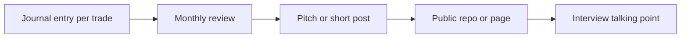

# Building a track record

<span class="tag tag-career">Career</span> <span class="tag tag-part">CAREER</span>

After this lesson you can choose what to show an employer, write a track record that does not overstate it, and say how much a small record proves.

Before this: [The trade journal](../04-psychology-journal-and-paper-trading/04-the-trade-journal.md), [Paper trading setup](../04-psychology-journal-and-paper-trading/06-paper-trading-setup.md) and [Win rate, payoff and expectancy](../03-risk-and-position-sizing/03-win-rate-payoff-and-expectancy.md). You need: a calculator.

## The idea

You have 40 paper trades with an average result of +0.315R. An interviewer asks, "Does that mean you can trade?" An honest answer starts with how much 40 trades can tell you. A **track record** is a dated, checkable history of your work. In finance it can be trades, research, code or projects, and the interviewer wants evidence that you do the work, and the honesty to describe it.

## How it works

### What to build

| Evidence | What it shows | What it does not show |
|---|---|---|
| Trade journal with a paper record | Process, discipline, review habits | That you can trade real money under stress |
| Written stock pitch or blog | Reasoning, writing, valuation skill | That the call was right |
| Competition entry | Skill against others, under a deadline | Long-run results |
| Open-source code or a research repo | You can build and test things | Market skill |
| Internship or work experience | You can work in a team and a firm | Your own judgment |

Pick two or three and do them well, rather than five thinly. For a trading or research role, a journal and one pitch is a good pair. For a quant role, add code and a tested idea ([Overfitting and out-of-sample testing](../20-quant-track-in-python/09-overfitting-and-out-of-sample.md) shows how to test honestly).



Follow the arrows: each trade feeds a review, a review gives you something to write, and the writing becomes something you can send an interviewer.

### What a small record proves

The expectancy in R is an average of noisy results, so it has an uncertainty. The standard error of the mean is

\[ SE = \frac{s}{\sqrt{n}} \]

- \(s\) is the sample standard deviation of the R results, in R.
- \(n\) is the number of trades.
- \(SE\) is in R. An approximate 95% range for the true average is the sample mean plus or minus 1.96 x \(SE\).

<div class="example" markdown>

### Worked example: 40 trades

The mean is +0.315R and the standard deviation of the 40 results is 1.20R (made up).

1. SE = 1.20 / sqrt(40) = 1.20 / 6.325 = 0.19R.
2. Range: 0.315 plus or minus 1.96 x 0.19 = 0.315 plus or minus 0.37, so from -0.06R to +0.69R.
3. The range includes zero. The record is consistent with a skilled trader and with luck.
4. To halve the SE you need four times the trades: 160 trades give SE = 1.20 / sqrt(160) = 0.095R.

</div>

A paper record has further limits: fills are better than real ones (no slippage, no partial fills), and there is no fear when you lose real money. The lesson on [paper to live](../04-psychology-journal-and-paper-trading/07-from-paper-to-live.md) covers the gap. Say in an interview what a record can prove and what it cannot. Doing so shows more judgment than quoting a return.

### Writing it honestly

Write each record with the same fields: the period, the number of trades, the rules, the costs you assumed, the mean and the spread, and the worst drawdown. Never show only the winners. Never present a paper return as a return. Put the date range and "paper" on every figure.

## In code

The code computes the range from a list of made-up R results.

<details class="code" markdown>
<summary>In code</summary>

```python
import statistics as st

r = [1.8, -0.9, -0.9, 2.1, -1.0, 0.4, -0.9, 3.0, -0.9, 1.5]
n = len(r)
mean = st.mean(r)
se = st.stdev(r) / n ** 0.5
print(f"n={n} mean={mean:.2f}R se={se:.2f}R "
      f"range {mean - 1.96 * se:.2f} to {mean + 1.96 * se:.2f}")
```

</details>

<div class="canada" markdown>

### For Canadians

Do not post trade signals or manage other people's money in public to build a record. Giving advice for pay can require registration (lesson 2). Publish your own research as study, say so, and keep client work out of it. For regulatory questions, read the provincial securities regulator's pages, such as the Ontario Securities Commission.

</div>

## Common mistakes

- Quoting a percentage return from paper trades with no costs or dates.
- Showing the best three trades. An interviewer asks for the worst.
- Treating a small record as proof. Report the range, as in the example.

## Try it

1\. A journal has 25 trades, mean +0.20R and standard deviation 1.0R. Find the approximate 95% range.

<details class="solution" markdown>
<summary>Answer</summary>

SE = 1.0 / 5 = 0.20R. Range = 0.20 plus or minus 1.96 x 0.20 = 0.20 plus or minus 0.39, so -0.19R to +0.59R. It includes zero.

</details>

2\. How many trades make the SE 0.10R when the standard deviation is 1.2R?

<details class="solution" markdown>
<summary>Answer</summary>

n = (1.2 / 0.10)^2 = 144 trades.

</details>

3\. A record shows +18% in 3 months of paper trading. List two things you would add before showing it.

<details class="solution" markdown>
<summary>Answer</summary>

The number of trades and the assumed costs. Also useful: the worst drawdown, the rules, and the label "paper".

</details>

4\. Run the code above. What are the mean and the range?

<details class="solution" markdown>
<summary>Answer</summary>

The mean is +0.42R, the SE is 0.49R, and the range is -0.54R to +1.38R. Ten trades say very little.

</details>

<div class="practice" markdown>

## Practice today (10 min)

| Minutes | Task |
|---|---|
| 5 | Open your [trade journal](../practice/trade-journal.md) and count your trades and the mean R. Compute the range as in the example. |
| 3 | Write the "record sheet" fields (period, trades, rules, costs, mean, spread, drawdown) at the top of your journal. |
| 2 | Pick one piece of evidence from the table to build this month. |

</div>

## Key terms

- **Track record**: a dated, checkable history of your work.
- **Standard error of the mean**: the standard deviation divided by the square root of the number of trades.
- **Paper record**: results from trades with no real money.

Next: [Market and stock pitch interviews](04-market-and-stock-pitch-interviews.md)
