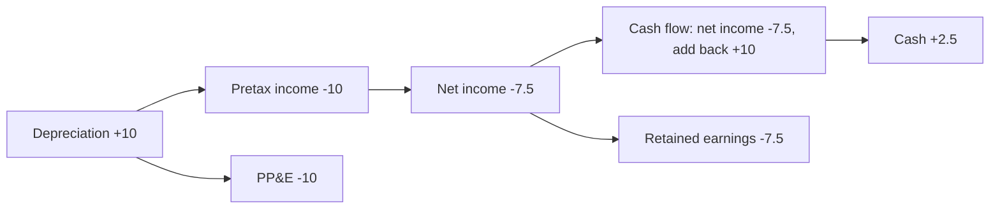

# Accounting and valuation interview questions

Career CAREER

After this lesson you can walk through the three statements aloud, trace a change such as a US$10 rise in depreciation through all of them, and answer the standard questions on enterprise value, DCF steps and multiples.

Before this: [How the three statements connect](../09-company-financials/05-how-the-statements-connect.md), [Enterprise value and EV/EBITDA](../10-valuation-and-research/02-enterprise-value-and-ev-ebitda.md) and [A DCF step by step](../10-valuation-and-research/05-dcf-step-by-step.md). You need: a calculator.

## The idea

Banking, research and fund interviews often start with technical questions. They have right answers, and the interviewer listens for whether you reach them in a clear order. A standard technical round asks: walk me through the three statements, what happens if depreciation goes up by 10, what is the difference between enterprise value and equity value, walk me through a DCF, and which multiple would you use. This lesson gives the answer pattern for each. Part 9 and part 10 teach the content, so use their lessons if a step is unfamiliar.

## How it works

### Walk me through the three statements

Answer in four sentences. The income statement starts with revenue, subtracts costs and taxes, and ends with net income. Net income is the first line of the cash flow statement and also adds to retained earnings on the balance sheet. The cash flow statement adjusts net income for non-cash items and changes in working capital, adds investing and financing flows, and ends in the change in cash. That change in cash is the cash line of the balance sheet, which must balance: assets equal liabilities plus equity.

### What happens if depreciation goes up?

Assume a tax rate of 25% and that depreciation is a non-cash expense. Follow it in a fixed order: income statement, cash flow statement, balance sheet.

### Worked example: a rise in depreciation

1. Income statement: pretax income falls by 10. Tax falls by 25% of 10 = 2.5. Net income falls by 10 - 2.5 = US$7.5.
2. Cash flow statement: start with net income, down 7.5. Add back depreciation, up 10. Cash from operations changes by -7.5 + 10 = +US$2.5. The 2.5 is the tax saved.
3. Balance sheet: cash is up 2.5. PP&E (the asset being depreciated) is down 10. Assets change by +2.5 - 10 = -US$7.5.
4. Retained earnings fall by 7.5, so equity falls by 7.5. Liabilities do not change.
5. Check: assets -7.5, liabilities 0, equity -7.5. It balances.

Say the one-line summary: a higher non-cash charge lowers profit and slightly raises cash through the tax saved.

The same pattern answers other prompts. For an inventory write-down of 20 at 25% tax: net income falls by 15, the add-back is 20, cash rises 5, inventory falls 20, equity falls 15. Part 9 gives Northwind's own versions of these ([How the three statements connect](../09-company-financials/05-how-the-statements-connect.md)).

### Enterprise value and equity value

**Equity value** is what the shareholders' stake is worth: the share price times diluted shares. **Enterprise value** (EV) is the price of the whole operating business, which also includes what the lenders are owed and excludes spare cash.

\[ \text{EV} = \text{Equity value} + \text{Debt} + \text{Preferred stock} + \text{Minority interest} - \text{Cash} \]

- Equity value is the market capitalization on diluted shares, in US$.
- Debt, preferred stock and minority interest are claims that sit ahead of or beside the shareholders' claim, in US$.
- Cash is subtracted because a buyer who pays for the company gets the cash back.

Match the numerator to the metric: EV goes with measures that belong to all funders, such as EBITDA and revenue. Equity value goes with measures that belong to shareholders, such as net income and EPS.

### Worked example: from equity value to EV

Equity value is US$5,075 million (4,925 plus 150 for options and stock units, as in part 10). Debt is 275, cash is 130, with no preferred or minority interest.

1. EV = 5,075 + 275 - 130 = US$5,220 million.
2. EV / EBITDA = 5,220 / 270 = 19.3 times.
3. Diluted EPS is US$1.61, so P/E = 50.00 / 1.61 = 31.1 times.

The two multiples answer different questions, and they differ because debt, cash and interest sit between EBITDA and net income.

### Walk me through a DCF

Five steps, in this order.

1. Forecast revenue and margins for 5 to 10 years, and compute unlevered free cash flow each year.
2. Choose the discount rate (WACC) and a terminal value method.
3. Compute the terminal value: Gordon growth or an exit multiple.
4. Discount every cash flow and the terminal value to today, and add them: enterprise value.
5. Subtract debt and add cash to get equity value, then divide by diluted shares.

Then volunteer the weakness: the terminal value is most of the value (80% in the Northwind base case), so the answer should be a range.

### Which multiple do I use?

Use EV/EBITDA to compare companies with different debt levels in the same industry. Use P/E for stable, profitable companies where earnings are meaningful. Use EV/sales or price-to-sales for companies with no profit yet, with the caution that sales say nothing about margins. Say why before you say which.

## Common mistakes

- Answering a "what happens" question without checking the balance sheet balances.
- Forgetting the tax effect, and saying cash falls when depreciation rises.
- Dividing EV by net income or equity value by EBITDA. The numerator and the denominator must belong to the same group of funders.

## Try it

1\. A company writes down inventory by US$20 with a 25% tax rate. Trace it.

Answer

Pretax income falls by 20, tax by 5, net income by US$15. Cash from operations: -15 + 20 (the write-down is non-cash) = +US$5, so cash rises by 5. Inventory falls by 20, so assets change by +5 - 20 = -15. Retained earnings fall by 15. Balanced.

2\. A company buys a US$40 machine for cash. What changes on the three statements this period?

Answer

Income statement: nothing yet (depreciation starts later). Cash flow: investing activities -40. Balance sheet: cash down 40, PP&E up 40, total assets unchanged.

3\. Equity value is US$3,000 million, debt US$800 million, cash US$300 million, preferred US$100 million, EBITDA US$300 million. Find EV and EV/EBITDA.

Answer

EV = 3,000 + 800 + 100 - 300 = US$3,600 million. EV/EBITDA = 3,600 / 300 = 12.0.

4\. Why is EV/EBITDA a better comparison than P/E between a company with heavy debt and one with none?

Answer

EV and EBITDA both ignore how the business is funded, so debt does not change the multiple. Net income comes after interest, so a heavily indebted company's P/E reflects its debt as well as its business.

## Practice today (10 min)

| Minutes | Task |
|---|---|
| 5 | Without notes, say the three-statement walkthrough aloud and time it. It should take under 40 seconds. |
| 5 | Trace one more change (for example, a US$10 dividend or a US$10 rise in receivables) through all three statements on paper and check the balance sheet balances. |

## Key terms

- **Equity value**: the share price times diluted shares.
- **Enterprise value (EV)**: equity value plus debt, preferred stock and minority interest, minus cash.
- **Non-cash expense**: a cost on the income statement that uses no cash in the period, such as depreciation.
- **Walkthrough**: a short, ordered spoken explanation.

Next: [Probability and mental math puzzles](06-probability-and-mental-math-puzzles.md)
